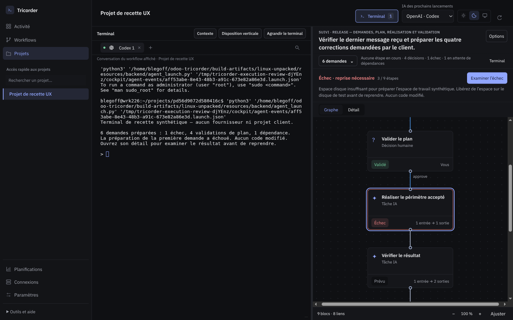

# Tricorder

**Dessinez vos workflows, pilotez le travail dans le terminal et suivez ses résultats.**
Préversion : **0.6.0-rc.11**.

[Parcours simplifiés et captures](release/2026-10-09_simplification-parcours/README.md) :
une navigation commune, réutilisation des workflows, terminal conservé et suivi
centré sur l’étape actuelle. Une analyse indépendante et une seconde réception
ont confronté les écrans aux usages : support, réunion, release, création de
workflow et coordination de plusieurs projets.



*Application réelle, projet et agent de test. Aucun contenu client publié.*

## Commencer et reprendre le travail

La barre latérale contient trois destinations principales :

| Destination | Utilisation |
|---|---|
| **Activité** | Reprendre une conversation et traiter les questions, décisions ou échecs. Les attentes passent avant l’historique. |
| **Workflows** | Retrouver ses workflows de tous les projets, les lancer, les modifier ou partir d’un modèle. |
| **Projets** | Retrouver le travail d’un dépôt et y enregistrer ses workflows. |

1. Cliquer **Nouvelle demande**, choisir un workflow existant ou un modèle, puis
   son projet principal — ou **Sans projet**. Une adaptation vers un autre projet
   est annoncée avant d’être enregistrée ; réutiliser un workflow ne le copie pas.
2. Examiner le lancement et, au besoin, ajouter d’autres projets à coordonner.
   **Lancer dans le terminal** ouvre la conversation et son suivi dans la même fenêtre.
3. Donner l’intention dans le terminal : analyser une demande client, préparer
   une release depuis un email, rédiger un compte rendu, ou tout autre travail
   prévu par le workflow. Le champ de demande initiale reste facultatif.
4. Suivre la demande, l’étape actuelle et la prochaine action. **Graphe** montre
   le parcours ; **Détail** laisse la place à la question, au plan ou au résultat.
   Répondre dans le terminal ou dans le panneau. Les décisions restent explicites.
5. Reprendre depuis **Activité** ou le projet. Une conversation sans tâche reste
   accessible ; changer de vue conserve la session et les brouillons de réponse.

Le terminal peut aussi être ouvert avant de choisir un projet. **Terminal**, en
haut de la fenêtre, l’affiche ou le masque sans fermer ses sessions. Le séparateur
redimensionne terminal et suivi ; **Disposition verticale** les superpose.
**Agrandir le terminal** lui donne toute la surface de travail.

Le sélecteur **IA des prochains lancements** choisit OpenAI · Codex ou Anthropic ·
Claude pour les nouvelles conversations. Une conversation déjà ouverte conserve
son fournisseur. Le choix d’un fournisseur ne prouve pas sa connexion.

## Dessiner et configurer un workflow

Dans **Workflows**, choisir **Créer un workflow**, partir d’un workflow vide ou
d’un modèle, puis nommer le workflow et choisir où l’enregistrer. L’éditeur prend
toute la largeur ; les terminaux déjà ouverts restent disponibles.

Ajouter les blocs, renseigner leurs consignes et critères, définir les entrées et
sorties, puis les **Relier**. Les données de même nom et type sont proposées.
**Choisir l’IA** applique un fournisseur et un modèle communs aux étapes IA ; les
options de chaque bloc permettent de choisir un agent spécialisé et ses réglages.
Les profils précisent la méthode ; les entrées, sorties et branches appartiennent
au workflow. Aucun pack Odoo n’est requis pour un workflow générique.

**Exécuter…** retrouve le lancement. Les réglages manquants désignent le bloc
concerné et donnent accès à sa configuration. **Revenir au lancement** conserve
la demande et les projets choisis. Une copie locale de recette Odoo peut être
préparée pendant la conversation, avant l’étape de QA.

Les définitions sont enregistrées dans `.tricorder/workflows/` du dépôt choisi,
prêtes à être versionnées. **Options → Workflows du dépôt** permet de les retrouver
après un clone. Les commits restent sous votre contrôle. Les exécutions actives,
leurs décisions et leurs autorisations restent locales. Le dessin enregistré
conserve ses positions ; le suivi utilise une disposition verticale adaptée au
panneau voisin du terminal.

## Support, meeting, release et travail transversal

Les modèles **Demande ponctuelle**, **Support**, **Clôture de meeting**,
**Correction express** et release utilisent le même éditeur et le même suivi.
Un workflow peut être réutilisé séparément dans plusieurs projets, ou une seule
conversation peut coordonner plusieurs projets avec leurs demandes et dépendances.

Le pack Odoo 0.3.1 installe deux modèles éditables par projet Odoo découvert : release
et support. La release relie intention, plan, décision, candidat isolé, QA sur copie
locale et proposition de livraison. L’express qualifie le périmètre avant de
travailler. Le modèle de meeting prépare compte rendu, actions et email.

Depuis le terminal lié au workflow, l’agent peut rechercher un email avec ses
connexions disponibles, conserver les sources et enregistrer les demandes.
Dans **Paramètres du workflow**, une opération de notification vérifiée peut
prévenir lorsqu’une question apparaît. **Connexions** détecte les plugins OpenAI
et Anthropic ; les opérations réellement utilisables doivent être vérifiées.
Le parcours de brouillon local ne prouve pas la création d’un brouillon dans
une messagerie : celle-ci nécessite une opération de connecteur adaptée.

Les résultats et preuves restent consultables avant une décision. Une tâche
refusée ou non résolue ne libère pas ses successeurs. Après un échec de recette,
une tâche de correction reste nécessaire : les modèles n’intègrent pas encore
une boucle automatique de correction/recette. Un parcours de déploiement direct
peut être configuré avec candidat, cible, contrôles et autorisation précise.

Le [guide de fonctionnement et de reprise](docs/WORKFLOW-RUNTIME.md) décrit les
contrôles du moteur et les intégrations. Les [preuves de cette version](release/2026-10-09_simplification-parcours/README.md)
portent sur des projets synthétiques, un vrai terminal et des agents déterministes.
Elles ne qualifient ni les réponses d’un modèle commercial, ni un service externe,
ni une recette métier Odoo.

## Travailler sur une release

Tricorder ouvre vos projets existants et leurs releases. Le terminal occupe la
partie principale ; le panneau voisin montre le workflow, les intentions, le
plan, les décisions, les preuves et les temps. Changer de vue conserve la session.
**Agrandir le terminal** masque temporairement le panneau ; **Afficher le workflow**
le rétablit.

1. Choisir un projet et sa release.
2. Choisir **OpenAI · Codex** ou **Anthropic · Claude** dans l’en-tête. Le choix
   est mémorisé pour les prochains lancements ; une session existante reste intacte.
3. Interagir directement dans le terminal, ou utiliser une étape du panneau :
   **Ouvrir une release → Recueillir les demandes → Préparer le plan → Exécuter
   le plan → Recetter et clôturer**. Les boutons préparent une demande contextualisée
   que vous pouvez relire ; **Lancer le travail** ouvre sa session d’agent.
4. Consulter Demandes, Plan, Mémoire et Temps en gardant le terminal visible.

Le parcours de release utilise Odoo Crew et les fichiers existants sous
`changelog/` et `.odoo-agents/`. Une ouverture ou un recueil d’intentions ne lance
pas le développement. Les écritures externes gardent leurs accords propres.
Les fournisseurs utilisent leurs CLI et leur authentification native ; Tricorder
ne lit pas vos secrets. Le choix d’un fournisseur ne prouve pas sa connexion.

## Personnaliser ou exécuter un autre workflow

Depuis les vues de release, **Outils et aide → Reprendre le workflow** retrouve la dernière vue ouverte
(catalogue, projet ou éditeur) dans la même fenêtre. **Workflows** réunit les
définitions enregistrées et les modèles ; les planifications et connexions restent accessibles dans la barre latérale.
Le terminal reste disponible pendant ces changements de vue.

Depuis la fiche d’un projet ou **Workflows → Mes workflows**, **Exécuter…** ouvre directement
le récapitulatif et les prérequis, sans passer par la modification des blocs.
**Choisir l’IA** applique OpenAI ou Anthropic et un modèle commun aux étapes IA.
Les profils d’agents sont conservés. Les paramètres particuliers d’un bloc restent
accessibles dans ses options ; consigne et critères sont affichés en premier.
Les ports ont des formulaires ; les paramètres supplémentaires restent repliés.

Un prérequis manquant est présenté avec le nom de l’étape et un accès à sa
configuration. La simulation reste explicitement distincte d’une exécution réelle.
Les modèles Odoo enregistrés avant cette simplification restent des brouillons
à compléter : ils ne remplacent pas vos releases historiques.

## Transférer un workflow et mettre à jour Tricorder

« Exporter… » produit un fichier `.tricorder-workflow`, avec ses sous-workflows
intégrés et ses choix de modèles. Sur un autre ordinateur équipé de Tricorder,
le double-clic affiche un aperçu puis propose d’importer un brouillon. Aucun
accord, historique d’exécution ni récurrence active n’est transféré. Les comptes
et capacités doivent être vérifiés sur le poste destinataire.

Au lancement, Tricorder consulte la dernière
release stable publique sur GitHub.
Une nouvelle version propose ses notes et le téléchargement du paquet Ubuntu.
L’installation et le redémarrage restent explicites. Hors connexion, le travail
continue ; « Mises à jour » permet de réessayer.

## Documentation lisible

Une release possède une seule entrée humaine : `release/<id>/README.md`, pour
l’intention, le plan, la réalisation, les tests et la livraison. Le suivi machine
et les preuves sont regroupés dans `.suivi/`. Les installateurs sont dans
`build-artifacts/`, distincts de la documentation.

## Essayer et développer

Prérequis : Ubuntu avec Python 3, Git, Node/npm et Bubblewrap pour les commandes
isolées. L’intégration de l’icône dépend de la zone de notification du bureau.

```bash
npm install
npm start
```

« Essayer un exemple » crée un dépôt Git de démonstration et propose un parcours
simulé : aucun modèle payant ni service métier n’est appelé. Dans **Nouvelle demande**, choisir **Sans projet** permet aussi de lancer
un workflow sans créer de dépôt.

```bash
npm test
npm run test:ui
npm run dist
npm run test:packaged
```

État du cockpit et des terminaux : `~/.config/odoo-tricorder/`. État des workflows : `~/.local/share/tricorder/` (SQLite, preuves, bibliothèque, workflows
globaux et exemples). `TRICORDER_STATE_DIR` permet une instance isolée ; les données historiques
conservent leurs emplacements, au sein de la même application.
Pas de service TCP ni de télémétrie dans Tricorder. La vérification de mise à jour contacte GitHub au lancement, conformément à la
préférence demandée. Les fournisseurs natifs contactent leurs services lors
des actions demandées.

Les anciens écrans et leurs références restent dans l’historique et certains
fichiers sources ; ils ne sont plus le point d’entrée de l’application. Aucun
ancien workflow client n’a été migré ou supprimé.
