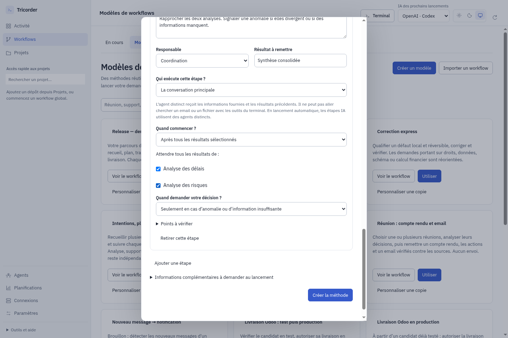

# Tricorder

**Préparez une méthode réutilisable. Fournissez vos sources. Retrouvez le résultat.**

Tricorder réunit un éditeur de workflows, vos conversations avec Codex ou Claude
et le suivi des demandes dans une application de bureau. Il sert à préparer une
release, analyser un ticket, clôturer une réunion ou organiser votre propre processus.
Les projets Odoo sont un usage possible ; le pack Odoo reste facultatif.

**Préversion publiée 0.6.0-rc.18 · Ubuntu** — [Télécharger](https://github.com/le-goff-benoit/odoo-tricorder/releases/tag/v0.6.0-rc.18)
· [Nouveautés](release/2026-10-10_methodes-reutilisables/README.md)
· [Guide d’utilisation](docs/WORKFLOW-RUNTIME.md)



*Captures de l’application avec des projets et exécutants fictifs.*

## Des méthodes réutilisables, du modèle au résultat

**Workflows** distingue **En cours**, **Modèles** et **Historique**. La bibliothèque
présente des méthodes complètes ; exemples et composants restent dans les options
avancées. **Voir le workflow** montre ses sources, étapes, agents, décisions et
livrables sans créer de copie ni d’exécution.

1. **Choisir.** Consultez **Support : comprendre et répondre** ou **Réunion : compte
   rendu et email**. **Utiliser** prépare une demande ; **Personnaliser une copie**
   enregistre votre propre méthode. Choisir l’IA pendant une préparation ne crée
   aucune copie ; abandonner le lancement ne crée pas d’adaptation.
2. **Créer.** **Créer un modèle** demande le résultat souhaité, les informations de
   départ et les travaux. Choisissez pour chaque étape son agent, son résultat,
   ses prérequis et le moment où votre décision est nécessaire. Deux analyses
   peuvent démarrer ensemble ; une synthèse peut attendre tous leurs résultats.
3. **Fournir les sources.** Collez du texte, ajoutez un ou plusieurs fichiers,
   indiquez un email ou un document à retrouver. Pour une réunion, choisissez les
   réunions et leur période. Les fichiers sont copiés et conservés ; une référence
   externe reste à lire avec un outil réellement accessible.
   Fermer une préparation conserve son brouillon et l’annonce à la réouverture ;
   **Commencer une demande vierge** efface les sources de cette préparation.
4. **Suivre.** **Démarrer le travail** ouvre le suivi. Les étapes métier regroupent
   leurs travaux sans changer les contrôles du moteur. Les questions, décisions
   et interruptions disposent d’actions visibles. Le terminal reste accessible.
5. **Reprendre le résultat.** **Résultats** présente le diagnostic, les actions,
   le compte rendu ou l’email prêt à copier. Le rapport conserve le plan et les
   preuves dans un journal détaillé replié. Un email préparé n’est pas envoyé.

**Agents** présente les rôles disponibles et permet d’ajouter un pack. Un rôle
précise les consignes ; il ne désigne pas automatiquement un processus distinct.
Les méthodes Support et Réunion utilisent la conversation pour lire les sources,
puis des agents distincts pour analyser, rédiger et vérifier les textes transmis.
La création guidée permet de choisir explicitement ces agents distincts.
**Choisir l’IA** fournit une liste de modèles issue des métadonnées publiques
locales, avec un catalogue embarqué si elles manquent. L’accès au modèle choisi
reste vérifié au lancement. Aucun nom technique à mémoriser.

**Options → Éditeur détaillé** conserve les commandes, contrats, branches et
opérations particulières. Les définitions et exécutions client existantes restent
inchangées. Les [neuf personas](docs/RECETTE-USAGE.md) testent la découverte sans
onboarding ; leurs abandons restent consignés à côté des contre-épreuves.

Dans **Paramètres → Agents dans le terminal**, **Autorisations des agents** permet de conserver la configuration du fournisseur ou de choisir **Accès complet — sans confirmations de commandes**. Le choix est enregistré pour les nouveaux lancements et les reprises de Codex et Claude. Le dossier d’état du workflow est transmis au fournisseur pour que le pont local puisse ouvrir sa base SQLite. Les décisions du workflow restent dans le suivi.

Vous pouvez commencer par le terminal. Le bouton **Terminal** l’affiche à tout
moment ; sa session reste ouverte pendant la navigation. Revenir à une liste ou aux modèles masque le terminal pour libérer la lecture ; le bouton Terminal le retrouve. **Autres terminaux** retrouve les sessions ouvertes dans les autres projets sans
changer le workflow affiché. Le séparateur ajuste sa place. **Disposition verticale** superpose
terminal et suivi, et **Agrandir le terminal** lui donne toute la surface.
En fenêtre compacte, le terminal garde une hauteur utile. Le réaffichage suit
la sortie courante tout en préservant une lecture volontaire de l’historique.

## Utiliser Tricorder sans IA

Partez du modèle **Commande locale avec validation**, renseignez la commande du
contrôle, puis choisissez **Exécuter… → Lancer l’exécution réelle**. La commande s’exécute localement dans
son environnement isolé. Une seule décision finale présente sa sortie et sa preuve
pour décider de la suite, sans configurer de fournisseur IA. Les critères métier
de ce contrôle se configurent dans cette décision. Un échec présente sa cause et
le nombre de tentatives avant de proposer une reprise.

Le shell ouvert depuis le suivi démarre à la racine du projet. Celui ouvert dans
l’éditeur démarre dans `.tricorder/` pour y concevoir la méthode ; son contexte
indique ce dossier. Une session déjà ouverte conserve son dossier et son historique.
Les workflows enregistrés et rapports exportés sont versionnables ; l’export d’un
contrôle local ne constitue pas à lui seul une attestation du commit Git testé.

## Votre méthode, vos blocs

La création guidée suffit pour une méthode de travaux textuels. Dans l’éditeur détaillé, choisissez les blocs nécessaires. Dans **Options → Paramètres du workflow**,
le **Formulaire de lancement** définit les informations demandées à chaque exécution :
texte, nombre, Oui/Non ou liste de choix, avec aide et réponse obligatoire.
Les réponses figurent dans le suivi et le rapport. Une planification les conserve
pour ses prochaines occurrences. Les paramètres fixes restent dans le modèle.


L’éditeur relie des tâches, agents, documents, décisions, conditions et opérations.
Chaque bloc explique son travail, ce qu’il utilise, ce qu’il produit et ses critères.
Les informations portent un nom métier et indiquent les étapes qui les transmettent
ou les reçoivent. Une question attend une réponse libre ; une décision propose un accord.
Les données peuvent être un élément ou une liste, requises ou facultatives.
**Recevoir un résultat existant…** ajoute en une fois l’information et sa liaison
au producteur. Les nouveaux workflows proposent directement les données structurées.
Les liens montrent quelles données passent au bloc suivant ; un lien peut aussi
servir uniquement à définir l’ordre du travail.

Une règle choisit son information dans une liste. Les décisions humaines acceptent
des choix en français, avec espaces et accents ; renommer un choix conserve sa
branche. Le mode **Validation du résultat** explique si une tâche attend une
revue humaine ou poursuit après contrôle de structure. Ce contrôle ne garantit
pas la qualité métier de la réponse.

Dans **Paramètres du workflow → Paramètres supplémentaires**, ajoutez des valeurs
fixes par nom et valeur. Pour demander une information à chaque lancement,
ajoutez une Question ouverte. Le JSON avancé reste disponible pour les structures
complexes. Le choix d’un type de bloc explique qui agit et ce qui arrête la suite.

Déplacez une carte directement, ajoutez un bloc près de la zone visible et reliez
ses points d’entrée et de sortie. Cliquer sur un bloc ouvre ses propriétés ; sur un panneau compact, **Retour au graphe** retrouve le dessin.
Le bouton **Propriétés** reste aussi disponible. **Réorganiser le graphe** range les branches.
Les déplacements et modifications peuvent être annulés. Les notes permettent
de commenter votre dessin et restent sans effet sur son exécution.

La méthode appartient au workflow. **Choisir l’IA** règle le fournisseur et le
modèle dans une liste issue des métadonnées locales ou du catalogue embarqué (avec saisie avancée si nécessaire) ; les profils d’agents précisent les compétences et les consignes de chaque
bloc. Vous pouvez adapter ces choix sans redessiner votre méthode, sous réserve
des outils et capacités réellement disponibles chez l’exécutant choisi.

**Données de simulation…** permet d’essayer des branches et des valeurs d’exemple.
La simulation sert à vérifier le parcours ; elle ne réalise pas le travail métier.


Sur un petit écran, les propriétés utilisent le panneau workflow avec des actions
fixes. Le formulaire conserve la saisie lorsque vous redimensionnez la fenêtre.

## Un workflow, plusieurs usages

| Besoin | Exemple de parcours |
|---|---|
| Support | Demande client → analyse → clarification → constat → proposition de réponse |
| Réunion | Choix des réunions et sources → analyse → compte rendu, actions et brouillon d’email |
| Release | Intentions → plan → décision → réalisation → contrôles → proposition de livraison |
| Travail transversal | Demandes dans plusieurs projets → dépendances → consolidation |
| Processus personnalisé | Vos blocs, vos données et vos règles de décision |

**Projets → Nouveau projet** crée un espace local ou associe un dépôt Git existant.
Aucune préparation de dépôt n’est nécessaire pour commencer dans un nouvel espace.

**Options → Réutiliser…** crée une copie vers les modèles ou un autre projet.
Les copies évoluent indépendamment ; les anciennes demandes, résultats, décisions
et planifications ne sont pas transférés. Un même workflow peut aussi servir à
plusieurs exécutions sans créer une nouvelle définition à chaque lancement. Les exemples personnalisés de simulation sont retirés de la copie, sauf si vous choisissez de les conserver.

Dans un dépôt, les définitions sont enregistrées dans `.tricorder/workflows/`,
prêtes à être versionnées. **Éditeur → Fichier JSON du workflow…** montre le fichier enregistré. **Options → Workflows du dépôt** les retrouve après
un clone. Les commits restent sous votre contrôle ; l’historique d’exécution reste local.

## Comprendre le travail en cours

Le graphe de suivi montre **votre demande, son plan et ses tâches**. Il affiche
les intentions recueillies, le plan produit puis les éléments en cours, leurs
dépendances et leurs résultats. Ouvrir une tâche permet d’examiner son travail
et de revenir au workflow parent en conservant le terminal.

**Vue d’ensemble** rassemble les demandes, les exécutants et leur dernier état
observé, ainsi que les attentes. Une question, une décision, une dépendance et un échec ont des actions
propres. **Graphe** montre le parcours ; **Détail** donne la place au contenu à lire.
Une demande terminée propose **Voir les résultats**, puis son rapport complet.
La durée totale, début et fin proviennent du journal d’exécution ; elle comprend
les attentes humaines et ne prétend pas mesurer le temps de calcul de l’IA.
Les questions attendues sont visibles dans le suivi. Les badges des projets
donnent accès à la raison et à l’action attendue, même pour un ancien suivi. Les branches non applicables sont comptées séparément. Les décisions disposent de leurs actions en pied de panneau, même avec un long contenu à lire.

Les tentatives précédentes présentent leur compte rendu, leurs preuves et le
motif de reprise. Une reprise annonce son budget : **Relancer maintenant** exécute
une étape automatique ; **Préparer la reprise** remet une tâche de conversation
à disposition de son agent. Le diagnostic d’une commande échouée apparaît directement. **Agent arrêté** et **Demande suspendue** sont
traités séparément. Si son terminal a été fermé, **Retrouver la conversation**
propose une reprise explicite avant de créer un nouveau terminal.

**Lancer les demandes prêtes** démarre une vague de travail, avec jusqu’à quatre
exécutants et les verrous nécessaires. Le terminal peut faire la même chose.
Les demandes qui attendent une réponse ou une validation restent visibles.
Les demandes ordinaires restent lancées par vagues explicites. Les étapes
configurées comme agents distincts dans une méthode démarrent automatiquement
quand leurs prérequis sont satisfaits, dans cette même limite de quatre exécutants.

Les intentions en cours de saisie sont conservées pendant un ajout. Un conflit
ou un accusé perdu laisse le texte dans **Ajouts à récupérer** : vous pouvez
réessayer l’ajout sans doublon ou le retirer de cette liste avant de confirmer.

Le modèle **Intentions, plan et travaux** propose un autre parcours :
plusieurs intentions alimentent un plan unique, que vous validez avant le travail.
**Refuser la suite** empêche la branche approuvée de démarrer ; cela ne commande
pas un nouveau plan. Une nouvelle proposition passe actuellement par une nouvelle
demande, qui conserve séparément ses décisions.
Le bloc **Pour chaque élément** crée ensuite une exécution pour chaque tâche du
plan. Sa coordination démarre les éléments prêts, respecte leurs dépendances et
continue lorsque des places se libèrent. Vous choisissez de un à quatre travaux
simultanés. Une reprise ciblée conserve les résultats des autres tâches.

Le terminal porte la conversation avec l’agent coordinateur ; Tricorder gère
la file, les dépendances et les états. Le suivi affiche les exécutants réellement
actifs et les interventions attendues. Une consultation ne crée aucun agent.

Pour du développement, un second modèle réunit les contributions de code dans
un candidat commun, exécute ses tests puis présente la décision sur ce candidat.
Les commandes de test sont à adapter à votre projet. Un conflit entre fichiers
ou un échec des tests communs empêche l’application du candidat.

## Fournisseurs, outils et connexions

**IA des prochains lancements** choisit OpenAI · Codex ou Anthropic · Claude.
Les conversations déjà ouvertes conservent leur fournisseur. Tricorder utilise
leurs CLI et leur authentification native ; sélectionner un fournisseur ne
connecte pas automatiquement son compte.

Dans une conversation, l’agent utilise ses outils disponibles pour rechercher
un email, lire une source locale ou préparer un brouillon. **Connexions** présente
les plugins détectés. Une opération autonome dans un workflow — notification,
email ou autre service — demande une capacité vérifiée pour ce connecteur.
Un brouillon local ne devient pas automatiquement un brouillon dans la messagerie.

Les **actions facultatives** associent un travail complémentaire à un résultat
ou à une question. Elles sont proposées séparément pour activation. Leur état
reste visible, même après la fin du résultat principal ; un échec peut être repris
sur cette action seule. Un envoi au résultat incertain exige d’abord de rechercher
son accusé. Les notifications automatiques de question disposent de leur réglage
et de leur autorisation au lancement.

Pour faire relire un contenu avant un envoi, placez une **Décision humaine**
avant le bloc de communication. La validation du résultat de ce bloc intervient
après l’opération.

## Planifier et partager

**Planifier** règle la fréquence, les jours, le fuseau et le mode d’exécution.
Pour une méthode avec une étape initiale de lecture, choisissez de reprendre le
même texte ou de lire de nouvelles sources par une connexion de lecture vérifiée.
La seconde option demande une recherche et un périmètre ; elle conserve les
identifiants déjà traités et ne produit aucun livrable si aucune source ne correspond.
Sans connexion vérifiée, aucune recherche automatique n’est annoncée.
La planification traite un nouvel élément par occurrence, sans chevauchement. La planification
conserve une version du workflow, consultable dans **Version planifiée**.
Modifier le dessin ne change pas une planification active ; son remplacement
est explicite. La fréquence reste visible et les réglages horaires sont repris lors du remplacement ; vous vérifiez à nouveau le mode et les autorisations.

**Options → Exporter…** produit un fichier `.tricorder-workflow` avec ses
composants. À l’ouverture sur un autre poste, Tricorder présente un aperçu avant
import. Les comptes, autorisations et anciennes exécutions ne sont pas transférés.

## Installer et mettre à jour

Téléchargez le paquet `.deb` depuis la [release](https://github.com/le-goff-benoit/odoo-tricorder/releases/tag/v0.6.0-rc.18),
installez-le avec le gestionnaire de paquets Ubuntu, puis ouvrez **Tricorder**.
**Essayer un exemple** permet de découvrir un parcours simulé sans modèle payant.

Les mises à jour stables sont signalées depuis GitHub. L’installation et le
redémarrage restent explicites. Fermer la fenêtre conserve les sessions terminal ;
pour appliquer une mise à jour, quittez Tricorder depuis son icône système puis
relancez-le. Un agent déjà ouvert conserve ses instructions jusqu’à sa reprise.

## État de la préversion

Les modèles enrichis utilisent un format de workflow versionné. Les anciens
modèles et leurs exécutions restent consultables avec leur fonctionnement initial ;
la conversion d’un brouillon est explicite.

Un recueil ou un traitement accepte jusqu’à 100 éléments, avec quatre exécutants
maximum dans l’application. Les traitements par élément imbriqués ne sont pas
encore proposés. L’intégration de code et ses tests restent propres à chaque dépôt.

Les [notes et preuves de réception](release/2026-10-10_methodes-reutilisables/README.md)
distinguent essais GUI, simulations et limites. Elles ne qualifient ni un modèle
commercial, ni un service externe, ni une release cliente réelle.

## Développer Tricorder

Ubuntu, Python 3, Git, Node/npm et Bubblewrap pour les commandes isolées :

```bash
npm install
npm start
npm test
npm run test:ui
npm run dist
npm run test:packaged
```

Le terminal utilise Electron et xterm.js ; le moteur de workflows est en Python.
État du bureau : `~/.config/odoo-tricorder/`. État des workflows :
`~/.local/share/tricorder/`. `TRICORDER_STATE_DIR` permet un banc isolé.
Tricorder n’expose pas de service TCP et n’envoie pas de télémétrie. La vérification
de mise à jour contacte GitHub ; les fournisseurs et connecteurs contactent leurs
services lors des actions demandées.
