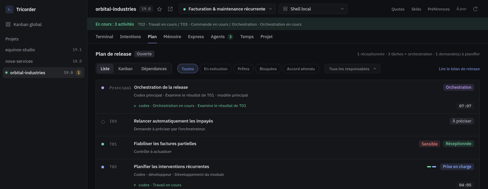
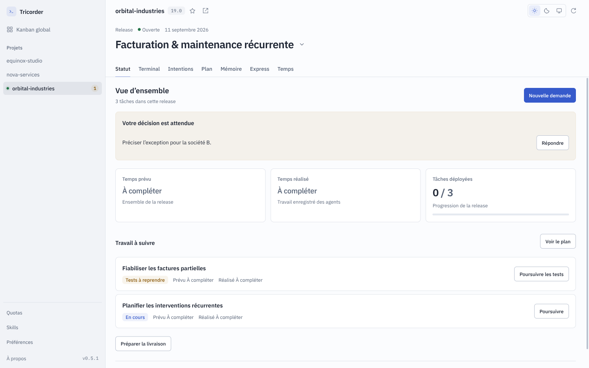
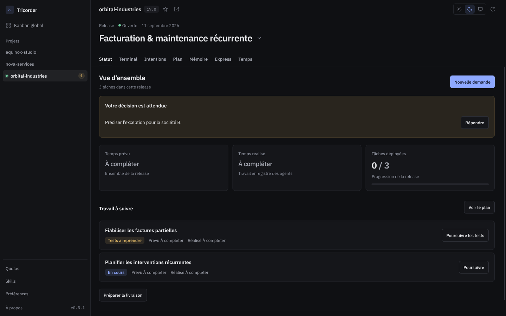
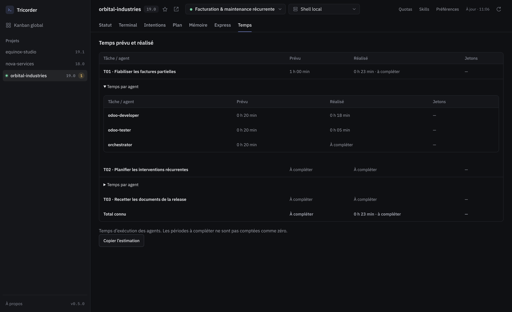

# Odoo Tricorder

**Le cockpit de bureau de vos projets Odoo menés avec Claude Code et Codex.**

Un terminal persistant par projet, et autour de lui tout ce qu’il faut pour
garder la main sur l’exécution : les demandes d’origine, le plan de la release,
les agents en activité, leurs preuves et leur temps. **Odoo Crew orchestre le
travail ; Tricorder le rend lisible.** Rien n’est modifié depuis le cockpit.

[Installer la version 0.5.0](https://github.com/le-goff-benoit/odoo-tricorder/releases/tag/v0.5.0) ·
[Installer Odoo Crew](https://github.com/le-goff-benoit/odoo-crew/blob/main/docs/INSTALL.md) ·
[Parcours d’exemple](docs/WORKFLOWS.md) ·
[Socle visuel](docs/DESIGN.md) ·
[Signaler un problème](https://github.com/le-goff-benoit/odoo-tricorder/issues)

## Ce que vous voyez

**Statut** ouvre un cockpit de la release : temps prévu et réalisé, tâches en cours,
questions à trancher, travaux à déployer et déploiements vérifiés. Les sept onglets
sont Statut, Terminal, Intentions, Plan, Mémoire, Express et Temps.

La **release active** est le titre principal. La branche Git et le choix de shell
sont regroupés dans le Terminal ; les outils et préférences restent discrets.
Les commandes en haut à droite proposent **Clair / Sombre / Système**, avec un
choix mémorisé et un terminal assorti sans interruption de session.




**Plan** ouvre le Kanban : À faire → En cours → Tests en cours → À déployer →
Déployées. Un contrôle périmé reste indiqué « Tests à reprendre ». Une publication
GitHub seule ne vaut pas déploiement ; la cible doit être observée par Crew.
Les modes Liste et Dépendances restent disponibles.

Une fiche de tâche rassemble critères d’acceptation, temps par agent et tests
réellement enregistrés. Les identifiants de sessions et journaux techniques
n’encombrent plus cette fiche.

**Intentions** conserve la demande originale, la proposition de travail, les
contraintes, décisions et questions avec leurs réponses. **Mémoire** expose les
apprentissages utiles, leur conséquence et leur intégration au projet.
Les acquis périmés ne sont pas présentés comme immédiatement réutilisables.

**Temps** regroupe Prévu / Réalisé / Jetons par tâche, avec détail par agent.
Les travaux communs et la préparation figurent dans les totaux. Une mesure
incomplète conserve son sous-total connu ; elle ne devient jamais zéro.
La synthèse d’estimation copie périmètre et hypothèses, sans convertir les minutes
d’agent en charge humaine ou en prix commercial.



**Express** décrit chaque petite correction par son résultat métier, ses tests
et son temps. **Terminal** conserve les sessions et leur contexte habituel.
Les ressources techniques restent dans **Statut → Outils du projet**.

## Installer

Le paquet **0.5.0** cible Linux Ubuntu / Pop!_OS **amd64**. La construction et
les parcours de bureau sont vérifiés sur Pop!_OS 22.04 LTS.

1. Télécharger `odoo-tricorder_0.5.0_amd64.deb` dans la
   [release 0.5.0](https://github.com/le-goff-benoit/odoo-tricorder/releases/tag/v0.5.0).
2. Depuis le dossier du téléchargement :

   ```bash
   sudo apt install ./odoo-tricorder_0.5.0_amd64.deb
   ```

3. Ouvrir **Odoo Tricorder** dans le menu des applications.

Python 3 et les bibliothèques du bureau sont des dépendances du paquet. Pour le
suivi Odoo complet, installer séparément
[Odoo Crew](https://github.com/le-goff-benoit/odoo-crew) (généré avec `build.sh`,
normalement dans `~/.odoo19-agents`) et **Claude Code, Codex, ou les deux**. Le
terminal reste utilisable sans fournisseur IA ; un raccourci vers l’installation
de Crew n’est proposé dans la barre latérale que si le dispositif manque.

## Commencer

1. **Préférences → Dossiers partagés → Dossier des projets** : la racine de vos
   projets si elle diffère de votre dossier personnel.
2. Choisir un projet dans la barre latérale, puis une release dans la pastille de
   l’en-tête (le point vert signale une release ouverte). La seconde pastille est
   l’environnement des nouveaux terminaux : un repère, jamais une connexion ni
   une permission.
3. Dans **Statut**, cliquer **Nouvelle demande**, choisir l’action et l’agent,
   puis décrire le résultat attendu. **Lancer le travail** ouvre un terminal contextualisé.
4. **Reprendre** retrouve le terminal de la tâche s’il existe ou prépare une nouvelle
   session. Le texte original, la release et la tâche sont transmis à l’agent.
5. Les critères et preuves sont accessibles depuis la tâche ; **Mémoire** présente
   les apprentissages et décisions établis. Le terminal et le sélecteur **Skills** restent
   disponibles pour les usages avancés ; `Ctrl Shift T` ouvre un shell simple.

Les skills se saisissent **dans la conversation de l’agent**, pas dans le shell :

| Action | Claude Code | Codex |
|---|---|---|
| Construire ou adapter le plan | `/odoo-plan` | `$odoo-plan` |
| Exécuter le périmètre autorisé | `/odoo-start` | `$odoo-start` |
| Faire la recette complète et clôturer | `/odoo-close` | `$odoo-close` |
| Réaliser un correctif local express | `/odoo-express` | `$odoo-express` |
| Diagnostiquer un ticket | `/odoo-support` | `$odoo-support` |

Trois parcours prêts à adapter : [docs/WORKFLOWS.md](docs/WORKFLOWS.md).

## Lire les états

| Indication | Ce qu’elle signifie |
|---|---|
| **À planifier / À préciser** | Demande enregistrée, sans tâche exécutable liée. |
| **Prise en charge** | Responsabilité enregistrée ; l’activité effective se lit dans le suivi fournisseur. |
| **Réceptionnée** | Travail reçu dans l’historique de la release. |
| **Contrôle à actualiser** | La réception reste conservée, mais les preuves demandent un nouveau contrôle dans ce contexte. |
| **En exécution** | Activité confirmée par une observation récente. Un terminal ouvert ne suffit pas. |
| **Durée inconnue / Suivi à vérifier** | Il manque une borne fiable ou une observation récente. Cela ne prouve pas l’arrêt du processus. |

Le minuteur indique le **temps écoulé de l’étape observée**, pas un pourcentage.
Les rapports JUnit sont comptés par exécution ; un rapport qui mélange des
résultats détaillés et des compteurs incompatibles est signalé comme non
exploitable et ne peut pas apparaître vert. Un rapport vert ne suffit pas à
déclarer une tâche reçue.

Les demandes et plans sont relus dès qu’un fichier change (contrôle toutes les
**2 secondes**) ; le suivi fournisseur est interrogé toutes les **5 secondes** ;
une actualisation générale intervient toutes les **30 secondes**.

### Quotas : disponibilité actuelle

Les adaptateurs de quotas **5 h / hebdomadaire** sont expérimentaux et n’ont pas
pu être qualifiés sur compte réel. Tant qu’aucune donnée fiable n’existe, la
barre supérieure n’affiche qu’un lien **Quotas** ; les pastilles par fournisseur
apparaissent dès qu’une fenêtre est lue. Aucun appel modèle ne sert à les
rafraîchir et aucun basculement de modèle n’en dépend.

## Raccourcis

| Raccourci | Action |
|---|---|
| `Alt 1` à `Alt 7` | Statut, Terminal, Intentions, Plan, Mémoire, Express, Temps |
| `Ctrl Shift T` | Nouveau terminal |
| `Ctrl Shift F` | Rechercher dans le terminal |
| `Ctrl Shift C` / `Ctrl Shift V` | Copier la sélection du terminal / coller |
| `Ctrl Alt ↑` / `Ctrl Alt ↓` | Projet précédent / suivant |
| `Ctrl PageUp` / `Ctrl PageDown` | Terminal précédent / suivant |
| `Ctrl Shift P` | Palette de skills |
| `Ctrl Alt F` | Recherche dans les documents des projets |

**Statut → Outils du projet** regroupe les ressources en lecture seule : **Fichiers**,
**Environnements** et **Sources**. Les préférences règlent le terminal, la
largeur de la barre latérale et le contraste.

## Données locales

Tricorder lit les projets, plans, preuves et workflows sans les modifier. Les
agents et commandes lancés dans le shell conservent leurs propres permissions.
Fermer la fenêtre laisse les terminaux en marche ; ils ne survivent pas au
redémarrage du poste. Changer de vue ne change ni leur dossier ni leurs
instructions.

L’application utilise Electron, xterm.js et un service Python sur socket Unix
privée. Elle n’expose aucun service TCP, n’envoie aucune télémétrie, ne charge
rien depuis le réseau (polices comprises) et ne lit ni le trousseau ni les clés
des fournisseurs. Les lancements suivis conservent des métadonnées locales
d’événements ; ils ne parcourent pas vos conversations. Les préférences sont dans
`~/.config/odoo-tricorder/settings.json`.

## Développer et vérifier

Node.js 22+, Python 3.10+ et Odoo Crew pour les tests d’intégration :

```bash
npm ci
npm test            # contrats Python et JavaScript
npm run test:ui     # parcours Electron sur projets synthétiques
npm run dist        # paquet Debian dans release/
npm run test:packaged
npm run checksum
```

`npm start` lance l’application depuis les sources. Les parcours Electron
nécessitent une session graphique ou `xvfb-run -a`. Aucun test ne lance de
campagne de modèles réelle. Le socle visuel est documenté dans
[docs/DESIGN.md](docs/DESIGN.md) ; les maquettes des directions explorées sont
dans [docs/design/variants](docs/design/variants).

## Licence et marques

Code sous [licence MIT](LICENSE). Les polices IBM Plex Sans et Mono sont embarquées
sous [SIL Open Font License](assets/fonts/README.md). Les logos OpenAI et Anthropic
sont des marques de leurs titulaires ; leurs
[sources officielles sont documentées](assets/providers/README.md). Projet
indépendant, sans affiliation à Odoo, OpenAI ou Anthropic.

## Compatibilité Crew

La release 0.5 utilise l’API de lecture d’Odoo Crew v2026.10.07. Les anciens
registres restent lisibles ; les nouvelles mesures et projections exigent la
mise à jour de Crew. Le cache des validations vit seulement pendant une lecture,
avec réévaluation à l’actualisation. Le cockpit reste en lecture seule sur les
projets ; les actions passent par les agents et leurs contrôles.
