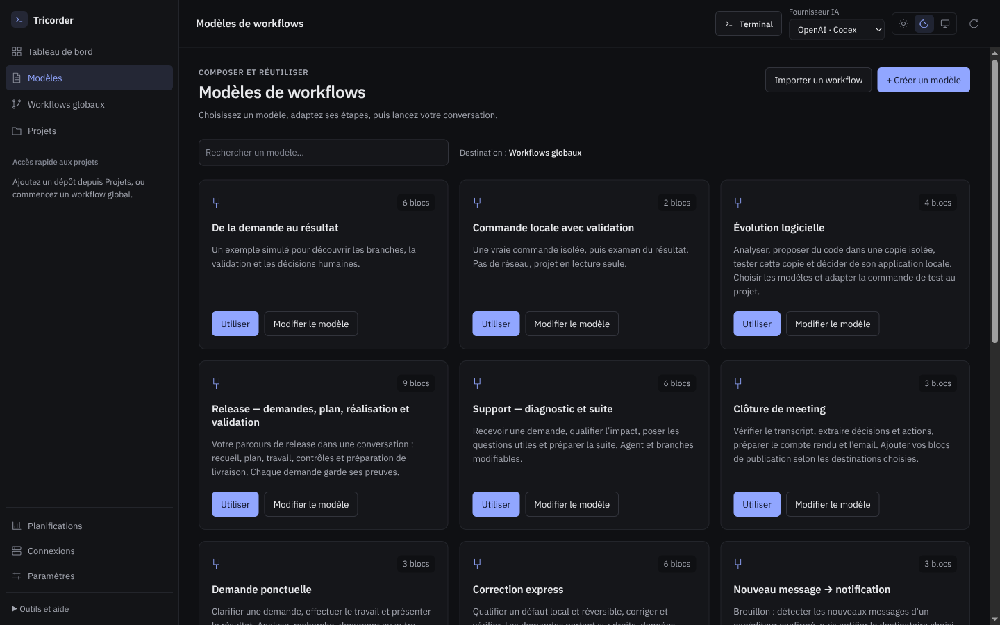

# Tricorder

**Dessinez vos workflows, pilotez le travail dans le terminal et suivez ses résultats.**
Préversion publiée : **0.6.0-rc.7**.

[Correctif du chargement et du crash EPIPE](release/2026-10-09_chargement/README.md) :
les historiques de projets volumineux ne sont plus renvoyés au moteur pour leur
enregistrement. Une requête interrompue produit une erreur récupérable.

[Parcours de travail et limites](release/2026-10-08_parcours/README.md) · [Revue ergonomique et captures](release/2026-10-08_design/README.md) · [Revue fonctionnelle](release/2026-10-08_revue/README.md).

Une application et une fenêtre : le terminal natif et le graphique partagent
le même espace. Les modèles peuvent être réutilisés par projet ou alimenter une
conversation avec plusieurs tâches et plusieurs projets. Les anciens dossiers
de release restent accessibles sans migration.



*Capture sur un espace fictif, sans données client.*

Les modèles, les projets et les réglages disposent de toute la largeur.
**Terminal**, en haut de la fenêtre, affiche ou masque la session sans la fermer.
Lancer une conversation ouvre le terminal avec son suivi graphique à côté.
La recherche de modèles et les propriétés des blocs facilitent la conception.
Le séparateur permet de redimensionner terminal et graphe à la souris ou au clavier.
**Disposition verticale** les superpose ; **Côte à côte** les remet en colonnes.
Revenir à l’éditeur lui rend toute la largeur sans fermer la session.
La barre latérale sépare navigation, raccourcis des projets et configuration ;
les commandes des agents, quotas et mises à jour sont dans **Outils et aide**.

## Dessiner, lancer et converser

1. **Créer un workflow** : choisir un modèle, nommer le workflow et choisir son projet
   ou l’espace global. Saisir la demande ici ou plus tard dans le terminal.
   **Créer et ouvrir** enregistre le dessin ; ouvrir les blocs pour adapter consigne,
   entrées/sorties, agent et branches. Un workflow vide reste disponible dans le projet.
2. **Relier** choisit les sorties du bloc amont et les entrées du suivant. Les
   données de même nom et type sont proposées automatiquement.
3. Choisir OpenAI ou Anthropic, puis **Exécuter… → Lancer dans le terminal**.
   Cocher d’autres projets pour une conversation transversale.
4. La demande saisie est déjà enregistrée une seule fois. Le terminal permet
   d’ajouter d’autres demandes. L’agent enregistre les tâches et remet
   ses résultats au moteur ; le graphique montre leurs états réels. Une question
   attend sa réponse sans suspendre les autres tâches.
5. Retrouver la conversation depuis le projet, même après redémarrage. Les
   décisions et autorisations exactes se prennent sur les blocs correspondants.

Pour un bloc de modification de code isolée, renseigner aussi un modèle explicite
avec **Choisir l’IA** avant de lancer la conversation.

Les profils précisent la méthode ; les ports, critères et branches appartiennent
au workflow. Le bloc **Support critique ?** réunit qualification et aiguillage.
Un parcours de livraison directe en production est disponible sans staging imposé,
avec candidat, cible, contrôles et décision humaine exacts à configurer.

Le pack Odoo 0.3.1 installe deux modèles éditables par projet Odoo découvert : release
et support. La release relie intention, plan, décision, candidat isolé, QA sur copie
locale et proposition de livraison. Le modèle de meeting prépare compte rendu,
actions et email ; publication et envoi demandent un connecteur et une autorisation.
La validation technique d’un résultat ne remplace pas sa recette métier.
Une tâche terminée avec un travail non résolu ou un refus ne libère pas ses
successeurs. Après un échec de recette, ouvrir une tâche de correction : les
modèles graphiques n’ont pas encore de boucle automatique de correction/recette.
Les workflows déjà enregistrés conservent leur version ; importer une nouvelle
copie du modèle pour bénéficier de ses nouvelles branches, puis comparer vos adaptations.

## Support, meeting, demande ponctuelle ou flux personnalisé

Les modèles **Demande ponctuelle**, **Support**, **Clôture de meeting** et
**Correction express** utilisent le même éditeur et le même suivi. Les profils
spécialisés sont facultatifs. L’express commence par une qualification et réoriente
les périmètres sensibles ; une fin bloquée ne devient pas un succès.

Les définitions sont dans `.tricorder/workflows/` du dépôt choisi. **Workflows du
dépôt** permet de les reprendre après un clone, sans reprendre des autorisations.
Depuis une exécution, **Exporter le rapport dans le projet** produit un dossier
`work/<nom>/` avec README, définition exécutée, journal et preuves. Les commits
restent sous votre contrôle ; les exécutions actives restent locales.

Dans **Paramètres du workflow**, une opération de notification vérifiée peut prévenir lorsqu’une
question apparaît, même si elle n’était pas prévue dans le dessin. Son activation
est explicite et son envoi a un suivi séparé. **Connexions** détecte les plugins
OpenAI et Anthropic ; leur installation seule ne prouve pas un accès exécutable.
La [revue des parcours](release/2026-10-08_parcours/README.md) précise les transports
pris en charge et la différence entre brouillon de texte et brouillon de messagerie.

## Travailler sur une release

Tricorder ouvre vos projets existants et leurs releases. Le terminal occupe la
partie principale ; le panneau voisin montre le workflow, les intentions, le
plan, les décisions, les preuves et les temps. Changer de vue conserve la session.
**Agrandir le terminal** masque temporairement le panneau ; **Afficher le workflow**
le rétablit.

1. Choisir un projet et sa release.
2. Choisir **OpenAI · Codex** ou **Anthropic · Claude** dans l’en-tête. Le choix
   est mémorisé pour les prochains lancements ; une session existante reste intacte.
3. Interagir directement dans le terminal, ou utiliser une étape du panneau :
   **Ouvrir une release → Recueillir les demandes → Préparer le plan → Exécuter
   le plan → Recetter et clôturer**. Les boutons préparent une demande contextualisée
   que vous pouvez relire ; **Lancer le travail** ouvre sa session d’agent.
4. Consulter Demandes, Plan, Mémoire et Temps en gardant le terminal visible.

Le parcours de release utilise Odoo Crew et les fichiers existants sous
`changelog/` et `.odoo-agents/`. Une ouverture ou un recueil d’intentions ne lance
pas le développement. Les écritures externes gardent leurs accords propres.
Les fournisseurs utilisent leurs CLI et leur authentification native ; Tricorder
ne lit pas vos secrets. Le choix d’un fournisseur ne prouve pas sa connexion.

## Personnaliser ou exécuter un autre workflow

Depuis les vues de release, **Outils et aide → Reprendre le workflow** retrouve la dernière vue ouverte
(bibliothèque, projet ou éditeur) dans la même fenêtre. La bibliothèque,
les workflows globaux, les planifications et les connexions utilisent cette navigation.
Le terminal reste disponible pendant ces changements de vue.

Depuis la fiche d’un projet ou les workflows globaux, **Exécuter…** ouvre directement
le récapitulatif et les prérequis, sans passer par la modification des blocs.
**Choisir l’IA** applique OpenAI ou Anthropic et un modèle commun aux étapes IA.
Les profils d’agents sont conservés. Les paramètres particuliers d’un bloc restent
accessibles dans ses options ; consigne et critères sont affichés en premier.
Les ports ont des formulaires ; les paramètres supplémentaires restent repliés.

Un prérequis manquant est présenté avec le nom de l’étape et un accès à sa
configuration. La simulation reste explicitement distincte d’une exécution réelle.
Les modèles Odoo enregistrés avant cette simplification restent des brouillons
à compléter : ils ne remplacent pas vos releases historiques.

## Transférer un workflow et mettre à jour Tricorder

« Exporter… » produit un fichier `.tricorder-workflow`, avec ses sous-workflows
intégrés et ses choix de modèles. Sur un autre ordinateur équipé de Tricorder,
le double-clic affiche un aperçu puis propose d’importer un brouillon. Aucun
accord, historique d’exécution ni récurrence active n’est transféré. Les comptes
et capacités doivent être vérifiés sur le poste destinataire.

Au lancement, Tricorder consulte la dernière
release stable publique sur GitHub.
Une nouvelle version propose ses notes et le téléchargement du paquet Ubuntu.
L’installation et le redémarrage restent explicites. Hors connexion, le travail
continue ; « Mises à jour » permet de réessayer.

## Documentation lisible

Une release possède une seule entrée humaine : `release/<id>/README.md`, pour
l’intention, le plan, la réalisation, les tests et la livraison. Le suivi machine
et les preuves sont regroupés dans `.suivi/`. Les installateurs sont dans
`build-artifacts/`, distincts de la documentation.

## Essayer et développer

Prérequis : Ubuntu avec Python 3, Git, Node/npm et Bubblewrap pour les commandes
isolées. L’intégration de l’icône dépend de la zone de notification du bureau.

```bash
npm install
npm start
```

« Essayer un exemple » crée un dépôt Git de démonstration et propose un parcours
simulé : aucun modèle payant ni service métier n’est appelé. Depuis « Globaux »,
les modèles peuvent aussi s’exécuter sans créer de projet.

```bash
npm test
npm run test:ui
npm run dist
npm run test:packaged
```

État du cockpit et des terminaux : `~/.config/odoo-tricorder/`. État des workflows : `~/.local/share/tricorder/` (SQLite, preuves, bibliothèque, workflows
globaux et exemples). `TRICORDER_STATE_DIR` permet une instance isolée ; les données historiques
conservent leurs emplacements, au sein de la même application.
Pas de service TCP ni de télémétrie dans Tricorder. La vérification de mise à jour contacte GitHub au lancement, conformément à la
préférence demandée. Les fournisseurs natifs contactent leurs services lors
des actions demandées.

Les anciens écrans et leurs références restent dans l’historique et certains
fichiers sources ; ils ne sont plus le point d’entrée de l’application. Aucun
ancien workflow client n’a été migré ou supprimé.
