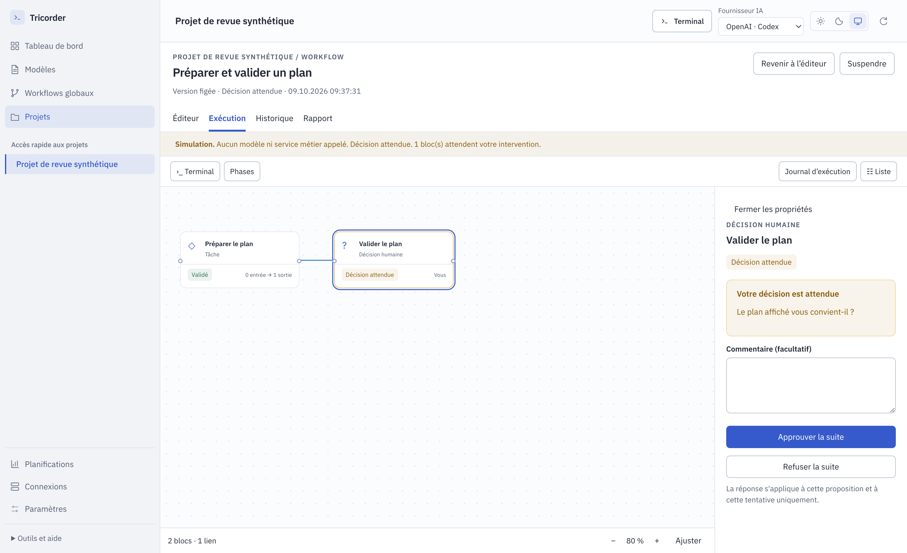
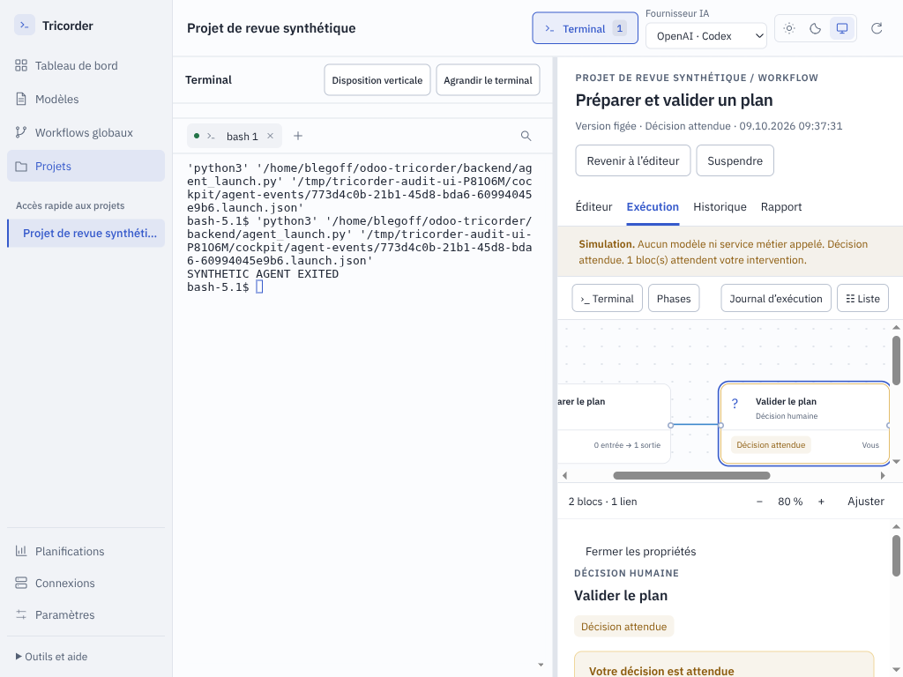

# Audit indépendant de Tricorder — 9 octobre 2026

Référence : **0.6.0-rc.7**, commit `6e8a286eba6f65d7f6aa7204b18df3acbdced88f`.
Audit demandé par l’utilisateur, effectué par un nouvel agent indépendant.
Périmètre d’écriture : ce rapport et ses preuves synthétiques uniquement.
Aucun correctif applicatif, commit, push, installation ou changement d’état utilisateur dans cette mission.

## Avis de réception

L’architecture va dans la direction demandée : une fenêtre, un terminal persistant,
des définitions versionnées, un moteur indépendant des profils d’agents, des
branches et des décisions explicites. La difficulté principale n’est plus la
palette graphique. **Le parcours « je vois ce qui a été produit, je décide, puis
le workflow poursuit correctement » reste incomplet.**

Les reproductions montrent notamment qu’un plan transmis à une décision n’est pas
affiché, qu’une tentative orpheline peut bloquer les suivantes, et qu’un résultat
relié à une publication n’est pas transmis au connecteur. Une nouvelle couche de
style seule ne résoudrait pas ces problèmes. La priorité est de rendre les données,
les transitions et la reprise fiables, puis de simplifier les écrans autour de ce
comportement.

Je recommande de traiter les constats P1 ci-dessous avant d’élargir le catalogue ou
de présenter les modèles comme des parcours complets prêts à l’emploi. Aucun
incident de production ni écriture distante non autorisée n’a été observé pendant
cet audit. L’application d’un candidat au dépôt local possède toutefois un défaut
de respect des étapes de QA et de décision configurées dans son graphe.

## Méthode et niveau de preuve

- Cartographie des sources applicatives, moteur, connecteurs, transport, PTY,
  observation historique, modèles, stockage, exports, tests, packaging et CI.
- Lecture des revues et releases récentes, puis comparaison des promesses avec les
  chemins exécutables. Les cas Odoo historiques ont été repris à partir des
  analyses déjà présentes dans le dépôt ; aucun dossier client réel n’a été ouvert.
- Reproductions Python/Node et parcours Electron dans des dossiers temporaires.
  Les transitions utilisent les API du moteur : aucun état SQLite ou JSON
  d’exécution n’a été modifié pour obtenir un résultat.
- CLI Codex de substitution pour vérifier le cycle de vie terminal/agent ; aucun
  appel payant. Le test de publication remplace uniquement la qualification et le
  transport par un adaptateur factice ; les décisions et le registre des effets
  passent par le moteur réel. Aucun email/Slack envoyé.
- Les captures sont celles de l’application exécutée, sur un projet fictif.
  Elles ne sont pas des maquettes. Le bundle `dist` local existant a été utilisé ;
  les sélecteurs et comportements vérifiés correspondent aux sources rc.7.
- **90 tests Python `test_workflow*.py` réussis** en 9,251 s lors de cette revue.
  Ils coexistent avec les défauts reproduits : leur succès ne qualifie pas les
  parcours manquants. La recette UI complète et le paquet installé n’ont pas été
  rejoués pour cet audit documentaire.

Priorités : **P0** = corruption grave, écriture distante incontrôlée ou exposition
critique avérée ; **P1** = parcours central bloqué, décision insuffisamment éclairée
ou invariant métier contourné ; **P2** = fiabilité secondaire, productivité et
compréhension ; **P3** = dette de maintenance. Aucun P0 n’est déclaré sur la base
des preuves recueillies. « Reproduit » signifie un résultat observé ; « code »
signifie une conclusion étayée par un chemin précis, sans qualification du service
externe ; « recommandation » n’est pas présenté comme un bug démontré.

Preuves rejouables : [Python](2026-10-09-audit-complet/probes.py),
[résultats moteur](2026-10-09-audit-complet/probes-results.json),
[parcours Electron](2026-10-09-audit-complet/ui-probes.cjs),
[résultats UI](2026-10-09-audit-complet/ui-results.json),
[modèles de présentation](2026-10-09-audit-complet/model-probes.cjs),
[résultats de présentation](2026-10-09-audit-complet/model-results.json).

```bash
python3 docs/audits/2026-10-09-audit-complet/probes.py
node docs/audits/2026-10-09-audit-complet/model-probes.cjs
node docs/audits/2026-10-09-audit-complet/ui-probes.cjs
python3 -m unittest discover -s tests -p 'test_workflow*.py'
```

Le script Electron demande une session graphique ; `xvfb-run -a` peut la fournir.
Il nettoie exclusivement ses propres sockets et terminaux temporaires.

## Carte de la codebase et frontières

| Ensemble | Responsabilité et constat |
|---|---|
| `electron/main.cjs`, `preload.cjs`, `workspace-window.cjs` | Fenêtre unique, IPC autorisés, intégration terminal/workflow et compatibilité historique. `contextIsolation`, sandbox renderer, refus des nouvelles fenêtres et des navigations externes : bases correctes. |
| `electron/studio-main.cjs`, `backend-request.cjs` | Pont Python par requête, droits applicatifs distincts pour décisions, polling du runtime et icône système. Le correctif rc.7 protège stdin et EPIPE ; les réponses restent globales et plafonnées. |
| `src/app.js`, `cockpit.js` | Shell commun, barre latérale, fournisseur, terminal, dialogues et cockpit historique. Deux états de navigation subsistent : projet/release natif et projet/workflow générique. |
| `src/studio.js`, `studio-model.js` | Édition, création, imports, lancement, inspection, conversation, historique et rapport. Beaucoup de logique de domaine, de rendu et d’effets dans un seul module. |
| `design-system.css`, `workspace-layout.css`, `studio.css`, `style.css` | Tokens partagés, thèmes, redimensionnement et adaptation à la largeur du panneau. Plusieurs couches de règles héritées et réécrites compliquent la prévision du layout. |
| `backend/workflow_engine/engine.py`, `contracts.py`, `store.py` | Graphe acyclique, transitions, révisions, verrous, preuves et SQLite WAL. Base transactionnelle utile, mais pas de cycle complet de récupération des tentatives orphelines. |
| `conversations.py`, `workflow_cli.py`, `guidance.py` | Une conversation coordonne plusieurs demandes et projets. Le modèle doit appeler explicitement le pont ; le terminal n’est pas interprété automatiquement comme un journal d’exécution. |
| `runtime.py`, `providers.py`, `candidates.py` | Commandes Bubblewrap, sessions IA limitées et propositions de code. La QA d’un candidat et sa permission d’application ne sont pas encore modélisées par un contrat unifié. |
| `integrations.py`, `local_tools.py`, `mcp_stdio.py`, `tool_runtime.py`, `effects.py` | Manifestes, qualification des transports, identité, mappings et effets idempotents. Bons contrôles des écritures ; transmission des données dynamique incomplète pour ces écritures. |
| `schedules.py`, `notifications.py`, `studio-tray.cjs` | Planifications locales, absence de chevauchement, questions et notifications suivies séparément. Les agrégats UI omettent encore un état d’attente. |
| `library.py`, `work_templates.py`, `setup.py`, `packs.py` | Catalogue générique et ajout de profils Odoo. L’ajout d’un pack n’impose pas son domaine aux workflows sans lien ; le routage initial Studio/module reste une heuristique du dépôt. |
| `portable.py`, `documentation.py`, `reuse.py` | Définitions portables sans autorisations, exports et réutilisation prudente de preuves. Les fichiers existent, mais l’accès aux résultats produits et la restauration complète demandent encore du travail. |
| `catalog.py`, `lifecycle.py`, `knowledge.py`, `quality.py`, `insights.py` | Lecture des releases historiques et preuves via les validateurs Crew, séparation du déclaré et du vérifié. Le catalogue initial charge encore trop de détails de toutes les releases. |
| `terminal_service.py`, `studio-terminal.cjs`, observation/hooks/quotas | PTY privés, limites de buffers, maintien des shells, collecte de métadonnées et absence de faux zéro pour les mesures inconnues. Shell vivant et agent vivant ne sont pas équivalents. |
| `tests/`, `scripts/`, `.github/workflows/check.yml` | Banc synthétique substantiel, tests de paquet, screenshots et axe. Crew est figé par SHA en CI. Il manque des cas de charge durable, d’interruption sans résultat et de lecture effective des livrables. |

Le dépôt contient aussi de la documentation de générations précédentes. Par
exemple `docs/WORKFLOWS.md` décrit encore l’ancienne navigation « Intentions »,
« Skills » et les flows Crew. Ce contenu doit être étiqueté comme parcours
historique pour ne pas concurrencer le guide principal actuel.

## Constats prioritaires

### A01 — P1 — Les livrables et les données d’une décision ne sont pas lisibles

**Reproduit, confiance élevée.** Un bloc produit `outputs.plan`, relié à
`inputs.plan` de « Valider le plan ». Le moteur possède bien le plan. L’inspecteur
ne montre que le résumé du producteur et la question de la décision ; le plan
reste absent dans les deux. Le rapport Markdown ne montre pas davantage les
sorties. Les liens de preuves dans le rapport affiché sont privés de leur `href`.

Sources : [inspecteur](../../src/studio.js#L306),
[rapport affiché](../../src/studio.js#L386),
[projection Markdown](../../backend/workflow_engine/documentation.py#L16).
La reproduction donne `decisionInputExists=true`, puis trois booléens d’affichage
à `false` et zéro lien de preuve actionnable.

Impact : relire des minutes, approuver un plan, examiner un diagnostic ou utiliser
le texte d’un email exige de retrouver la conversation ou d’ouvrir manuellement
les données exportées. Une validation peut être donnée sans voir son objet.
Cela concerne les modèles release, meeting et demande ponctuelle dès leur usage
normal. Le contenu n’est pas perdu en base ; c’est son accès humain qui manque.



Correction : inspecteur d’exécution avec **Entrées reçues, Résultat, Preuves et
Suite** ; formats adaptés au texte/Markdown, tableaux et JSON. Une décision doit
présenter ses données reçues et leurs sources avant ses boutons. Ouvrir une preuve
via un lecteur applicatif borné ; conserver les mêmes livrables dans le rapport.

Validation : minutes contenant un texte sentinelle visibles et copiables dans le
producteur, la décision et le rapport ; lien de preuve consultable ; aucun
contenu actif ni fichier extérieur accessible par ce lecteur.

### A02 — P1 — Une tentative orpheline peut bloquer durablement le moteur

**Reproduit, confiance élevée.** Une réservation est créée par `claim`, puis le
worker disparaît avant d’écrire `result.json`. `reconcile` ne peut rien reprendre.
Annuler l’exécution ne libère ni son état `running` ni les ressources réservées.
La nouvelle tâche demandant la même ressource reçoit « Ressource occupée ». Après
quatre tentatives orphelines annulées, tout nouveau `claim` reçoit « Quatre étapes
sont déjà en cours ».

Sources : [comptage et verrous](../../backend/workflow_engine/engine.py#L320),
[annulation](../../backend/workflow_engine/engine.py#L475),
[réconciliation](../../backend/workflow_engine/runtime.py#L207).
La reproduction simule la frontière après `claim` sans démarrer de processus.
Un worker réel qui remet finalement son résultat libère son verrou ; le défaut
porte bien sur l’absence définitive de ce résultat.

Correction : tentative durable avec identité du processus, bail/heartbeat,
diagnostic d’orphelin et action explicite « Terminer cette tentative interrompue ».
Ne jamais relancer automatiquement un effet externe incertain. Distinguer les
places effectivement occupées des tentatives terminées ou annulées, en vérifiant
la fin réelle des processus avant libération.

Validation : crash avant spawn, après spawn et avant résultat ; redémarrage de
l’app ; annulation ; aucune double exécution ; les tâches indépendantes et les
ressources libérées redeviennent utilisables sans éditer SQLite.

### A03 — P1 — Le plafond de réponse peut encore rendre un projet inaccessible

**Reproduit, confiance élevée.** Le correctif rc.7 réduit la requête d’inscription
du catalogue. Il ne réduit pas les réponses de `project.get`, `conversation.get`
ou `runtime.tick`. Cinquante demandes de 90 000 caractères, toutes dans les limites
acceptées, produisent environ **9,07 Mo** pour le projet et **13,58 Mo** pour la
conversation. Le pont Electron plafonné à 8 Mio renvoie « Le moteur local ne
répond pas ». Actualiser ne change pas la taille des données.

Sources : [pont borné](../../electron/backend-request.cjs#L13),
[500 exécutions complètes](../../backend/workflow_engine/engine.py#L235),
[snapshot conversation complet](../../backend/workflow_engine/conversations.py#L98),
[runtime complet](../../backend/studio.py#L105).
La base est toujours lisible dans le test ; il s’agit d’un échec de projection et
de transport, pas d’une corruption.

Correction : listes paginées contenant des résumés, chargement du détail à la
sélection, événements incrémentaux, références d’artefacts pour les gros textes.
L’icône système doit demander des compteurs et des identités, pas les graphes et
résultats entiers. Le message doit distinguer moteur absent et réponse trop grande.

Validation : conversations avec 1 000 demandes, plusieurs centaines d’exécutions,
pièces et résultats volumineux ; chargement initial borné, pagination, recherche
et ouverture du dernier résultat sans relever arbitrairement `maxBuffer`.

### A04 — P1 — Une publication reliée à un livrable n’en reçoit pas les données

**Reproduit, confiance élevée.** Le test transmet `DRAFT_SENTINEL` de la rédaction
à la décision, puis au bloc externe. Ce dernier possède bien `inputs.body`.
`execute_tool` construit cependant l’appel d’écriture à partir de `node.operation`
statique et n’y inclut pas ces entrées. L’adaptateur reçoit l’action, la cible et
le candidat configurés, sans le corps du brouillon. Le mapping MCP ne peut pas
retrouver un champ absent du payload.

Source : [opération envoyée](../../backend/connectors/tool_runtime.py#L35), en
particulier lignes 66–75 ; [proposition de décision](../../backend/workflow_engine/engine.py#L303).
Même limite pour un candidat de déploiement calculé par un bloc précédent :
l’accord porte sur une chaîne fixée dans le dessin, avant la production du candidat.
Une opération dont tout le contenu est connu au moment de concevoir le workflow
fonctionne ; une chaîne dynamique de rédaction/publication complète ne fonctionne
pas avec le simple branchement que l’éditeur laisse attendre.

Correction : résoudre les paramètres autorisés depuis les entrées, produire une
**proposition d’opération figée à l’exécution**, l’afficher, puis lier l’accord et
l’idempotence à son empreinte. Toute variation de contenu/cible/candidat doit
invalider l’accord. Ne pas remplacer ce contrôle par l’évaluation de code libre.

Validation : transcript → minutes → aperçu de l’email → accord → vrai brouillon
sur messagerie synthétique ; contenu exact conservé. Même test avec SHA de
candidat issu d’un bloc amont et changement de proposition après décision.

### A05 — P1 — L’application locale d’un candidat ne respecte pas toute la QA du graphe

**Reproduit, confiance élevée.** `candidate.apply` exige le résultat de
développement accepté et les blocs **Commande** qui testent ce candidat acceptés.
Il ne contrôle pas une QA de type **Agent**, ni la décision finale d’application.
Dans un projet temporaire, le fichier original a pu être remplacé alors que la
QA agent était seulement `ready`. Une seconde reproduction a appliqué le candidat
après une exécution terminée avec `completion_outcome=rejected`.

Source : [application du candidat](../../backend/connectors/candidates.py#L174),
lignes 188–197. La confirmation humaine d’application reste requise : ce n’est
pas une écriture automatique ou un contournement de production. Le défaut est
l’écart entre le processus dessiné et les préconditions réellement appliquées.
Le modèle Odoo configuré utilise précisément un agent pour la recette.

Correction : définir explicitement dans le contrat les contrôles et décisions
préalables à l’application de ce candidat, indépendamment du type d’exécutant.
Faire de l’application une opération du graphe, ou rattacher son action UI à
cette étape, avec candidat exact et exigences de QA.

Validation : QA commande et QA agent ; QA absente, en attente, échouée ou acceptée ;
décision refusée/approuvée ; aucun changement du dépôt tant que les préconditions
du même candidat ne sont pas remplies.

### A06 — P1 — Les ports des sous-workflows ne composent pas les données

**Reproduit, confiance élevée.** Un sous-workflow avec une sortie reliée à la suite
passe `validate`, puis échoue dans `expand` : l’edge sort de `component.exit`, qui
ne possède aucun port de sortie. Dans le sens entrant, la valeur arrive à la
jonction `component`, mais n’arrive pas au bloc enfant `component.work`.

Source : [expansion](../../backend/workflow_engine/contracts.py#L184), notamment
lignes 198–219. Les sous-workflows sans échanges de données peuvent être utiles,
mais ils ne sont pas encore des composants typés réutilisables complets.

Correction : contrat public d’entrée/sortie du composant, mapping explicite vers
ses blocs racines et depuis ses résultats terminaux ; préserver les issues des
branches et la provenance. Montrer ce contrat dans l’éditeur du composant.

Validation : analyse réutilisable avec demande entrante et diagnostic sortant,
deux niveaux d’imbrication, branche non choisie, décision terminale et ports
incompatibles. Aperçu et expansion doivent accepter ou refuser le même contrat.

### A07 — P1 — Le conflit entre terminal et éditeur n’a pas de sortie utile

**Reproduit dans Electron, confiance élevée.** Modifier un champ dans l’éditeur,
puis le JSON du workflow depuis le terminal. Enregistrer refuse : « Recharger et
valider avant d’enregistrer ». Recharger refuse : « Enregistrez-les avant de
recharger le fichier ». Les deux versions sont protégées, mais le dialogue ne
permet ni de comparer, ni de choisir, ni d’enregistrer une copie. La navigation
qui sauvegarde automatiquement rencontre le même conflit.

Sources : [protection du fichier](../../backend/workflow_engine/engine.py#L112),
[rechargement UI](../../src/studio.js#L470),
[sauvegarde avant navigation](../../src/studio.js#L747).
Capture : [conflit sans résolution](2026-10-09-audit-complet/editor-conflict-no-recovery.png).

Correction : conserver un brouillon local, montrer le diff de la base, du fichier
et du formulaire ; proposer fusion, adoption du fichier ou enregistrement d’une
copie. « Annuler mes modifications » doit être explicite et ne pas toucher aux
changements du terminal. Un incident de fermeture ne doit pas perdre le brouillon.

Validation : édition concurrente sur champs distincts et identiques, rechargement
invalide, fermeture/reprise ; aucune perte silencieuse et aucune impasse entre
les deux messages.

### A08 — P1 — Une question peut disparaître des indicateurs d’attention

**Reproduit en JavaScript, confiance élevée.** `waiting_input` ne figure ni dans
les compteurs de l’icône système, ni dans l’ordre de priorité des phases repliées.
Une exécution attendant une réponse affiche une sévérité système `idle`,
« 0 décision(s) · 0 résultat(s) à valider · 0 étape(s) active(s) », un menu « En
cours » et une phase repliée `pending`.

Sources : [icône et menu](../../electron/studio-tray.cjs#L3),
[phase repliée](../../src/studio-model.js#L19). Le tableau de bord compte déjà
cet état ; le problème est l’incohérence entre projections. L’utilisateur qui
laisse Tricorder dans la barre système peut manquer sa question.

Correction : catalogue d’états partagé, avec catégorie « action utilisateur
attendue », compteurs distincts question/décision/validation et priorité identique
dans graphe, listes, icône et notifications.

Validation : chaque état, seul et combiné, en phase ouverte/repliée et fenêtre
masquée ; un clic ouvre le bloc qui demande l’intervention, sans recherche manuelle.

### A09 — P2 — Retrouver le terminal ne garantit pas de reprendre l’agent

**Reproduit dans Electron pour la sortie de CLI ; code pour la reprise après
réponse graphique.** Après l’arrêt normal de la CLI, le shell reste vivant.
`workflow-terminal` retrouve la liaison avec ce shell et le retourne, sans relancer
l’agent. La reproduction observe le même shell et un seul lancement de la CLI
après deux demandes d’ouverture. Par ailleurs, une réponse dans le panneau remet
le bloc à `ready` sans envoyer une reprise à la conversation native.

Sources : [liaison par shell vivant](../../electron/main.cjs#L167),
[réponse graphique](../../src/studio.js#L580),
[retour à ready](../../backend/workflow_engine/conversations.py#L136).
La limite de reprise après réponse était déjà documentée ; elle concerne le
parcours principal et doit donc être traitée comme travail produit restant.

Correction : afficher trois faits séparés : terminal disponible, agent actif et
workflow à reprendre. Proposer « Reprendre l’agent » dans la même fenêtre avec son
identité/session lorsqu’elle existe. Après une réponse, livrer un événement au
contrôleur de la bonne conversation ou proposer une reprise explicite contextualisée.
Ne jamais injecter une commande de reprise dans un shell ou processus arbitraire.

Validation : agent actif, agent arrêté mais shell vivant, shell arrêté,
redémarrage de l’app, redémarrage du PC, changement de fournisseur et réponse
graphique ; aucune conversation doublée, aucune demande enregistrée deux fois.

### A10 — P2 — Les deux modes d’exécution n’offrent pas les mêmes capacités

**Code, confiance élevée.** Les modèles génériques release/express demandent de
modifier et tester du code. Leurs étapes sont souvent des agents en mode texte.
La conversation native peut faire ce travail avec ses outils ; le runtime
automatique délègue ces mêmes blocs à une session sans outils et lui demande de
ne pas prétendre avoir exécuté des tests. Le précontrôle sait vérifier un modèle
et une CLI, mais pas cette contradiction entre mission et capacités.

Sources : [express et release](../../backend/workflow_engine/work_templates.py#L41),
[périmètre texte du fournisseur](../../backend/connectors/providers.py#L128),
[précontrôle](../../backend/workflow_engine/runtime.py#L62),
[lancement natif](../../backend/workflow_engine/conversations.py#L27).
Le lancement conversationnel ne passe pas par tout le précontrôle du mode
automatique ; un bloc isolé sans modèle peut donc échouer tard dans la conversation.

Correction : déclarer les modes compatibles d’un modèle et les capacités requises
de chaque bloc (lecture, rédaction, édition, shell/test, outil externe). Le profil
décrit une méthode ; il ne doit pas servir de preuve de capacité. Présenter avant
lancement ce qui sera natif, délégué ou exécuté par un outil.

Validation : même workflow exécuté avec deux profils et deux fournisseurs de
substitution, capacités inchangées ; refus explicite d’un mode incapable de tenir
son contrat ; aucun simple texte accepté comme preuve d’un test réellement exécuté.

### A11 — P2 — Le cycle de vie des essais et des projets est incomplet

**Code, confiance élevée.** Le moteur connaît `cancel`, mais l’écran d’exécution
propose seulement Suspendre/Reprendre. Une planification se suspend mais ne
s’archive pas. Il n’existe pas d’action de clôture/archivage des conversations,
ni de retrait d’un workflow/projet générique. Les listes de projets et d’historique
n’ont pas de recherche/pagination utilisateur ; les essais finissent dans les
mêmes surfaces que le travail réel.

Sources : [actions d’exécution](../../src/studio.js#L516),
[listes](../../src/studio.js#L111),
[commandes exposées](../../backend/studio.py#L31),
[conversation ouverte](../../backend/workflow_engine/conversations.py#L56).

Correction : annuler une exécution avec impact affiché, clôturer/archiver une
conversation, archiver un modèle ou une planification, masquer un projet disparu,
filtrer simulations et réel. Préférer archivage réversible et conservation des
preuves aux suppressions automatiques.

Validation : plusieurs semaines d’essais synthétiques, reprise d’un travail
archivé, projet déplacé, modèle utilisé par une exécution active ; aucune perte
de définition exécutée ou de preuve.

### A12 — P2 — Choisir l’IA modifie aussi un effort non présenté

**Reproduit, confiance élevée.** `withWorkflowAI` a `effort='high'` par défaut.
Le formulaire commun demande fournisseur et modèle seulement. Appliquer ce choix
remplace un effort `low` ou `medium` par `high`, puis supprime les surcharges des
blocs, sans l’indiquer dans ce formulaire.

Sources : [formulaire](../../src/studio.js#L144),
[mutation](../../src/studio-model.js#L34).
Correction : conserver l’effort existant par défaut, ou exposer le choix et le
résumé des paramètres remplacés. Validation : changer uniquement le fournisseur
ou le modèle ne change aucun autre réglage sans choix explicite.

## Revue des parcours et des modèles

| Parcours | Fonction disponible | Écart important / critère de réception |
|---|---|---|
| Dessiner un workflow depuis zéro | Bloc initial, types, ports, liens, historique d’édition, sauvegarde Git locale | Montrer les contrats et les erreurs au niveau du bloc/lien ; résoudre A06/A07 ; retirer les options inexécutables ou expliquer précisément leur alternative. |
| Réutiliser un modèle pour une nouvelle demande | Exécuter depuis la fiche ; conversation avec demande initiale | Mettre l’usage d’un modèle existant aussi en évidence que sa création. Une nouvelle demande ne devrait pas inciter par défaut à dupliquer un workflow. |
| Demande ponctuelle | Cadrage → travail → décision | Le résultat à examiner doit être visible (A01). Les sources et pièces méritent une entrée dédiée, sans imposer release ou Odoo. |
| Support | Criticité/constat/suite, question, réévaluation, branche non résolue | Bonne séparation urgence/permission. Après diagnostic, proposer une nouvelle demande liée ou un sous-workflow configurable ; ne pas prétendre que la branche urgente livre en production. |
| Express | Éligibilité → correction → contrôle → décision, recadrage des risques | Les branches protègent la suite. Le mode automatique doit réellement disposer d’édition et de tests (A10) ; la correction après QA rouge demande encore une nouvelle tâche. |
| Release | Demande → plan → accord → réalisation → QA → proposition → décision | A01 empêche la lecture du plan ; A05 fragilise la QA du candidat. Le modèle générique représente une exécution par demande, pas encore tout le pilotage d’une release multi-demandes avec recette intégrée. |
| Déploiement direct ou staging/production | Portes sur action/cible/candidat statiques, écritures qualifiées | Utile pour un candidat déjà connu. Une chaîne produisant son candidat doit figer la proposition à l’exécution (A04). Le statut livré demande un contrôle distant dédié, pas seulement un bloc documentaire. |
| Meeting | Minutes/actions → relecture → texte d’email | A01 masque les minutes à relire. A04 bloque le passage direct du brouillon à une écriture de messagerie. Distinguer « texte préparé », « brouillon créé dans la messagerie » et « message envoyé ». |
| Veille email → notification | Filtrage exact, messages consommés, adaptateur et accusé | Parcours déterministe le plus concret, testé avec outils synthétiques. Prévoir onboarding connecteur et cas de plusieurs messages, indisponibilité, pagination et délais réels. |
| Plusieurs projets | Conversation unique, projets autorisés, une exécution par demande, dépendances | Présenter projets et dépendances comme un tableau de tâches, pas seulement une rangée horizontale. La reprise des dépendants est déclenchée dans `snapshot` ; rapprocher cette transition du moteur autonome et afficher le prédécesseur bloquant. |
| Clone / partage | Définition importable depuis `.tricorder/workflows`, pas d’accord importé | Contrat sain. État actif local, connexions et packs à qualifier sur le nouveau poste. Prévoir diff des modèles et assistance de réassociation des ressources ; aucune synchronisation de conversation complète actuellement. |
| Planifier | Révision figée, fuseau, DST, pas de chevauchement | Expliquer les coûts et prérequis du mode automatique ; éditer/archiver une planification ; rendre visible qu’une attente humaine bloque l’occurrence suivante. |
| Reprendre un travail | État durable et terminal conservé tant que son broker vit | A02/A09 ; reprendre doit sélectionner la prochaine action utile et sa session, pas seulement rouvrir le premier item de la conversation. |

Le pack Odoo reste optionnel et ses profils ont une place utile. Pour conserver
l’indépendance demandée, le contrat de bloc doit contenir objectif, données,
capacités, preuves et issues ; l’agent choisi ne fournit que sa méthode. Les
contrôles de série/copie locale/Online appartiennent à un pack de politiques
appliqué au contexte effectif, pas à la navigation générale.

L’heuristique actuelle de `setup.py` choisit Studio ou module selon la présence
de manifests et la plateforme. Elle facilite l’initialisation mais ne remplace
pas une qualification par demande. Un dépôt mixte doit pouvoir choisir standard,
Studio ou code dans son workflow. L’attestation de copie locale demeure une
déclaration de contexte ; cet audit n’a pas qualifié une restauration Odoo réelle.

## UI/UX : organiser les vues autour du travail

### Parcours cible

1. **Choisir ce qu’on veut faire.** Tableau de bord centré sur « Reprendre » et
   « Nouvelle demande ». Sélection d’un workflow existant ; « Créer un workflow »
   disponible à côté. Aucune duplication implicite de définition.
2. **Concevoir et configurer.** Graphe large ; propriétés ouvertes à la demande.
   Chaque bloc explique en une vue ce qu’il reçoit, ce qu’il fait, ce qu’il produit
   et les branches possibles. Connexion sélectionnable et modifiable directement.
3. **Lancer.** Récapitulatif court : demande, version du workflow, projet(s), agent
   de conversation, blocs délégués et connexions nécessaires. Les problèmes ont
   un accès direct à leur réglage. Simulation et réel restent distingués.
4. **Travailler.** Terminal principal et suivi graphique compact. L’en-tête de la
   session indique workflow, conversation, projet courant et projets autorisés.
   Le fournisseur affiché distingue le défaut du prochain lancement de la session
   effectivement ouverte.
5. **Interagir.** Une question ou décision apparaît dans une liste « À traiter »
   et sur le bloc ; sélectionner l’une sélectionne l’autre. Les données reçues et
   preuves sont visibles. Une réponse terminal ou graphique est consignée une
   fois ; la bonne exécution reprend avec un retour visuel.
6. **Terminer et retrouver.** Livrables consultables, résultat global explicite,
   rapport exportable dans le repo, conversation clôturable. Les prochaines
   demandes réutilisent le workflow, sans réutiliser des accords périmés.

### Revue par surface

| Surface | À conserver | À améliorer |
|---|---|---|
| Barre latérale | Navigation principale courte, outils secondaires repliés | Distinguer bibliothèque de modèles et workflows utilisables par destination sans multiplier les accès. Projet actif unique ; raccourcis réellement favoris/récents et recherchables. Ne pas dépendre du mode historique pour changer le comportement du même projet. |
| Tableau de bord | Comptage des exécutions et éléments à examiner | Mettre les questions et reprises en premier, avec titre de demande et bouton d’action ciblé. Filtres projet, statut, réel/simulation. Action principale d’usage, puis création du dessin. |
| Modèles | Recherche et cartes lisibles | Séparer modèles complets, exemples simulés et composants. Afficher compatibilité natif/automatique, prérequis et état prêt/à configurer avant duplication. Éviter six composants très abstraits au même rang que les parcours métier. |
| Projet/global | Définitions et exécutions au même endroit | Une fiche unifiée : workflows, demandes/conversations, historique, ressources ; releases historiques en onglet identifiable. Réduire la rangée de six ou sept actions d’en-tête. |
| Éditeur | Graphe, liste, undo/redo, champs I/O, Ctrl+S | Une seule section I/O avec options avancées ; données de liaison visibles et éditables ; erreurs en ligne avant sauvegarde ; aperçu des branches. Les ports dessinés semblent interactifs mais ne le sont pas. |
| Inspecteur | Panneau fermable, sections avancées | Priorité au contrat et aux données réelles. Éviter d’afficher des champs sans effet : « Issues » d’une question ouverte, session principale non disponible, et validation qui exige ensuite de supprimer les critères. |
| Lancement | Terminal présenté en premier, projet(s) explicites | Précontrôle adapté au mode choisi ; résumé des modèles réellement utilisés et capacités manquantes avant création de conversation. Garder les détails techniques sous divulgation progressive. |
| Terminal + graphe | Même PTY, redimensionnement souris/clavier, dispositions horizontale/verticale | Un seul contrôle clair de disposition ; suivi réduit aux étapes actives et à la prochaine décision pendant le dialogue. Ne pas empiler automatiquement terminal, graphe et long formulaire dans une zone trop petite. |
| Conversation multi-tâches | Demandes séparées avec statuts | Liste filtrable, projet et dépendances visibles, sélection du premier bloc à traiter. La rangée horizontale devient peu pratique avec beaucoup de tâches. |
| Historique | Révisions exécutées figées | Recherche, pagination, filtres, comparaison et archivage. Montrer ce qui a réellement été exécuté, ce qui a été réutilisé et ce qui a changé. |
| Rapport | Export dans le repo, questions et décisions persistées | Livrables et liens de preuve utilisables (A01), statut global et suites, pagination complète des événements ; ne pas forcer le vocabulaire release pour un meeting. |
| Connexions | Déclaration, présence et qualification distinguées | Assistant de configuration par opération, schéma d’entrée/sortie et test de lecture. Éviter une page dominée par des cartes de services indisponibles et un renvoi à l’édition JSON. |
| Planifications | Fuseau et absence de chevauchement explicites | Aperçu lisible de la règle, modification et archivage ; un seul champ pertinent selon fréquence. Afficher la cause d’une occurrence ignorée. |
| Paramètres/quotas/outils | Outils secondaires hors du chemin quotidien | Relier les paramètres globaux aux réglages de workflow sans mélange ; vocabulaire identique dans menu système, sidebar, titres et documentation. |
| Anciennes vues Odoo | Lecture des preuves, distinction état déclaré/validé | Les conserver comme vues de compatibilité ; limiter la duplication de notions de tâche, flow, release et workflow avec le moteur générique. |

### Répartition de la fenêtre et accessibilité

Le terminal doit rester **principal pendant le dialogue**, tandis que la conception
doit laisser de l’espace au graphe. Ce n’est pas une division fixe de 50/50 à toutes
les étapes. Proposer trois dispositions mémorisées : conception (graphe large),
travail (terminal + suivi), revue (résultat/preuves + décision, terminal accessible).
Un mode de revue doit être une disposition de la même fenêtre, pas une autre app.

La mesure Electron à **1 024 × 768** confirme le compromis actuel : terminal de
431 px de large, suivi de 391 px, graphe de **184 px de haut** et inspecteur de
**180 px de haut** lorsque les trois sont visibles. La décision et ses boutons
nécessitent un défilement dans ce dernier panneau ; le graphe a son propre
défilement. Ce n’est pas un débordement technique déclaré, mais une fragmentation
qui explique une partie de la difficulté d’usage. Il faut privilégier la revue
du résultat quand une décision est sélectionnée, avec retour simple au graphe.



Les tests existants couvrent axe, thèmes et plusieurs largeurs. Ils ne remplacent
pas une vérification clavier des interactions du graphe : relation entre onglets
et panneaux, déplacement/sélection des liens, parcours complet sans souris,
annonce d’une nouvelle question, restauration du focus après re-rendu, lecture des
statuts repliés. Le piège de focus des dialogues est codé localement, mais le fond
n’est pas un véritable panneau rendu inerte ; à qualifier avec lecteur d’écran.

L’effort UX prioritaire n’est pas d’ajouter des boutons. Il est de rendre visibles
la demande active, la prochaine action attendue, son résultat et le contexte du
terminal. Les détails de stockage, de `capabilities`, de transport ou de contrat
ne doivent apparaître que lorsqu’ils aident à configurer ou diagnostiquer.

## Fiabilité, sécurité et maintenance

Points solides à préserver : IPC filtrés, renderer isolé, fichiers portables sans
accords ni exécutions importées, preuve adressée par empreinte, refus d’une
publication sans opération exacte, registre d’effets pour éviter la répétition
aveugle, PTY privés avec vérification UID, sorties de commandes limitées, et
simulation explicitement distincte d’une preuve réelle.

Les adaptateurs locaux sont exécutés avec les droits utilisateur après
confirmation ; ce périmètre est annoncé dans le dialogue. Le terminal natif a les
mêmes droits qu’un terminal ordinaire. Les verrous et portes du moteur régissent
ses API ; ils ne constituent pas un confinement OS de tout ce qu’un agent natif
peut faire. L’audit n’a pas tenté de contourner les protections des CLI. Les options
Claude `--restricted`/`--safe-mode` ont été vérifiées dans l’aide locale ; leur
comportement contre une demande hostile n’a pas été éprouvé avec un modèle réel.

Axes supplémentaires, à traiter après les P1 :

- **Stockage et restauration (P2).** Sauvegarder comme un ensemble cohérent base,
  artefacts, configurations et références de projets. `Store.backup` seul ne suffit
  pas à restaurer les fichiers référencés. Tester crash/disque plein pendant
  `workflow.save`, qui remplace le JSON avant le commit SQLite, et exposer une
  récupération propre. Prévoir rétention et diagnostic de volume sans supprimer
  les preuves référencées.
- **Polling et coût local (P2).** Chaque lecture lance Python ; `runtime.tick`
  charge toutes les exécutions avant filtrage et `claim` parcourt tous les runs
  pour compter les tentatives. Le renderer compare régulièrement des snapshots
  JSON complets. Mesurer latence, taille IPC et fréquence de travail avec historique
  durable ; découpler les résumés d’activité du détail. Aucun chiffre de CPU n’est
  avancé ici : ce point est une conséquence du chemin de code, pas un benchmark.
- **Contrats et erreurs (P2).** Valider aussi les structures imbriquées, paramètres
  et defaults à la frontière ; homogénéiser les plafonds du pont natif, du pont UI
  et des artefacts. Un fichier importé mal formé doit produire une erreur située,
  pas une exception Python générique. Exposer les causes des attentes de ressources.
- **Exports (P2).** `events.json` utilise seulement le premier lot de 1 000
  événements ; les preuves des anciennes tentatives sont dans l’état historique
  mais la collecte de fichiers parcourt seulement les résultats courants.
  Définir un export complet vérifiable et un export compact explicitement nommé.
- **Maintenabilité (P3).** Extraire progressivement navigation, formulaires,
  inspecteur d’exécution et contrôleur de conversation de `studio.js`. Conserver un
  schéma central des états/types et des projections partagées avec l’icône système.
  Réduire les règles CSS obsolètes plutôt que superposer une nouvelle feuille de
  corrections. Une migration de framework n’est pas nécessaire pour ces objectifs.
- **Compatibilité des fournisseurs (P2).** Qualifier les options et formats des
  versions de CLI supportées. Les tests de substitutions prouvent le contrat
  attendu, pas l’authentification, le streaming réel ni la qualité d’exécution des
  modèles. Déclarer les versions observées sans lire les secrets.

## Plan de correction proposé

| Lot | Résultat concret | Critères de sortie |
|---|---|---|
| 1 — Lire et décider | A01, A08 : données/provenance/preuves consultables, états cohérents | Meeting et demande ponctuelle menés jusqu’à décision en lisant le vrai livrable ; question visible dans toutes les projections. |
| 2 — Reprendre sans blocage | A02, A03, A07, A09 : récupération, transport borné, conflit éditorial, cycle de l’agent | Tests de crash, 1 000 demandes, fichiers concurrents, agent arrêté ; aucune correction manuelle de la base ; session exacte retrouvée. |
| 3 — Exécuter le dessin | A04, A05, A06, A10 : données de bout en bout, candidat lié à QA, composants typés, modes compatibles | Un flux produit puis publie un brouillon synthétique exact ; une QA/refus bloque l’application ; sous-workflow avec I/O ; substitutions de fournisseurs sans changement de sens. |
| 4 — Usage quotidien | A11, A12 et simplification des surfaces | Nouvelle demande depuis un modèle, archivage, filtres, multi-projets lisible, paramètres prévisibles et fenêtre adaptée à la tâche. |
| 5 — Exploitation durable | Sauvegarde/restauration, rétention, mesures de charge, qualification native ciblée | Restaurer un espace exporté avec preuves et définitions ; vérifier les CLI et un connecteur réel sur environnement de test explicitement choisi ; documentation conforme aux fonctions livrées. |

Chaque lot doit livrer un parcours fini et une contre-épreuve. Éviter un nouveau
lot de modèles tant que leurs briques d’I/O et de reprise ne satisfont pas leur
contrat. Les migrations éventuelles doivent conserver les exécutions figées et
les workflows personnalisés ; proposer leur comparaison plutôt que les réécrire.

## Scénarios de réception centrés sur l’usage

1. **Première demande hors Odoo.** Choisir Demande ponctuelle, saisir l’objectif,
   sélectionner le fournisseur, lancer ; une seule définition et une seule
   conversation, résultat lisible et exportable.
2. **Meeting avec question.** Transcript incomplet → question imprévue → réponse
   dans le terminal ou panneau → reprise → minutes lisibles → décision → texte
   puis brouillon de messagerie synthétique exactement correspondant.
3. **Support critique.** Faits complets/incomplets → critical/normal/unknown →
   investigation ou traitement adapté. Aucune criticité ne vaut accord de
   déploiement ; l’opération exacte est présentée séparément.
4. **Express réorienté.** Demande nommée express mais touchant des données ou
   droits → recadrage. Une issue non résolue ne libère pas une tâche dépendante.
5. **Release avec QA rouge.** Candidat isolé → QA agent ou commande en échec →
   refus d’application/livraison ; correction liée, nouveau candidat et nouveaux
   contrôles avant toute acceptation.
6. **Conception conjointe terminal/graphe.** Éditer les deux côtés, comparer le
   conflit, conserver les deux intentions, sauvegarder une version cohérente ;
   annuler/reprendre sans perdre les champs.
7. **Cross-projet.** A produit une référence nécessaire à B, C travaille
   indépendamment ; questions et refus de A n’arrêtent pas C. La dépendance de B,
   son projet et sa conversation restent explicites après redémarrage.
8. **Défaillance.** CLI sort, worker disparaît, réseau d’adaptateur coupe après
   effet, app redémarre. Reprise ou réconciliation explicite sans double effet,
   fausse réussite ou place d’exécution conservée indéfiniment.
9. **Longue durée.** 1 000 demandes, centaines de runs, preuves volumineuses,
   événements paginés ; liste rapide, résultats accessibles, archivage/restauration.
10. **Clavier/petite fenêtre.** Création → configuration → exécution → réponse →
    revue, sans souris, en clair/sombre et avec terminal visible. L’utilisateur
    doit pouvoir expliquer quelle demande avance et ce qui attend son action.

## Limites explicites de l’audit

L’audit couvre toutes les grandes familles de la codebase et les parcours centraux,
pas une preuve formelle de chaque instruction ni un audit de sécurité exhaustif
des dépendances. Les défauts listés comme reproduits ne supposent pas un jugement
de modèle ; ceux dépendant des services externes restent distingués.

Pas de qualification OAuth Slack/Gmail/Outlook/Confluence, de modèle payant,
d’agent Odoo sur base restaurée, de déploiement Odoo.sh, ni d’essai avec de vrais
utilisateurs. Pas de test de panne matérielle ou de disque plein. Les captures
et tests UI ne remplacent pas la réception ergonomique avec les habitudes de
l’utilisateur. Le prochain jalon utile est la correction des parcours ci-dessus,
suivie de cette réception ciblée, sans prétendre qu’un total de tests suffit.
