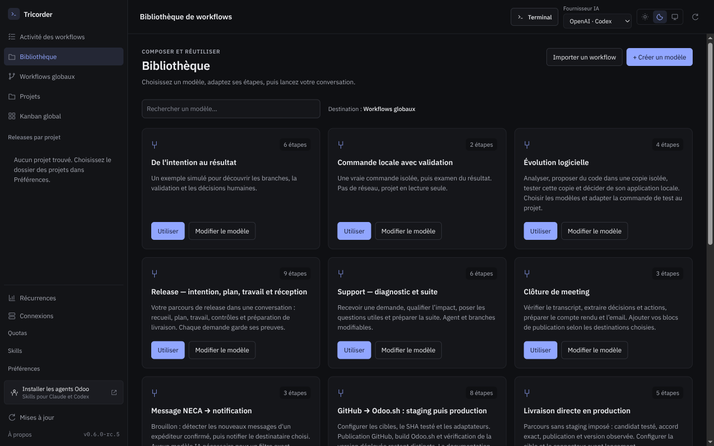

# Tricorder 0.6.0-rc.5 — ergonomie de l’espace de travail

La capture de départ montrait une bibliothèque enfermée dans une demi-colonne,
des actions coupées sur plusieurs lignes et un terminal vide occupant la majorité
de l’écran. Cette passe corrige la répartition de l’espace et unifie les vues.

## Parcours

Dessiner dans un éditeur large, lancer une conversation, travailler dans le
terminal avec le graphe à côté. La bibliothèque et les pages de gestion utilisent
la largeur disponible. **Terminal**, dans l’en-tête, permet de retrouver la session
sans changer de page ; masquer le panneau ne ferme aucun processus. Une ouverture
de conversation réaffiche automatiquement le terminal. Une seule fenêtre.

## Revue des vues

| Vue | Constat | Correction ou contrôle |
| --- | --- | --- |
| Navigation | Projets et releases confondus, sélection ambiguë | Groupe « Releases par projet », sélection propre à la destination, retour à la vue des workflows explicite |
| Bibliothèque | Cartes trop grandes dans une colonne étroite, actions comprimées | Pleine largeur, recherche, cartes alignées, actions groupées et libellés sur une ligne |
| Projets | Présentation de découverte répétée au-dessus des projets | Présentation réservée au premier usage ; actions de création/import accessibles ensuite |
| Workflows globaux et projet | Actions et descriptions se disputaient la largeur | En-têtes adaptatifs, mêmes cartes et espacements que la bibliothèque |
| Activité | Questions imprévues absentes des éléments à examiner | `waiting_input` compté et libellé « Réponse attendue » |
| Éditeur et exécution | Propriétés empilées même sur écran large | Inspecteur latéral, puis inférieur selon la largeur réelle du panneau ; nombre d’entrées/sorties de données déclarées visible sur chaque bloc |
| Historique et documentation | Tables et textes sans cohérence avec l’application | Typographie commune, lignes de lecture et défilement dans leur panneau |
| Connexions et récurrences | Cartes, boutons et messages trop volumineux | Pleine largeur, composants communs, titres et actions adaptatifs |
| Terminal | Panneau imposé même sans session | Visibilité contrôlable ; session et PID conservés pendant la navigation |
| Releases, intentions, plan, mémoire, express, temps | Lecture contrainte par le partage | Terminal masquable ; parcours et contexte conservés ; contrôles des vues existantes |
| Préférences, skills, quotas, recherche, ressources, à propos | Risques de débordement et styles hétérogènes | Contrôle des dialogues et limites de fenêtre, palette commune |
| Chargement | Une panne ressemblait à « aucun projet » | Message persistant, distinction vide/panne, reprise avec Actualiser ; catalogue natif conservé si les workflows échouent |
| Clair/sombre, petite fenêtre | Deux palettes différentes et règles fondées sur la fenêtre entière | Tokens partagés, contraste vérifié, adaptation à la largeur du panneau |

Les libellés fournisseur restent **OpenAI · Codex** et **Anthropic · Claude**.
Le changement visuel ne change ni les contrats du moteur ni les autorisations.
Les scénarios utilisent des projets fictifs ; aucune capture de données client.

## Captures

[Thème clair](captures/library-light.png) · [Fenêtre de 800 px](captures/library-compact.png) ·
[Connexions](captures/connections.png) · [Plan en pleine largeur](captures/plan.png) ·
[Terminal et suivi de release](captures/terminal-workflow.png) ·
[Conversation et graphe](captures/conversation.png) · [Décision](captures/decision.png) ·
[Préférences](captures/preferences.png).

## Validation

187 tests Python et 74 tests JavaScript réussis. La recette source couvre 49
parcours ; huit parcours ont été rejoués après les derniers ajustements de
navigation et de mise en page. Deux scénarios facultatifs sur projets réels
restent désactivés. **49 parcours réussissent également sur l’application
empaquetée**. Le binaire, l’archive applicative et les 39 fichiers Python extraits
du paquet correspondent au candidat testé. Les résultats et empreintes sont
consignés dans [validation.json](validation.json).
Les tests ne remplacent pas la réception utilisateur sur ses propres habitudes.
Le choix d’un agent ou d’un connecteur reste distinct de sa qualification réelle.
