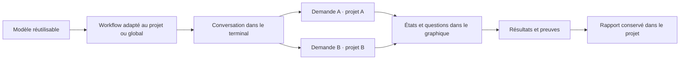
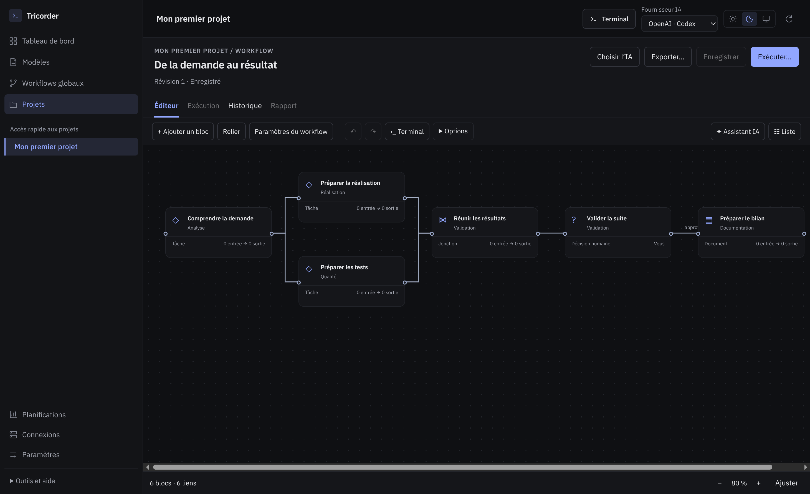

# Tricorder 0.6.0-rc.6 — créer et suivre tout type de travail

Le workflow définit le traitement ; une demande fournit la demande et le contexte.
Les agents apportent une méthode, les outils des capacités, et le projet un lieu
de travail et de conservation. La release est une utilisation possible de ce socle.

## Parcours livré

1. **Créer un workflow** : choisir un modèle, nommer le workflow, choisir un projet
   ou l’espace global, éventuellement saisir la demande initiale.
2. **Créer et ouvrir le workflow** : le dessin est enregistré dans
   `.tricorder/workflows/`. Il reste modifiable avant lancement. Un workflow déjà
   adapté au projet peut aussi servir de point de départ, avec ses profils.
3. **Exécuter → Lancer dans le terminal** : l’demande saisie devient une seule
   tâche. Le terminal natif conserve le dialogue et le graphique suit le moteur.
   D’autres demandes et projets peuvent rejoindre la conversation dans son périmètre.
4. **Rapport → Exporter le rapport dans le projet** : un instantané dans
   `work/<nom>/` regroupe la demande, les résultats, les questions, le workflow,
   les événements et les preuves. L’export ne clôture pas le travail.
5. **Workflows du dépôt** : reprendre une définition versionnée sur un autre
   poste. L’import conserve les octets et la révision d’un fichier déjà versionné ;
   un fichier sans révision est normalisé à la première importation. Aucun accord,
   état d’exécution ou lancement n’est importé.

Le graphique suit les actions enregistrées auprès du moteur par la conversation
ou ses outils. Les commandes libres d’un shell ne sont pas automatiquement
interprétées comme des étapes du workflow.

Les fichiers sont prêts à versionner ; Tricorder ne fait pas de commit ou push
implicite. Les exécutions actives restent dans son stockage local. L’export de bilan
est explicite et n’est pas une réplication en direct de la base d’exécution.

## Revue des usages

L’analyse s’appuie sur des dossiers locaux de support, configuration Studio,
interventions de données, corrections ponctuelles et livraisons. Ces dossiers
ont été lus sans modification. Leurs données ne sont pas publiées : les cas de
réception sont synthétiques et indépendants d’un client.

| Situation observée ou demandée | Comportement attendu | Réponse de cette version |
|---|---|---|
| Diagnostic sans autorisation de réparer | Conserver constat, questions et proposition sans inventer un correctif | Modèle Support ; question durable et suite distincte |
| Demande nommée « express » qui touche aux droits ou aux données | Qualifier les effets réels avant de choisir la méthode | Nouveau modèle Express : éligible, périmètre élargi ou inconnu ; les deux dernières issues bloquent la suite après recadrage |
| Compte rendu et email de suivi | Produire décisions/actions, obtenir relecture et préparer le brouillon | Modèle Meeting et bilan générique ; aucune release obligatoire |
| Analyse ou document ponctuel hors Odoo | Utiliser un workflow sans pack métier | Nouveau modèle Demande ponctuelle et espace global |
| Plusieurs travaux portant le même modèle | Identifier les demandes, pas seulement répéter le nom du modèle | Demande visible dans les listes d’exécutions ; une conversation peut porter plusieurs tâches |
| Même méthode sur plusieurs dépôts | Conserver des adaptations et résultats distincts | Fichiers par projet ; imports et exécutions indépendants |
| Travail coordonné sur plusieurs projets | Dépendances entre tâches, bon projet à la consultation | Périmètre de conversation explicite ; contexte du projet cible restauré ; terminal de conversation retrouvé dans son projet d’origine |
| Nouvelle installation à partir d’un clone | Retrouver le workflow sans reconstruire le dessin | Inspection/import du dépôt ; contrôle du fichier au moment de l’import |
| Question prévue ou imprévue | Attendre une réponse et éventuellement prévenir sur un outil externe | Notification configurée au niveau du workflow, avec exécution et reçu séparés |
| Connexion modifiée pendant un travail | Ne pas réutiliser l’ancien accord sur le nouvel accès | Empreintes de connexion figées pour la conversation et ses demandes |
| Consultation des anciennes releases Odoo | Retrouver les usages existants et le nouveau dessin | Liens entre fiche historique et workflows du même dépôt |

Les graphes restent acycliques. Les corrections après QA rouge sont des demandes
explicites ; cette version n’introduit pas une boucle automatique de développement.
La qualification Express est un contrat soumis à l’agent : les tests déterministes
vérifient le routage des issues, pas la qualité d’un diagnostic de modèle réel.

## Questions et plugins

Dans **Paramètres du workflow → Quand le workflow a une question**, choisir une capacité de
notification vérifiée et un destinataire. Au lancement, autoriser ces notifications
pour cette révision. Le message contient le nom du workflow et la référence de
l’exécution ; le texte de la question reste dans Tricorder. Le titre choisi peut
lui-même contenir une information client : choisir le canal en conséquence.

Une question planifiée comme une question imprévue crée une notification suivie
séparément. Un échec de notification ne perd pas la question et ne répond pas à sa
place. Une réponse distante perdue ne déclenche pas un renvoi aveugle. L’interface
permet de consulter l’envoi puis de revenir au travail.

**Connexions** distingue les inventaires OpenAI et Anthropic. La détection utilise
leurs CLI et ne lit ni leurs secrets ni leur trousseau. Un plugin détecté reste à
connecter : Tricorder sait appeler un serveur MCP stdio ou un adaptateur local
explicitement vérifié. Il ne récupère pas automatiquement une session OAuth de
Codex ou Claude et ne prend pas en charge tous les transports distants des plugins.

Les plugins peuvent combiner instructions et services MCP ; cela ne signifie pas
que leur authentification est portable entre applications. Voir les sources
consultées le 8 octobre 2026 : [architecture des plugins OpenAI](https://developers.openai.com/plugins/concepts/plugins)
et [référence des plugins Claude Code](https://code.claude.com/docs/en/plugins-reference).
Les décisions d’architecture de Tricorder ci-dessus sont propres à cette application.

Un brouillon de texte préparé par le modèle Meeting n’est pas un brouillon créé
chez Gmail ou Outlook. Pour cette écriture distante, configurer l’opération exacte
et son connecteur, puis l’autoriser. Aucun message client, Slack ou email réel
n’a été envoyé pendant la recette.

## Réception

Les tests utilisent des dépôts temporaires, des CLI de substitution pour les
conversations et des serveurs locaux pour les outils. Ils exercent le terminal,
le moteur, les fichiers, la persistance et les transports. Ils ne qualifient ni
un fournisseur IA réel, ni un service Slack/Gmail réel, ni une recette métier Odoo.
Les captures sont issues des parcours synthétiques dans l’application Electron.

- **197 tests Python et 74 tests JavaScript réussis.**
- **55 parcours Electron réussis sur le paquet installable** ; deux scénarios
  facultatifs sur des projets réels sont exclus de cette recette synthétique.
- Construction Ubuntu `.deb` réussie ; somme SHA-256 fournie avec la release.
- Défaut de perte de saisie reproduit puis corrigé ; menu d’options contrôlé avec
  le terminal ouvert. Le PID, l’identité et le texte de la session sont conservés.
- Preuves structurées : [validation.json](.suivi/validation.json).

| Vue | Capture |
|---|---|
| Modèles et navigation simplifiée | [Thème sombre](captures/library-dark.png) |
| Éditeur du workflow | [Sombre](captures/editor-dark.png) · [Clair](captures/editor-light.png) |
| Nouveau workflow de meeting | [Modèle, nom, projet et demande](captures/new-meeting.png) |
| Terminal et graphique | [Conversation](captures/native-conversation.png) · [Côte à côte](captures/terminal-side.png) · [Disposition verticale](captures/terminal-stacked.png) |
| Question et notification | [Suivi de l’envoi](captures/question-notification.png) |
| Rapport de l’exécution | [Export générique](captures/generic-work-bilan.png) |

## Points à poursuivre après cette livraison

| Axe | Critère pour une prochaine évolution |
|---|---|
| Réponse graphique et reprise du modèle natif | Une réponse enregistrée doit pouvoir réveiller le bon agent sans injecter du texte dans un shell quelconque ; aujourd’hui poursuivre dans son terminal reste explicite. |
| Connexion de plugins distants | Assistant de connexion par transport et fournisseur, avec contrôle du compte réellement utilisé ; la détection CLI ne suffit pas. |
| Écriture d’un brouillon de messagerie | Mapping des résultats vers le contenu exact d’une opération puis reçu du fournisseur ; ne pas confondre texte préparé et objet Gmail/Outlook créé. |
| Comparaison des modèles du pack | Diff lisible avant adoption dans un projet adapté ; aucune mise à jour silencieuse des workflows existants. |
| Corrections et nouvelle QA | Reprise bornée conservant ancien résultat, nouveau candidat et nouveaux contrôles ; jamais réutiliser une preuve devenue périmée. |
| Journaux volumineux | Paginer l’export au-delà de 1 000 événements ; l’état complet et les preuves sont exportés, le fichier events.json utilise actuellement la première page du journal. |
| Qualité des agents en situation | Essais autorisés sur mêmes intentions et critères, fournisseur/modèle/effort déclarés, incidents d’outil séparés des erreurs de raisonnement. |

Ces axes ne sont pas présentés comme livrés. Les anciennes releases et les profils
Odoo Crew ne sont pas réécrits par cette version.

## Revue de l’expérience : concevoir, configurer, exécuter, suivre

Le point d’entrée est une méthode réutilisable, pas une release imposée. Le modèle
est une base de conception ; le workflow est sa définition enregistrée ; une
exécution en conserve une version et traite une demande. Une conversation peut
piloter plusieurs demandes. Un projet désigne leur dépôt, pas le type de travail.

| Moment du parcours | Problème constaté | Changement et vérification attendue |
|---|---|---|
| Choisir où commencer | Bibliothèque, activité et outils techniques au même niveau | Quatre destinations principales ; modèles et workflows globaux nommés explicitement ; outils secondaires regroupés |
| Créer | « Nouveau travail » ne disait pas si une exécution démarrait | « Créer un workflow », choix du modèle, nom et destination ; ouverture de l’éditeur avant lancement |
| Configurer | Trop d’actions visibles ; vocabulaire différent entre blocs et validation | Ajouter un bloc, Relier, Paramètres ; options secondaires regroupées ; entrées/sorties, critères et validation explicites |
| Conserver la saisie | Un titre saisi était perdu après l’ajout d’une sortie sans « Appliquer » | Défaut reproduit dans Electron ; les champs sont appliqués au brouillon avant une action, le changement de bloc ou la navigation ; Ctrl+S fonctionne depuis un champ |
| Dessiner | Un terminal vide ou une session existante réduisait l’éditeur | Retour à l’éditeur en pleine largeur ; terminal toujours récupérable avec le bouton global |
| Exécuter | Le terminal et le graphe avaient des largeurs imposées | Partage ajustable de 30 à 70 %, souris ou flèches clavier ; disposition côte à côte ou verticale ; terminal agrandissable |
| Répondre | Une question affichait « En cours » et zéro décision attendue | Statuts distincts : réponse attendue, décision attendue, résultat à valider ; compteur des blocs nécessitant une intervention |
| Vérifier les résultats | Rapport affiché sous des commandes d’édition et la révision courante | Rapport attaché à la définition exécutée, avec statut et date de cette exécution |
| Changer de vue | Risque de perdre la session ou de retrouver le terminal d’un autre projet | Identité et PID de session contrôlés dans les tests ; une seule fenêtre ; contexte de la conversation retrouvé |

La barre latérale distingue navigation principale, accès rapide aux projets et
configuration. « Outils et aide » contient le Kanban historique des releases,
les commandes des agents, les quotas et la maintenance. Les paramètres restent
accessibles directement. Les tests de présentation couvrent thèmes clair/sombre,
largeurs 800, 1024 et 1440 px, débordements et contrôles d’accessibilité automatisés.

Vocabulaire retenu : **modèle**, **workflow**, **bloc**, **entrée/sortie**,
**condition**, **exécution**, **validation**, **rapport**, **planification**,
**connexion**, **projet** et **terminal**. Les identifiants techniques des fichiers
et protocoles restent compatibles ; les définitions déjà enregistrées dans les
projets ne sont pas renommées silencieusement.

### Ce que l’étude de n8n apporte ici

n8n distingue les blocs qui déclenchent un workflow, ceux qui traitent des données
et ceux qui agissent sur un service ; leurs opérations et paramètres sont
configurables. Il distingue également la définition du workflow de ses exécutions,
consultables globalement ou pour un workflow précis. Sources consultées :
[blocs et opérations](https://docs.n8n.io/build/understand-workflows/workflow-components/work-with-nodes.md)
et [exécutions](https://docs.n8n.io/build/understand-workflows/understand-executions.md).

Notre choix de conception est d’appliquer cette séparation tout en faisant du
terminal l’interface de dialogue : les blocs décrivent le traitement et les données,
les agents exécutent une méthode interchangeable, les outils portent les opérations,
et le suivi graphique montre ce qui a réellement été exécuté. La conversation
n’est donc ni un second éditeur ni une seconde application. Les corrections de
navigation, de configuration et de disposition sont évaluées sur cette continuité.
