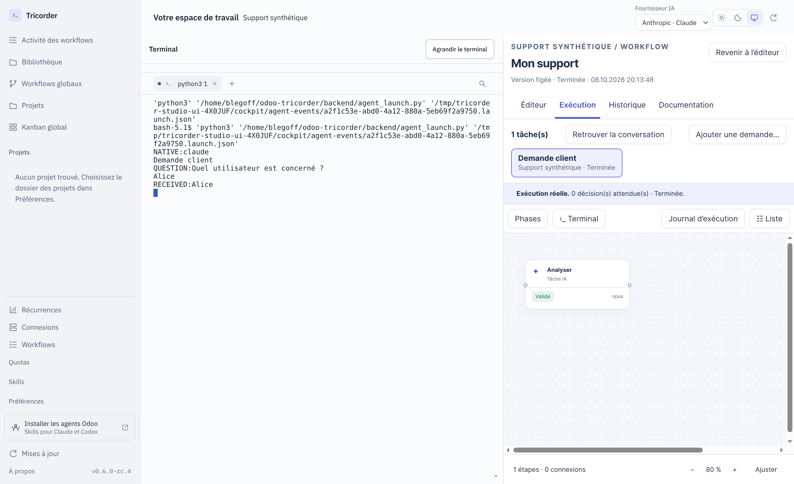
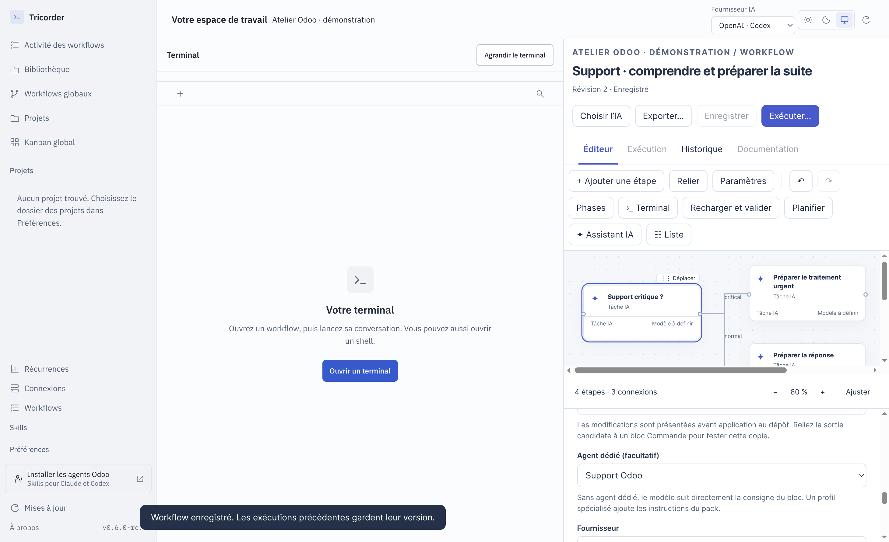

# Tricorder 0.6.0-rc.4 — terminal, workflows et revue de fonctionnement

Le terminal redevient le lieu du dialogue ; le dessin explique le travail,
les entrées/sorties et les décisions dans la même fenêtre. Cette préversion
publie le travail de simplification ainsi que les corrections de la revue du
8 octobre 2026. Elle ne qualifie pas une livraison Odoo réelle.

## Périmètre et méthode

Référence Git avant publication : `1cd692e`. Référence exécutable pour la
contre-épreuve : paquet local 0.6.0-rc.3. Revue des parcours desktop, du pont
terminal, des contrats, de l’ordonnanceur, des preuves, des packs, des modèles,
des exports, de la CI et des tests. Les cas de release, support et express sont
ramenés à des situations synthétiques ; aucun ticket client n’est publié.

Une revue du code et des tests ne constitue ni une étude utilisateur ni une
campagne comparative des agents. Les captures montrent les vrais écrans sur
projets fictifs ; la capture de conversation utilise une CLI simulée. Aucun
appel payant, déploiement client ou envoi de message dans cette recette.

## Ce qui est livré

- Une fenêtre et un renderer, terminal persistant pendant la navigation et
  adoption des anciens terminaux sans rouvrir leur shell.
- Fournisseur OpenAI/Codex ou Anthropic/Claude visible ; lancement depuis la
  fiche du workflow, questions persistantes, plusieurs tâches et projets.
- Blocs configurables par mission, ports typés, critères et issues. Le profil
  apporte la méthode sans décider de la topologie ou des autorisations.
- Une branche non résolue peut terminer son graphe tout en bloquant les tâches
  dépendantes. Le bandeau l’indique ; le refus humain reste bloquant.
- Après une précision support, nouvel aiguillage critique/normal/inconnu ;
  un second constat inconnu conserve explicitement le blocage.
- Une clé de tâche ne peut plus être réutilisée avec d’autres dépendances.
- Contrôle des paramètres réellement transmis au lancement ; série et plateforme
  du projet cible reprises dans les conversations Odoo. Un développeur de module
  ne peut pas être lancé pour une cible Online en la renommant simplement « Studio ».
- Documentation exportable pendant une question, avec question et réponse ;
  limite des preuves alignée à 2 Mo. La CI archive le bon dossier d’installateurs.

## Revue des modèles de workflow

| Modèle | Contrat et comportement constatés | Décision de revue |
|---|---|---|
| Release conversationnelle | Intention → plan → accord → réalisation → QA → proposition → réception ; chaque tâche porte sa demande | Conserver ce parcours lisible. La branche QA rouge termine avec suite bloquée ; la correction se fait dans une nouvelle tâche, pas une boucle implicite. |
| Support | Criticité distincte du risque ; constat et suite alimentent urgent/normal ; précision puis réévaluation | Aiguillage après précision corrigé. La branche urgente prépare un traitement, elle ne déploie pas automatiquement. |
| Express | Parcours historique Crew avec qualification locale, QA ciblée et reprise bornée | Pas de modèle graphique express équivalent livré. Le critère d’éligibilité doit devenir un bloc réutilisable avant d’en créer un. |
| Livraison directe en production | Décision liée à l’action, cible et candidat exacts ; staging non imposé | Conserver la porte exacte. La criticité n’est pas une permission ; vérifier réellement SHA, build et cible avant de déclarer livré. |
| Meeting | Transcript → minutes/actions → relecture → brouillon d’email | Utile comme préparation. Configurer destinataires, connecteurs et autorisations pour publication/envoi. |
| Modification logicielle isolée | Candidat séparé → contrôle → diff → application autorisée | Conserver. Distinguer tests du candidat et état du dépôt après application. |
| Multi-projets | Définition figée, une exécution par tâche, dépendances entre tâches | Conserver l’indépendance des tâches. Un même modèle n’est pas forcément compatible avec des plateformes différentes. |
| Modèles historiques Odoo du catalogue | Brouillons et sous-workflows plus anciens | Ne pas les présenter comme équivalents au parcours conversationnel ; simplifier le catalogue lors de la prochaine passe. |

Les graphes Tricorder restent acycliques. Les workflows CLI Crew possèdent leurs
propres reprises bornées : ce sont deux contrats d’exécution distincts, même
quand ils décrivent une intention métier similaire. Le moteur Tricorder reste
seul écrivain de ses états ; le pack importé ne lance pas un second flow CLI.

## Axes d’amélioration et critères de réception

Priorités : P0 = résultat erroné ou périmètre incompatible ; P1 = parcours courant
ou fiabilité ; P2 = confort, maintenabilité ou évaluation. « À faire » n’est pas
une fonctionnalité livrée.

| Priorité / état | Observation sourcée | Prochaine amélioration et critère |
|---|---|---|
| P0 corrigé | `engine.py`, `conversations.py` : fin du graphe confondue avec suite recevable | Non résolu et refus ne libèrent pas l’aval ; contrôle positif sur branche reçue. |
| P0 corrigé | `engine.py:start`, `packs.py` : précontrôle avant fusion des paramètres | Précontrôle du contexte effectif, y compris plateforme du projet cible. |
| P1 corrigé | `work_templates.py` : réévaluation support sans nouvel aiguillage | Les trois issues après précision sont testées. |
| P1 corrigé | `conversations.py:add` : clé identique et dépendances différentes | Refus explicite, sans création ni altération de tâche. |
| P1 corrigé | `documentation.py` : état `waiting_input` absent des libellés | Export possible en attente puis après réponse ; texte conservé. |
| P1 à faire | `app.js`, `studio.js` : projet historique et fiche projet graphique ont deux accès | Un seul point d’entrée projet avec release, workflows et conversations ; test de navigation sans explication orale. |
| P1 à faire | `setup.py` : choix initial Studio/module par contenu du dépôt | Décision par demande : standard, Studio ou module, contexte de la cible explicite. Un dépôt mixte ne doit pas imposer le développeur. |
| P1 à faire | `work_templates.py` : QA rouge sans correction/retest intégrés | Sous-parcours de correction bornée avec candidat frais, tests réellement rejoués et résultat reçu. |
| P1 à faire | `setup.py` : modèles existants volontairement préservés | Proposer une comparaison ancienne/nouvelle version et import explicite, sans perdre une adaptation. |
| P1 à faire | `engine.py:execution_context` : copie déclarée par nom | Attestation de restauration/neutralisation liée à la copie et au candidat ; distinguer déclaration et preuve vérifiée. |
| P1 à faire | `providers.py`, dialogue de lancement : la CLI native peut utiliser son défaut, le bloc isolé exige un modèle explicite | Afficher ce prérequis avant la conversation pour chaque bloc délégué ; aujourd’hui choisir le modèle via « Choisir l’IA » avant lancement. |
| P1 à faire | `runtime.py`, profils Odoo : capacités isolées variables | Parcours natif de développement Odoo sur une fixture, sources de la bonne série, installation/update et QA ; preuves d’outils indépendantes du texte généré. |
| P1 à faire | `library.py` : vérification après livraison décrite par bloc documentaire | Connecteur de lecture retournant SHA/build/cible réellement observés ; publication partielle et réponse perdue testées. |
| P1 à faire | `conversations.py` : dépendant suspendu si amont bloqué | Montrer directement le prédécesseur et sa cause, puis proposer une tâche de remplacement sans modifier les preuves anciennes. |
| P2 à faire | `studio.js` : formulaires longs malgré sections repliées | Résumé mission/I/O/suite toujours lisible ; panneau propriétés facultatif, clavier et petits écrans. |
| P2 à faire | Graphes larges, état/polling répartis entre deux vues | Navigation par phases et recherche de bloc ; mesure sur graphes volumineux, sans perte du focus terminal. |
| P2 à faire | Connexions et choix de fournisseur séparés | Montrer « installé », « configuré », « testé » distinctement ; changer le fournisseur ne doit pas prétendre authentifier. |
| P2 à faire | Conservation de versions, preuves et jobs isolés | Politique de rétention/export et restauration vérifiée ; aucune suppression automatique des preuves référencées. |
| P2 à faire | Adaptateurs locaux de confiance et terminal natif | Documenter les frontières : le terminal dispose des droits de l’utilisateur ; les portes applicatives ne sont pas un confinement OS de l’agent natif. |
| P2 à faire | Profils natifs et profils importés séparés | Comparer leurs invariants métier sur mêmes dossiers, sans copier l’orchestration CLI dans Tricorder. |
| P2 à faire | Couverture déterministe, pas mesure de compréhension | Essais utilisateurs : dessiner un aiguillage, retrouver une question, reprendre une tâche, expliquer l’issue et choisir un fournisseur. |

## Modèles d’IA et agents

Aucun changement automatique de modèle, fournisseur ou effort. Le workflow fixe
les entrées, résultats et branches ; un profil peut influencer l’analyse et la
méthode. Cela ne garantit pas une performance identique entre modèles. La prochaine
évaluation doit comparer fidélité aux I/O, questions utiles, diagnostic, code et
preuves sur les mêmes cas et réglages, avec incidents fournisseur séparés.

Le [bilan Odoo Crew](https://github.com/le-goff-benoit/odoo-crew/blob/main/release/2026-10-08/README.md)
détaille les invariants et les priorités propres aux agents.

## Recette et livraison

Les résultats finaux sont consignés dans [la preuve de recette](validation.json).
Commandes : `npm test`, `npm run test:ui`, `npm run dist`,
`npm run test:packaged`, `npm run checksum`. Les scénarios sur vrais projets sont
exclus ; les captures publiées viennent des fixtures de recette.

Le paquet `.deb` et `SHA256SUMS` sont joints à la release GitHub. Il s’agit d’une
préversion : l’actualiseur stable ne la propose pas automatiquement. Les modèles
existants et les exécutions figées ne sont pas réécrits lors de l’installation.
La nouvelle sémantique de fin bloquée s’applique aux modèles qui la déclarent ;
les anciens brouillons doivent être comparés et adaptés explicitement.
