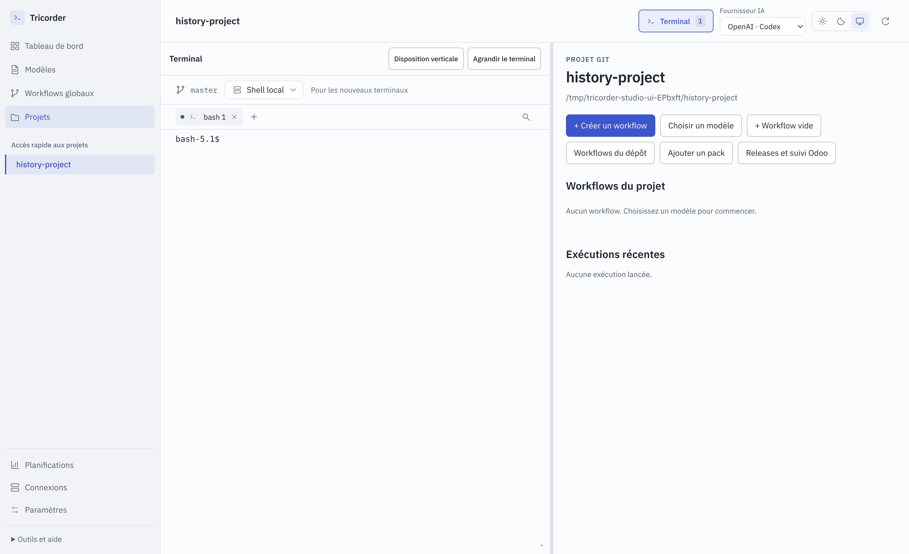

# 0.6.0-rc.7 — Chargement des projets et crash EPIPE

Avec un historique de projets important, le démarrage de la rc.6 affichait
« Chargement incomplet : Unterminated string… » et pouvait ouvrir une boîte
d’erreur JavaScript « write EPIPE ». Ce sont des défauts du transport local,
pas des limites fonctionnelles des workflows.

## Cause et correction

Le catalogue complet était transmis au moteur pour enregistrer les projets,
y compris les releases, demandes et résultats. La lecture Python s’arrêtait à
4 000 000 de caractères sans vérifier que le JSON était complet. La fermeture
du processus pouvait ensuite interrompre l’écriture Electron sur stdin ; son
erreur n’avait pas de gestionnaire.

Une mesure en lecture seule du poste concerné a trouvé 19 projets :
4 425 628 caractères transmis contre 1 669 nécessaires à leur enregistrement.
Les données client ne sont pas incluses dans ce rapport.

- Seuls le chemin, le nom et la série sont transmis pour enregistrer les projets.
  L’historique complet reste disponible dans les vues qui l’utilisent.
- Electron vérifie la taille en octets UTF-8 avant de lancer le processus.
- Python vérifie le dépassement avant de décoder ; aucun JSON partiel n’est traité.
- Une fermeture de stdin, un arrêt du moteur ou un délai dépassé renvoie une
  erreur à l’action en cours, sans exception EPIPE non gérée dans Electron.
- Le message de rejet structuré du moteur est conservé lorsqu’il est disponible.

La borne de transport est de 4 Mio par requête ; le catalogue n’est plus soumis
à cette borne lors de l’enregistrement des projets, car son historique reste
hors de la requête. Une demande réellement trop grande est refusée explicitement.

## Régression et validation

La version précédente a été reproduite sur un état temporaire : un même appel
provoque un JSON tronqué et EPIPE. Deux tests Python étaient rouges avant correction.

Les nouveaux contrôles couvrent la limite exacte, son dépassement, Unicode,
la transmission minimale du catalogue, la fermeture anticipée avec ou sans
réponse structurée, le délai dépassé et une sortie mal formée. Un parcours
Electron utilise un historique synthétique de plus de quatre millions de
caractères et vérifie le démarrage, Actualiser, l’accès au projet et le terminal.

Capture du scénario de régression, sans données client.

Les résultats de la recette et l’empreinte du paquet sont consignés dans
[validation.json](.suivi/validation.json).

Résultats : **199 tests Python, 81 JavaScript, 56 parcours d’interface et
5 parcours ciblés sur le paquet final réussis**. Deux scénarios facultatifs
sur projets réels sont exclus de la recette. La capture vient du paquet final.

Ces essais utilisent des projets temporaires. Aucun workflow client, appel de
modèle, envoi Slack, email ou opération Odoo n’est exécuté pour cette correction.
Les limites fonctionnelles de la [rc.6](../2026-10-08_parcours/README.md) restent
documentées séparément ; ce correctif porte sur les deux erreurs de démarrage.
