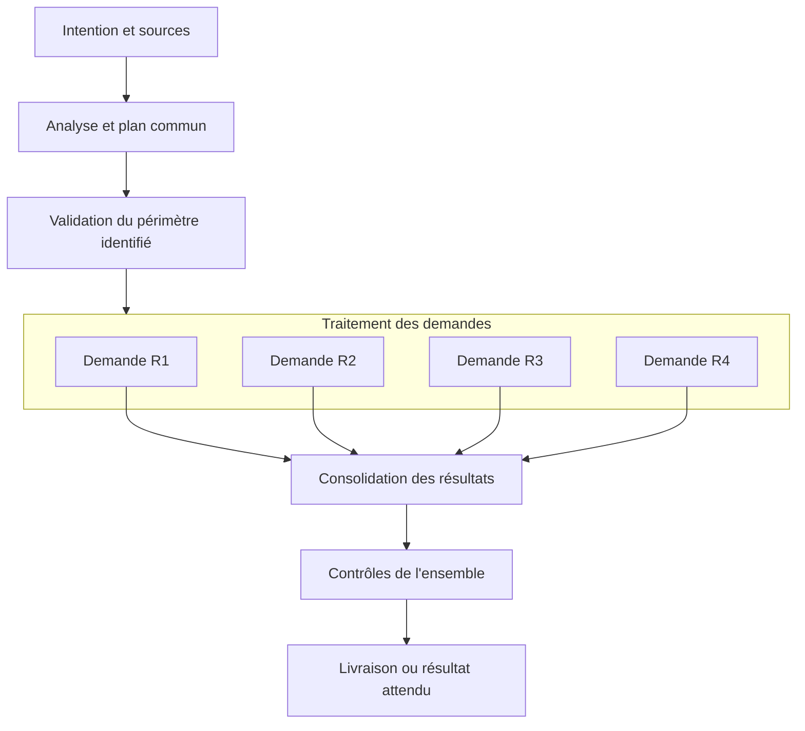

# Analyse fonctionnelle et ergonomique — Tricorder, 9 octobre 2026

Le problème principal est dans le modèle d’exécution. L’interface expose des
objets techniques que le moteur ne relie pas encore comme l’utilisateur les
comprend. La vue d’ensemble, le lancement parallèle et l’historique lisible
corrigent des défauts réels ; ils ne constituent pas la refonte complète du
parcours de travail.

Cette passe confronte le code du moteur, les modèles, les connecteurs, le pont
terminal et les écrans au parcours demandé : dessiner un workflow, lui confier
une intention dans le terminal, traiter une ou plusieurs demandes, comprendre
son activité et intervenir lorsque nécessaire. Les sources privées ont été
consultées en lecture seule. Les reproductions utilisent des projets inventés.
Les modules historiques d’observation Odoo ne sont pas tous réaudités ligne par
ligne ; le présent verdict porte sur la nouvelle conception et son exécution.

## 1. Ce que le cas de la release démontre

La collecte de l’email, les quatre demandes et la consolidation sont enregistrées
comme six exécutions du même workflow complet. Le code ne connaît pas de relation
« ces demandes sont traitées dans ce bloc de ce travail parent ».

`Conversations.open(initial_request=...)` appelle déjà `add` pour le texte saisi
au lancement. `add` copie ensuite la définition complète pour chaque demande.
Une consigne ajoutée au prompt pour éviter une collecte supplémentaire ne corrige
donc pas le cas où cette collecte est la demande initiale du formulaire.

Cela explique trois comportements :

- la collecte documentaire aboutit à un bloc de code exigeant des modifications ;
- accepter son plan ne valide pas les quatre plans des autres exécutions ;
- la consolidation reçoit à nouveau les étapes de développement et de livraison.

Le contrôle du candidat et les validations indépendantes font leur travail.
Modifier ces contrôles pour transformer le premier échec en succès cacherait
le mauvais découpage. Il faut changer le contrat du workflow, puis prévoir la
requalification explicite des anciennes exécutions en conservant leur histoire.

Sources : [conversations.py](../../backend/workflow_engine/conversations.py),
[modèles](../../backend/workflow_engine/work_templates.py),
[configuration Odoo](../../backend/workflow_engine/setup.py).
Reproduction : `test_collection_requests_and_consolidation_all_receive_same_full_release_graph`
dans [les contre-épreuves indépendantes](../../tests/test_rc12_independent_review.py).

## 2. Les écarts prioritaires

| Priorité | Écart constaté | Conséquence pour l’utilisateur | Correction de conception et critère de réception |
|---|---|---|---|
| P1 | Aucun travail parent avec demandes rattachées à un bloc. Chaque item recopie tout le workflow. | Collecte, correction et consolidation sont traitées de la même façon ; répétitions et graphe incompréhensible. | Un bloc traite une collection explicite de demandes, avec workflow enfant versionné, projet, entrées, critères et relation au parent. Une nouvelle demande apparaît dans ce bloc et son résultat remonte au parent. |
| P1 | Aucune consolidation de candidats de code parallèles. | Quatre corrections terminées ne constituent pas une release intégrée ; appliquer la première invalide potentiellement la base des autres. | Produire un candidat commun depuis une base identifiée, rendre les conflits visibles, tester l’ensemble et relier la livraison à ce candidat exact. Un test doit réunir deux changements disjoints et refuser un conflit réel. |
| P1 | Le choix du modèle change implicitement le mode d’exécution et ses outils. | Un bloc de QA utilisable dans le terminal peut perdre son accès aux commandes après un simple changement de modèle. | Séparer mission, rôle, fournisseur/modèle et exécuteur. Montrer et vérifier les capacités effectives avant activation. Changer de modèle conserve le contrat ou explique précisément l’incompatibilité. |
| P1 | Validation commune et validations des demandes sans relation formelle. | « Le plan est validé » dans le terminal peut coexister avec quatre décisions encore attendues. | Une décision commune doit référencer explicitement les demandes et leurs versions couvertes. Une modification ultérieure invalide seulement la portée concernée. Ne jamais déduire cette portée d’un texte de conversation. |
| P2 | Le lancement parallèle est une vague explicite, sans planification durable de la suite. | La reprise après un résultat ou une décision dépend d’un nouvel appel de l’agent ; ouvrir le suivi ne suffit pas. | Pour le mode autonome voulu, enregistrer une autorisation de poursuivre un périmètre et un budget définis. Le moteur reprend les demandes admissibles jusqu’à une vraie attente. Arrêt, reprise et redémarrage doivent être testés. |
| P2 | Sources principalement transmises comme texte, chemins ou résultats entiers. | Un agent sans outils ne peut pas lire un email uniquement référencé par chemin ; un lot de résultats peut dépasser le contexte admis. | Contrats de sources explicites : contenu utile, références lisibles, pièces et provenance. Lire les gros résultats à la demande. Un agent doit demander une source manquante, pas inventer sa lecture. |
| P2 | Dépannage orienté tentatives techniques. Une panne de préparation consomme aussi une tentative. | Une collecte mal classée ou un problème de copie peut conduire à « deux tentatives utilisées » sans chemin de reprise adapté. | Distinguer préparation, exécution, résultat non conforme et effet externe incertain. Proposer reconfigurer, reprendre, requalifier ou remplacer selon la cause ; conserver les preuves et les décisions applicables. |
| P2 | Modèles essentiellement textuels, avec capacités parfois plus faibles que leur intitulé. | « Corriger », « publier » ou « consolider » peut ne produire qu’une proposition, ou exiger une intervention native non évidente. | Chaque modèle annonce son résultat concret : diagnostic, fichier, candidat, preuve ou opération publiée. Vérifier son parcours entier avec ses entrées et ses effets attendus. |
| P2 | Sources de suivi fragmentées : terminal, conversation, exécution, candidat, dossier du dépôt, ancien suivi Odoo. | L’utilisateur doit recouper plusieurs endroits pour savoir ce qui est fait et ce qui reste à décider. | Un suivi principal par travail, relié au dépôt et aux preuves. Les vues détaillent le même état ; le terminal ne constitue pas un second registre de statuts. |
| P2 | Petit écran et zoom : des en-têtes consomment la surface utile. | Terminal réduit à quelques lignes ou réponse sous le bas du panneau. | Mesurer la surface réellement interactive, pas seulement la visibilité du composant. Préserver un terminal utilisable et un accès immédiat à la question/action, au clavier et au zoom 125 %. |

Les P1 décrivent ici un blocage du parcours demandé, pas nécessairement une
vulnérabilité. Les deux reviews indépendantes détaillent preuves, nuances et
limites : [réception](.suivi/review-independante.md) et
[architecture](.suivi/analyse-architecture-independante.md).

## 3. Organisation cible, sans seconde application

Conserver une seule fenêtre, un seul moteur de transitions et un terminal
principal. Quatre niveaux doivent avoir un sens stable :

| Objet | Ce qu’il représente | Ce que l’utilisateur voit |
|---|---|---|
| Workflow | La définition réutilisable des étapes, contrats, branches et décisions. | Le dessin et sa configuration. |
| Exécution du travail | L’intention confiée au workflow, son contexte et son périmètre de projets. | Le graphe en cours, son activité et les interventions attendues. |
| Demande | Un élément produit ou ajouté dans un bloc du travail, avec ses critères et son traitement. | Une ligne ou un sous-graphe dans ce bloc ; son responsable, son état et son résultat. |
| Tentative | Une exécution technique d’un bloc par un agent, une commande ou un connecteur. | L’état courant ; l’historique et les traces à la demande. |

La conversation devient l’interface de dialogue de l’exécution du travail. Elle
ne doit pas obliger l’utilisateur à apprendre une hiérarchie supplémentaire.
Un agent est un exécutant d’une mission ; il ne définit ni l’identité du bloc,
ni ses dépendances, ni sa réussite.

Exemple de structure pour une release, à adapter à d’autres métiers :

Ce dessin décrit le contrat à construire. Il ne prétend pas représenter une
fonction déjà disponible. Les liens entre demandes ne doivent être ajoutés que
lorsqu’une vraie dépendance existe. Un échec local doit laisser les demandes
indépendantes continuer et expliquer son effet sur la consolidation.

## 4. Application aux autres workflows

- **Support** : recevoir les sources, diagnostiquer, router selon des faits,
  demander une précision si nécessaire, puis produire une réponse ou ouvrir des
  corrections liées au diagnostic. L’urgence choisit un parcours ; elle ne vaut
  pas preuve de correctif ni autorisation d’une opération précise.
- **Express** : qualifier un défaut, réaliser le périmètre admissible et recevoir
  ses tests ciblés. Une sortie du périmètre conserve les sources et ouvre un
  traitement adapté, sans repartir de zéro ni multiplier les validations.
- **Clôture de réunion** : vérifier le transcript, produire le compte rendu et
  les actions, traiter ces actions si demandé, préparer ou publier selon les
  blocs réellement configurés. Un brouillon d’email et un email envoyé sont
  deux résultats différents et vérifiables.
- **Cross-projet** : un même modèle peut être réutilisé séparément ; un travail
  commun peut aussi contenir des demandes de projets différents. Le projet,
  les sources et le candidat restent attachés à chaque demande. La consolidation
  ne mélange pas les dépôts ni les autorisations.

## 5. Le pack Odoo et l’indépendance des agents

Le pack de référence 0.3.1, commit `75612ee195f08b5a764e5aac303d453741666457`,
contient déjà un contrat adapté à Tricorder dans `roles/tricorder.md` : le bloc
porte les entrées/sorties et le moteur porte les transitions ; le profil ajoute
sa méthode. Il interdit un second flow historique et distingue les preuves de
test, la validation humaine et la livraison. Ce socle doit être conservé.

Les problèmes trouvés ne justifient donc pas d’empiler davantage de consignes
sur les agents. Les corrections utiles du pack doivent accompagner le nouveau
contrat d’exécution :

- déclarer les sources et capacités nécessaires à chaque mission, sans supposer
  que le nom `odoo-tester` apporte un shell ou une base locale ;
- produire des demandes et constats structurés, identifiés et reliés à leurs
  sources, plutôt qu’un plan uniquement rédigé en prose ;
- choisir module, Studio ou analyse pour chaque demande à partir de son besoin
  et de sa plateforme ; la présence de modules dans un dépôt ne suffit pas à
  décider pour tous les futurs besoins de ce projet ;
- réserver au workflow parent le plan commun, l’intégration, la QA d’ensemble et
  le bilan ; garder des missions locales et vérifiables pour les agents ;
- conserver explicitement le dossier humain déjà choisi par le projet, y compris
  ses anciennes releases, sans créer un second ensemble documentaire.

Un profil doit rester remplaçable par un autre profil ou par un généraliste. Le
moteur reçoit le même contrat de sortie. Cette indépendance nécessite toutefois
un exécuteur disposant des outils requis ; le nom du rôle et le choix du modèle
ne peuvent pas suffire à le garantir. Aucun changement du pack n’a été publié
pendant cette passe d’analyse.

## 6. UI/UX autour de ce fonctionnement

Le terminal demeure la zone de dialogue. À côté, le suivi doit répondre à quatre
questions sans lecture de logs : que faisons-nous, qui travaille, qu’est-ce qui
attend une intervention et quelle est la prochaine action utile ?

Le niveau initial est le graphe du travail parent. Le bloc actif montre quelques
informations : demandes terminées/en cours/en attente, agents observés et cause
principale d’un blocage. L’utilisateur développe ce bloc pour voir R1–R4 ; il
ouvre une demande pour son résultat ou sa décision. Les traces techniques et les
tentatives précédentes restent un troisième niveau de lecture, formaté.

La vue d’ensemble de rc12 est une amélioration transitoire de la représentation
existante. Elle n’invente aucun lien parent/enfant absent des données. Il reste
à relier cette vue au bloc de traitement lorsque ce contrat existera réellement.

Une action proposée doit correspondre à la cause : **Répondre**, **Valider le
plan**, **Reprendre**, **Configurer l’accès**, **Résoudre le conflit**. Éviter
une succession de libellés vagues conduisant tous au terminal, ou une apparence
d’activité parce qu’un terminal est simplement ouvert.

## 7. Pourquoi les tests précédents ne suffisaient pas

Ils vérifiaient de nombreux mécanismes séparément : ports, statuts, décision,
reprise, affichage, copie isolée et conservation du terminal. Les scénarios
préparaient souvent les états attendus avec des agents déterministes. Cela
prouve le mécanisme exercé, pas la pertinence du découpage d’une demande réelle.

Le parcours manquant était : une intention ambiguë saisie au lancement → un
email conservé → plusieurs besoins de natures différentes → une validation
commune → des traitements simultanés → une vraie consolidation → la QA de
l’ensemble → un résultat final compréhensible. Le test doit suivre les API
publiques jusqu’au résultat métier, sans fabriquer le bon graphe intermédiaire.

| Scénario de réception nécessaire | Résultat à prouver |
|---|---|
| Même intention depuis le formulaire ou directement au terminal | Même découpage ; aucune demande de code supplémentaire pour la collecte. |
| Une question sur R1, R2 en cours, R3 prêt, R4 en échec | États distincts et actions accessibles ; R2/R3 ne s’arrêtent pas inutilement. |
| Plan commun accepté puis périmètre de R3 changé | Portée des accords explicite ; aucune validation générale inventée. |
| Deux correctifs disjoints puis deux correctifs incompatibles | Intégration et QA communes dans le premier cas ; conflit expliquable dans le second. |
| Même rôle, autre fournisseur ou modèle | Capacités conservées ou incompatibilité annoncée avant consommation. |
| Gros email/pièces/plans et historique chargé | Sources consultables, compte rendu lisible, aucun JSON tronqué ni contexte silencieusement perdu. |
| Agent interrompu, application relancée | Même travail et mêmes preuves ; aucun double lancement ni effet répété. |
| Support, réunion sans projet et travail cross-projet | Parcours adaptés au résultat attendu, sans vocabulaire ou étapes imposés par la release. |
| Fenêtre 1024×768, zoom 125 %, terminal ouvert | Saisie et action utilisables ; focus et session conservés lors du suivi. |

Les tests déterministes restent nécessaires. La qualification d’un véritable
exécuteur doit aussi prouver sa capacité à lire les sources, utiliser ses outils
et remettre le résultat attendu. La présence d’un CLI, un rôle configuré ou un
mock qui écrit un fichier ne constituent pas cette preuve.

## 8. Ordre de correction recommandé

1. **Définir le contrat parent/demandes/consolidation et ses invariants.** C’est
   le point qui détermine les modèles, le lancement et le graphe de suivi.
2. **Rendre explicite l’exécuteur et ses capacités.** Conserver des rôles et
   fournisseurs substituables dans la limite des outils réellement disponibles.
3. **Construire le parcours complet générique avec des données synthétiques.**
   Recueillir, décomposer, traiter, demander, reprendre et consolider. Le tester
   avant d’ajouter les règles Odoo.
4. **Ajouter l’intégration des candidats et les preuves d’ensemble.** Tester les
   changements simultanés avant de revendiquer la release de bout en bout.
5. **Adapter les modèles et la migration des exécutions existantes.** Prévisualiser
   ce qui est requalifié, les résultats réutilisés et les validations à reprendre.
6. **Rattacher le suivi visuel à cette structure.** Conserver les corrections
   utiles de rc12, puis recevoir les parcours sur la fenêtre réellement utilisée.

Les améliorations locales de cette branche restent vérifiables séparément :
vue multi-demandes, dispatch explicite, historique lisible, pagination des gros
historiques et explications d’attente. Leur validation ne ferme pas les écarts
structurels ci-dessus. Aucun état client n’a été réécrit pour produire une
apparence de réussite.
