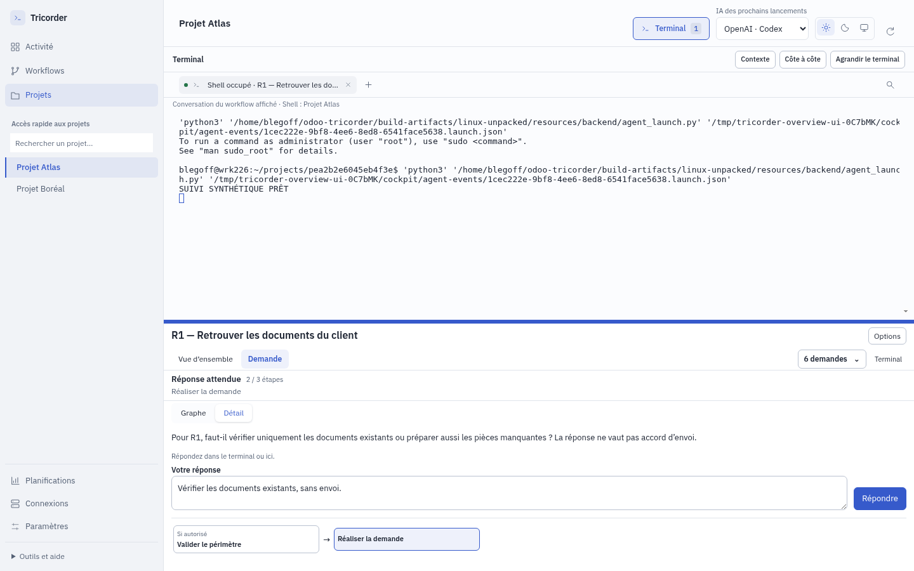
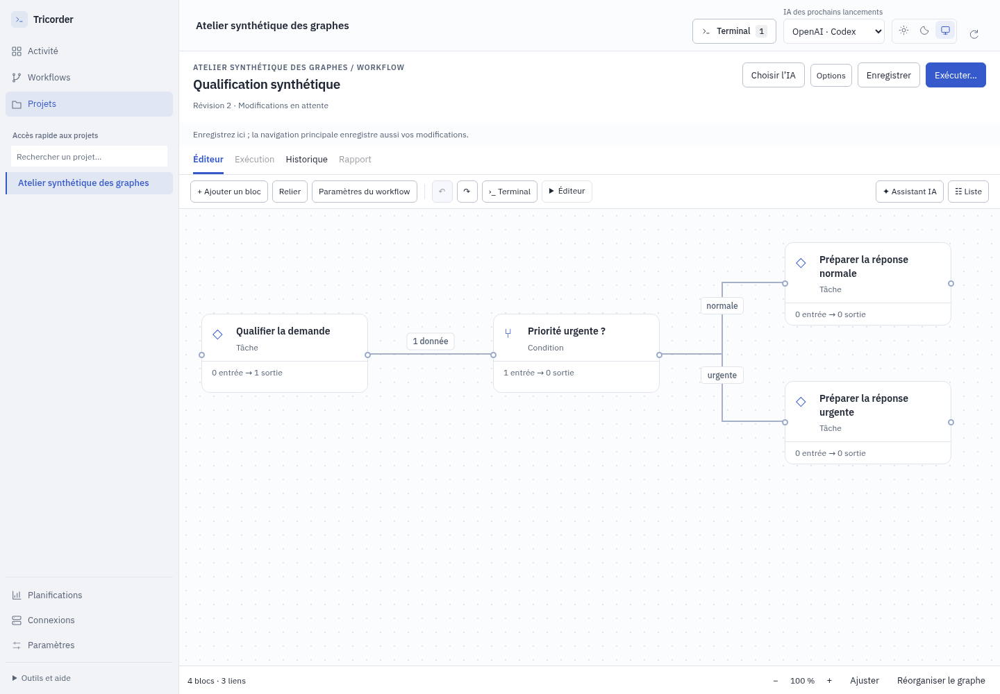
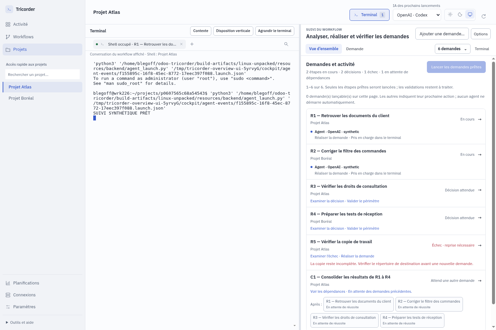
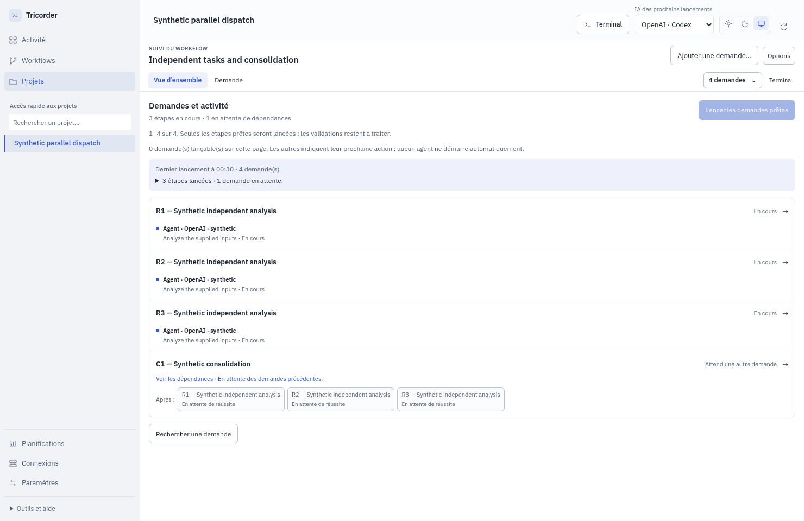
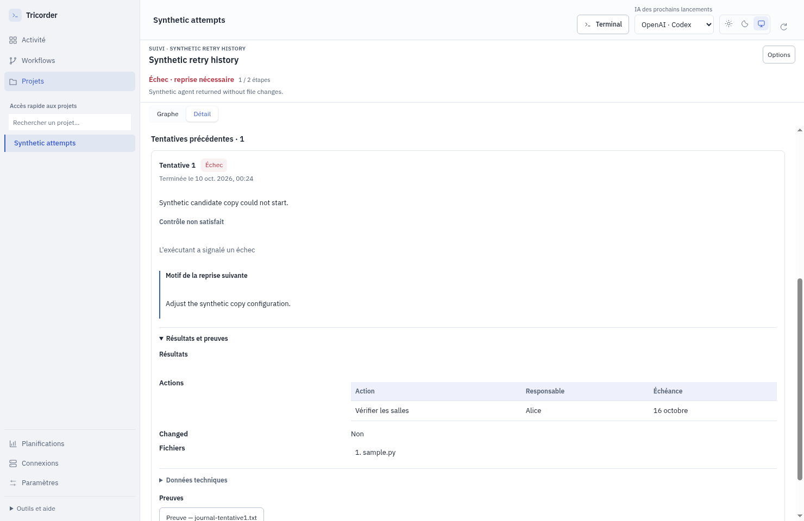

# 0.6.0-rc.12 — Création, terminal et suivi des workflows

Tricorder réunit le dessin du processus, la conversation et le suivi dans la même fenêtre. Cette préversion améliore le parcours complet : créer ou choisir un workflow, soumettre une demande, lire ce qui se passe, répondre puis retrouver les résultats. Support, réunion, release et processus personnalisés utilisent le même espace de travail.

## Garder le terminal au centre

La navigation conserve votre choix d’afficher ou de masquer le terminal, ainsi que sa session. Les onglets restent accessibles lorsqu’ils sont nombreux. Si le projet consulté diffère de celui dans lequel le shell a été ouvert, les deux contextes sont nommés. Changer de vue ne change pas le dossier du shell ni les instructions d’un agent déjà ouvert.

Une question ou une décision garde ses actions en pied de panneau, même avec un long document. Le commentaire obligatoire est annoncé et le brouillon conservé. L’accord reste lié à la demande et à la proposition affichées ; les doubles clics et propositions périmées ne valident pas un autre travail.

## Dessiner et réutiliser sa méthode

**Réorganiser le graphe** répartit les branches sans changer leur logique. L’action est annulable. Les liens peuvent être sélectionnés pour examiner leurs données ou les retirer. Les cartes, libellés et pieds de bloc prennent mieux en compte les textes longs et les bifurcations.

Les propriétés et les entrées/sorties disposent de plus de place. Le premier bloc explique comment utiliser le contexte de la demande ; une entrée nommée reste alimentée par un lien explicite. Les valeurs de simulation peuvent être personnalisées pour essayer les branches, sans présenter la simulation comme un travail réel.

**Réutiliser…** crée une copie indépendante. Les exemples de simulation sont retirés par défaut, avec un choix pour les conserver. **Fichier JSON du workflow…** indique le fichier enregistré dans le dépôt. Un projet local peut être créé depuis l’interface ; un dépôt existant peut être choisi ou saisi par chemin.

## Voir les demandes, les attentes et les résultats

**Vue d’ensemble** rassemble les demandes et rend **Ajouter une demande…** directement accessible. Les exécutants réellement enregistrés affichent leur rôle, fournisseur et état ; les dépendances restent consultables entre projets. Les questions, décisions et demandes prêtes remontent dans **Activité** avant les attentes automatiques, y compris avant pagination. Ce classement n’infère pas une urgence métier depuis un titre.

Le compteur distingue les étapes traitées des branches non applicables. Les comptes rendus, actions, preuves et résultats sont présentés avec des libellés métier. Les modèles parlent de réunion, transcription et compte rendu. Les critères attendus du Support sont décrits sans être présentés comme déjà vérifiés.

**Lancer les demandes prêtes** et la commande `dispatch` déclenchent une vague explicite de travail, avec jusqu’à quatre exécutants, en respectant les verrous, dépendances et décisions. Actualiser ou ouvrir le suivi ne lance aucun agent d’une conversation. Les étapes suivantes demandent une nouvelle vague après leurs prérequis ; ce mécanisme n’est pas une file autonome.

## Comprendre une interruption et reprendre

Les tentatives précédentes affichent leur date, leur état, leur compte rendu, leurs preuves et le motif de reprise. Les grands contenus ne masquent plus l’historique derrière du JSON brut. La reprise annonce le budget restant et distingue la préparation d’une étape du redémarrage de l’agent.

Un bloc de modification de code exige toujours de vrais changements. La collecte documentaire doit utiliser un bloc adapté. Aucun échec n’est transformé en succès, et les anciennes exécutions clientes conservent leurs résultats et décisions.

## Planifier et connecter

La fréquence, le fuseau et les jours sont visibles. Remplacer la version d’une planification reprend ces réglages ; activation, mode réel et autorisations demandent une nouvelle vérification. L’ancienne version reste consultable.

Les communications expliquent la capacité requise. Un outil disponible dans la conversation ne devient pas automatiquement un connecteur autonome. Les opérations externes nécessitent un adaptateur vérifié ; un brouillon local n’est pas un brouillon créé dans la messagerie. Les essais de cette release n’ont envoyé aucun message client.

## Réception

Les cinq campagnes demandées réunissent **29 profils d’agents GPT-6.1 Sol high** : cinq métier, cinq nouveaux parcours, cinq création/configuration, cinq UX/UI puis neuf profils de niveaux techniques variés. Le dernier panel a exécuté 27 parcours. Les retours ont été consolidés, les défauts confirmés corrigés puis soumis à des contre-épreuves et à une relecture indépendante. Il ne s’agit pas d’une étude auprès de personnes humaines.

- [Campagnes et preuves](.suivi/PLAN-CAMPAGNES.md)
- [Consolidation des neuf derniers profils](.suivi/testeurs-utilisateurs/CONSOLIDATION.md)
- [Corrections et réception finale](.suivi/corrections-panel/reception-finale.md)
- [Analyse des limites structurelles](ANALYSE.md)

Les tests utilisent des projets fictifs, des fournisseurs inertes et des adaptateurs locaux. Les captures sont issues de l’application empaquetée ; aucun contenu client n’est publié. Cette réception ne qualifie ni une réponse de modèle commercial, ni un compte distant, ni une correction métier Odoo.

Le cycle complet de release parallèle reste à construire : relation parent/demandes, accord commun, intégration des candidats et QA commune. Le suivi de demandes distinctes ne remplace pas ce contrat. L’indépendance du fournisseur reste aussi conditionnée aux capacités réellement disponibles. Les grands graphes conservent un défilement ; dans le suivi, **Ajuster** recentre le bloc sélectionné à une taille lisible, il ne réduit pas systématiquement tout le graphe à la fenêtre.

## Installation

La mise à jour locale prend effet au prochain lancement. Choisissez **Quitter Tricorder** dans l’icône système, puis relancez la même application. L’installation ne redémarre pas la fenêtre et ne termine pas les PTY en cours. Un agent natif déjà ouvert conserve ses instructions ; après sa sortie normale jusqu’au prompt Bash, **Reprendre l’agent…** lui donne les commandes de la nouvelle version.
