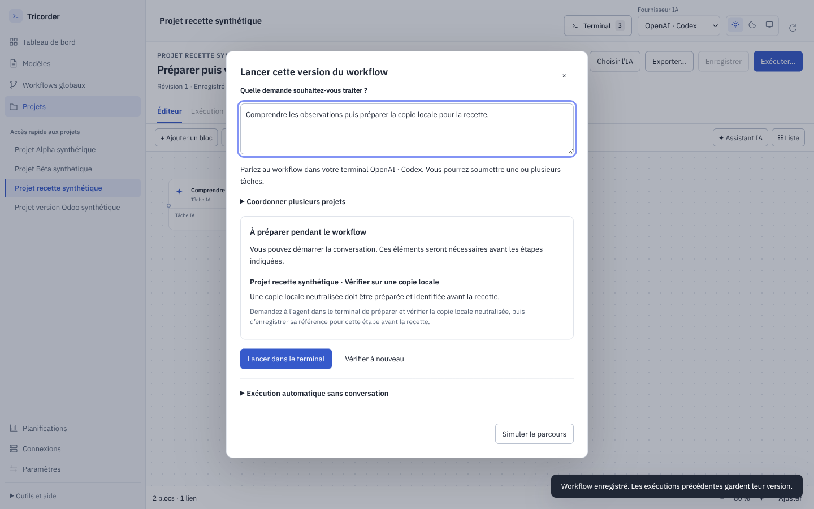
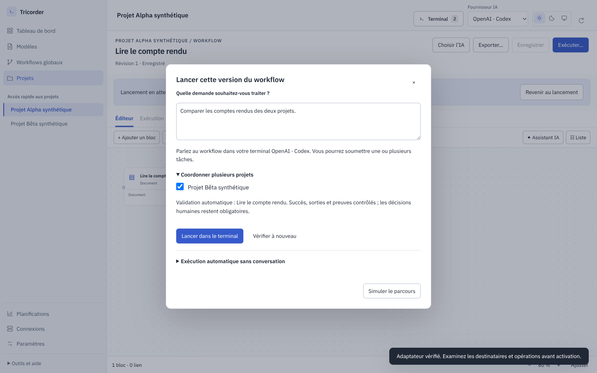
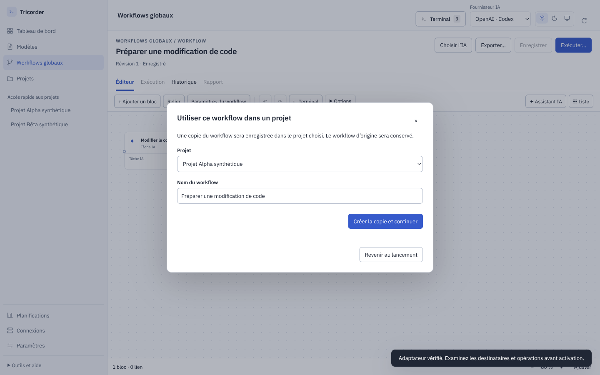

# 0.6.0-rc.9 — Lancer et dépanner un workflow

Cette release corrige le parcours signalé dans le dialogue de lancement et les
impasses similaires trouvées dans le code, les écrans et les modèles. Le terminal
reste l’entrée de travail ; le graphique suit les demandes et les étapes.

## Le problème que les tests précédents n’avaient pas couvert

Les tests du moteur ouvraient directement une conversation, tandis que le dialogue
appelait un autre précontrôle. Les tests d’interface ne combinaient pas le modèle
Odoo généré, le pack installé et l’absence de copie de recette. Ils ne prouvaient
pas non plus qu’un utilisateur pouvait suivre le bouton proposé, corriger le
réglage puis revenir sans perdre sa demande. La configuration d’un agent métier
sur un workflow créé depuis l’éditeur générique n’était pas couverte non plus :
elle doit reprendre le contexte de chaque projet, comme un modèle Odoo livré.

Le nouveau test commence par **Exécuter…**, sur ce cas incomplet. Il a échoué sur
le binaire rc.8 réellement installé : le bouton était désactivé. La correction
permet de lancer l’analyse et annonce ce qui sera nécessaire avant la recette.
La QA reste refusée tant que sa copie locale neutralisée n’est pas identifiée ;
un environnement distant, une référence invalide ou la production ne passent pas
ce contrôle. Une référence déclarée ne constitue pas une preuve de tests réussis.

*Application réelle sur projets et fournisseurs synthétiques, sans données client.*

## Parcours corrigés

| Situation | Comportement attendu |
|---|---|
| Copie de recette encore à préparer | La conversation peut commencer ; l’exigence apparaît pour l’étape QA. |
| Fournisseur ou modèle indisponible | Ouvrir le réglage IA pertinent puis revérifier, sans perdre la demande. |
| Plugin non vérifié | Ouvrir les connexions du projet concerné, vérifier l’adaptateur et revenir. |
| Projet secondaire incompatible | Le diagnostic apparaît dès sa sélection, avant le lancement. |
| Version Odoo absente | Ouvrir un champ « Version d’Odoo », sans modifier du JSON. |
| Workflow global de modification de code | Choisir un projet et y créer une copie ; conserver l’original et la demande. |
| Workflow générique utilisant un profil du pack Odoo | Reprendre version et hébergement du projet cible, quel que soit le nom du profil ; préserver les restrictions Online. |
| Effort différent entre bloc et conversation | Signaler l’écart, sans exécuter silencieusement avec un autre réglage. |
| Modèle repris d’une ancienne conversation | Séparer son mode d’exécution de la définition portable ; l’automatique et la planification exécutent réellement leurs étapes. |

Les brouillons conservent la demande et les projets pendant les détours de
configuration. Les autorisations d’envoi restent des décisions distinctes.
Les champs de contexte Odoo précisent quand les informations du projet sont
prioritaires. Les diagnostics distinguent l’étape, le projet et l’action utile.

La copie d’un workflow global vers un dépôt se fait depuis le diagnostic :

Un retour de suivi en retard ne ramène plus l’utilisateur au workflow après un
changement de vue et ne ferme pas son formulaire en cours. Un profil absent
reste visible comme absent ; modifier le nom du bloc ne le remplace pas
implicitement par un agent généraliste.

## Recette et preuves

La [review fonctionnelle indépendante](../../docs/audits/2026-10-09-parcours-blocages.md)
examine les modèles, branches, décisions, projets et modes d’exécution.
La [review UI indépendante](../../docs/audits/2026-10-09-depannage-ui.md) suit les
clics de dépannage jusqu’au retour et au lancement. Les références avant
correction sont conservées séparément des captures après correction.

Les scénarios utilisent des projets synthétiques, des CLI de substitution et des
adaptateurs locaux. Ils contrôlent l’interface, les transitions, les données
conservées et les refus. Ils ne valident pas les identifiants d’un compte réel,
le raisonnement d’un modèle ou une recette métier Odoo sur une base client.

### Résultats locaux du candidat

| Contrôle | Résultat et preuve |
|---|---|
| Tests moteur et Electron | 243 tests Python et 84 tests JavaScript réussis — [journal](.suivi/unit.log). |
| Interface depuis les sources | 71 scénarios réussis, puis 2 cas supplémentaires ciblés réussis ; 2 tests de fournisseurs réels désactivés — [campagne](.suivi/ui-source.log), [profil absent](.suivi/ui-profile-source.log), [contexte du pack](.suivi/ui-pack-profile-source.log). |
| Application empaquetée | 72 scénarios réussis dans la campagne initiale ; le dernier reçu après correction du test, soit 73 parcours distincts. Les 2 tests de fournisseurs réels restent désactivés — [campagne initiale](.suivi/ui-packaged-initial.log), [rejeu ciblé](.suivi/ui-model-delayed.log). |
| Construction | Paquet Ubuntu amd64 construit ; bundle graphique et 46 fichiers Python/JSON identiques aux sources reçues — [construction](.suivi/dist.log), [manifeste](.suivi/validation.json). |

Le seul échec de la campagne empaquetée concernait le test de changement de modèle :
son sélecteur pouvait viser le formulaire précédent pendant l’ouverture du dialogue
IA. La [trace textuelle initiale](.suivi/model-dialog-initial-failure.md) est conservée.
Le test attend désormais le dialogue nommé et limite ses actions à celui-ci.
Il réussit sur le **même paquet**, avec une réponse IPC réellement retardée de
1 500 ms ; [la preuve](.suivi/model-delayed-proof.json) vérifie le modèle, la demande
et les deux projets jusqu’au lancement. Aucun défaut applicatif supplémentaire
n’a été démontré par cet échec.

La publication et l’installation sont conditionnées à une nouvelle campagne CI
complète sur le commit livré. Son lien est indiqué dans la release GitHub.
