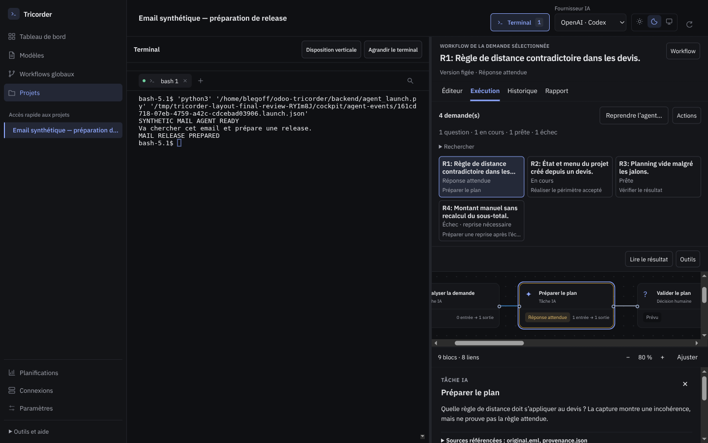
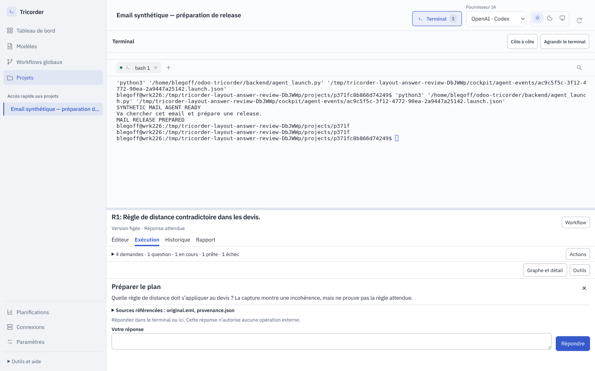
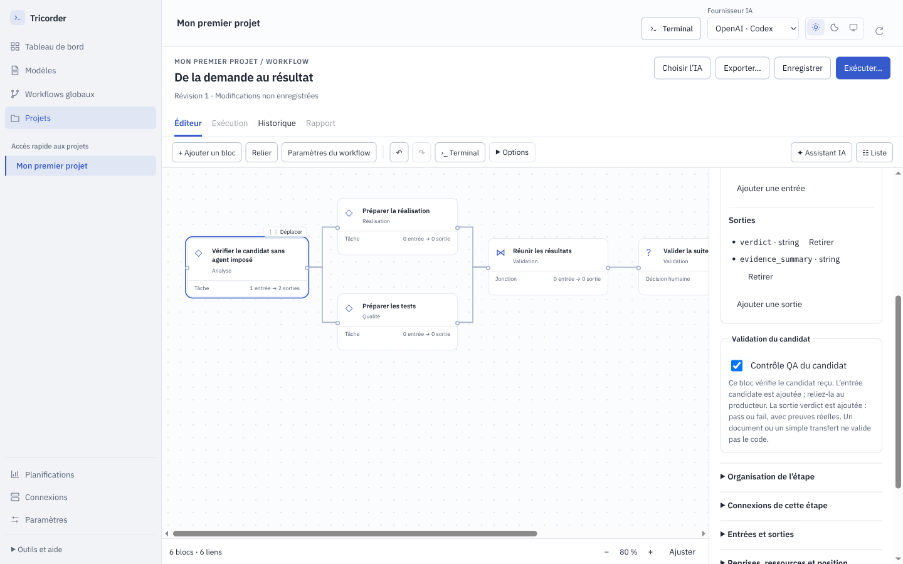

# 0.6.0-rc.8 — Fiabilité des workflows et ergonomie

**État : recette locale reçue pour la préversion 0.6.0-rc.8.**

Cette livraison répond à l’[audit indépendant de la rc.7](../../docs/audits/2026-10-09-audit-complet.md).
Elle vise le parcours complet : choisir ou concevoir un workflow, le lancer dans
le terminal, lire les résultats, répondre ou décider, puis reprendre et retrouver
le travail. Le terminal et le suivi graphique restent dans la même application.

Depuis **Exécuter… → Lancer dans le terminal**, demander par exemple :
« Va chercher cet email et prépare une release. » L’agent utilise ses outils
disponibles, conserve la source et les pièces, puis enregistre les demandes.
La vue identifie le sujet sélectionné, son état et l’action attendue. Une question
sur un sujet n’arrête pas les demandes indépendantes.

Pour répondre, **Lire le résultat** donne la place au contenu du bloc. La
disposition verticale conserve le terminal au-dessus de la question.

*Application réelle sur scénario synthétique : aucun mail client ni compte
connecté utilisé dans cette capture. Le terminal conserve 52 % de la hauteur.*

Les champs de l’éditeur, les sections Entrées/Sorties, les titres et les boutons
partagent des alignements et une typographie cohérents. Les textes métier se
lisent comme des textes ; les données techniques restent en monospace. Le graphe
se centre sur l’étape utile quand on change de demande ou revient du mode lecture.

La case **Contrôle QA du candidat** identifie un vrai contrôle du code proposé.
Il faut un résultat valide et les preuves du même candidat avant application.
Un changelog ou un bloc qui transmet le candidat ne peut pas remplacer sa QA.
Le lecteur de résultats et le formulaire ont également été inspectés en
[mode sombre à 1024 px](captures/editeur-sombre-1024.png) et sur un
[diagnostic rédigé](captures/diagnostic-lisible.png).

## Réception indépendante

Les états ci-dessous proviennent de la réception indépendante, dans le périmètre
local et synthétique des tests. Dix constats sont reçus ; deux restent partiels
pour les compatibilités et fonctions précisées plus bas. Le rapport initial et
ses captures constituent la référence avant correction, conservée séparément.

| Constat | Résultat attendu | Contre-épreuve indispensable | Réception |
|---|---|---|---|
| A01 — Résultats et décisions | Lire les entrées, livrables et preuves dans le producteur, la décision et le rapport. | Un contenu actif ou une référence de fichier hors périmètre reste inaccessible. | Reçu |
| A02 — Exécution interrompue | Une tentative réellement arrêtée peut être récupérée sans conserver ses ressources indéfiniment. | Un processus encore actif ou un effet externe incertain ne déclenche pas une nouvelle exécution aveugle. | Reçu |
| A03 — Historique volumineux | Parcourir projets et conversations avec des réponses bornées et accès au détail. | Aucune demande ni preuve ne disparaît silencieusement après une limite de pagination. | Reçu |
| A04 — Publication dynamique | Le connecteur reçoit exactement le contenu produit et présenté à la décision. | Un changement de contenu, cible ou candidat invalide l’accord correspondant. | Reçu |
| A05 — QA et application du candidat | Les contrôles et décisions requis portent sur le candidat appliqué, quel que soit le type de bloc. | Une QA en attente/échouée ou un refus empêche toute modification du dépôt. | Reçu |
| A06 — Sous-workflows | Les données traversent les ports publics et les blocs internes avec leur provenance. | Un port incompatible et une branche non exécutée ne deviennent pas un résultat valide. | Reçu |
| A07 — Conflits d’édition | Comparer et résoudre les versions terminal/éditeur en conservant les modifications choisies. | Un conflit ou un rechargement invalide ne détruit pas le brouillon courant. | Reçu |
| A08 — Questions en attente | Une question reste visible dans le graphe, les phases repliées, les listes et l’icône système. | Une combinaison d’états ne masque pas l’intervention humaine attendue. | Reçu |
| A09 — Reprise de l’agent | Distinguer shell disponible et agent actif ; reprendre la bonne conversation explicitement. | Aucun doublon de conversation et aucune commande injectée dans un processus arbitraire. | Partiel : sessions Bash gérées reçues |
| A10 — Modes d’exécution | Avant lancement, vérifier que le mode choisi possède les capacités requises par les blocs. | Un agent limité au texte ne fournit pas une fausse preuve d’édition ou d’exécution de tests. | Reçu |
| A11 — Cycle quotidien | Annuler, classer et retrouver les demandes sans encombrer les vues ni perdre les preuves. | Un archivage conserve la définition exécutée et ne contourne pas une opération encore active. | Partiel : cycle local reçu |
| A12 — Paramètres IA | Changer le fournisseur ou le modèle conserve les paramètres non modifiés explicitement. | Les efforts et surcharges de blocs ne changent pas silencieusement. | Reçu |

## Parcours de référence

- **Demande ponctuelle et meeting** : résultat lisible, question, décision, rapport.
- **Support et express** : qualification, issue non résolue, QA rouge et nouvelle tentative.
- **Plusieurs projets** : dépendance bloquée visible, travail indépendant poursuivi, reprise contextualisée.
- **Conception terminal/graphe** : conflit, résolution, conservation des saisies et de la session.
- **Interruption et historique** : récupération, pagination, accès aux anciens résultats.
- **Petite fenêtre et clavier** : terminal utilisable, résultat lisible au moment de décider, focus conservé.
- **Cohérence visuelle globale** : alignements, typographie, tailles, espacements,
  boutons et champs vérifiés dans les vues réelles, en clair et sombre ; revue
  indépendante dédiée au layout demandée pendant la réalisation.

Le [scénario multi-demandes issu d’un mail client](scenario-multi-demandes.md)
ajoute un cas concret : une source, six pièces, quatre sujets dont l’un attend
une clarification pendant que les autres progressent. Les données de test sont
anonymisées et synthétiques ; la release client réelle n’est pas exécutée par
cette recette Tricorder.

Les essais applicatifs utilisent des projets synthétiques, des CLI de substitution
et des adaptateurs locaux. Une réussite ne qualifie pas un modèle réel, une
authentification Slack/mail ou un déploiement Odoo. Les opérations client réelles
restent hors de cette recette.

## Relecture et livraison

Après la première remise du développeur, un nouvel agent a conduit la
[review fonctionnelle indépendante](../../docs/audits/2026-10-09-review-corrections.md).
Il a reproduit puis reçu huit corrections, dont un document sans tests accepté
comme QA, des références de contrôles incorrectes dans les composants et une
reprise envoyée pendant un `read` du shell. Les contre-épreuves vérifient aussi
le curseur au début, au milieu et à la fin d’une saisie : aucun suffixe non soumis
n’est exécuté lors de la reprise. Les preuves avant/après sont distinctes.

Le [reviewer visuel indépendant](../../docs/audits/2026-10-09-layout-ui-ux.md) a reçu
dix corrections d’alignement, de typographie et de lecture des états. Le cas mail
à quatre demandes, le centrage du graphe, la question en disposition verticale
et la conservation du terminal sont recontrôlés. La configuration QA a été
vérifiée au clavier, après changement de bloc, récupération du brouillon,
enregistrement et relecture. Les nouveaux modèles Odoo custom déclarent ce
contrôle ; les routes Studio et Online gardent leur propre type de travail.

Les axes complémentaires de sauvegarde/restauration, performance durable et
qualification de services réels restent distincts des corrections reçues.
Les états de réception reposent sur les contre-épreuves décrites dans les rapports.

## Compatibilité et limites pratiques

- **Reprise du terminal (A09)** : automatique uniquement pour un Bash géré dont
  le prompt est vérifié. Les anciens brokers et shells sans ce signal conservent
  leurs sessions ; l’application refuse d’y injecter une commande de reprise.
  La reprise d’une vraie session fournisseur n’a pas été qualifiée par ces essais.
- **Gestion des projets (A11)** : les exécutions ont recherche, pagination et
  archivage ; la liste des projets n’a pas encore sa propre recherche/pagination.
  La réassociation d’un dépôt déplacé n’a pas été recettée.
- **Anciens candidats** : une exécution sans contrat QA explicite reste non
  applicable. Configurer le contrôle dans un nouveau workflow ou une nouvelle
  révision et relancer les vérifications requises ; aucun accord rétroactif.
- **Pont terminal** : `ready` renvoie désormais un objet paginé
  `{items, parameters, project, total, next}` ; les scripts qui attendaient une
  liste doivent utiliser `items` et poursuivre avec `next`.
- **Services et métier** : le test mail utilise un adaptateur et une CLI locaux.
  Il qualifie le protocole et la conservation des sources, pas le raisonnement
  d’un modèle, l’authentification d’un compte ou une recette Odoo client. Les
  notifications, brouillons et déploiements réels gardent leurs accès et accords.

Le [guide détaillé](../../docs/WORKFLOW-RUNTIME.md) explique aussi les anciennes
tentatives sans identité, les effets externes incertains et les chantiers
séparés de sauvegarde, rétention, disque plein et coût du polling.

## Validation du paquet

- `npm test` : **226 tests Python et 83 tests JavaScript réussis**.
- `npm run test:ui` : **65 réussis, 2 ignorés**.
- `npm run dist` : installateur Ubuntu amd64 construit.
- `npm run test:packaged` : **65 réussis, 2 ignorés**, sur l’application empaquetée.

Les deux parcours ignorés exigent des projets réels ; les parcours synthétiques
restent exécutés. Les 77 fichiers du manifeste de réception correspondent aux
sources qualifiées. Les journaux et l’empreinte de l’installateur sont conservés
dans [la preuve de validation](.suivi/validation.json). Le contrôle CI du commit,
les fichiers à télécharger et leurs sommes SHA-256 accompagnent la
[publication GitHub](https://github.com/le-goff-benoit/odoo-tricorder/releases/tag/v0.6.0-rc.8).
