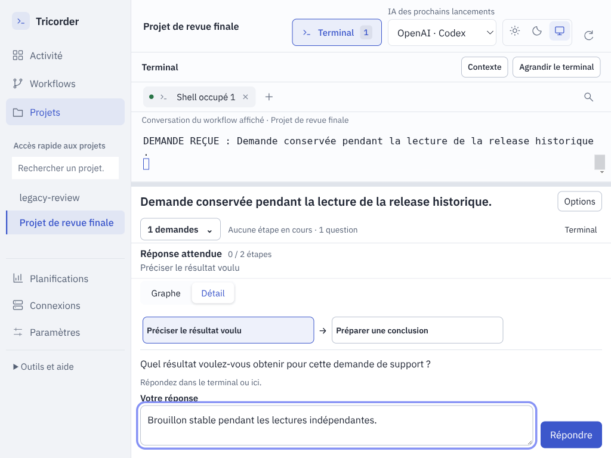

# 0.6.0-rc.11 — Des parcours de travail plus simples

La version précédente conservait trop de chemins concurrents : modèle, workflow
global, projet, conversation et demande. Après un lancement, l’éditeur restait
visible sans expliquer où donner l’intention. Le suivi obligeait à parcourir
plusieurs panneaux pour savoir quoi faire. Cette version réorganise ces usages.

## Choisir, lancer, suivre

- **Activité** présente les conversations à reprendre et les demandes à traiter.
  Une question ancienne ne disparaît plus derrière les travaux terminés.
- **Workflows** réunit les définitions de tous les projets et les modèles. On peut
  rechercher, exécuter ou modifier un workflow sans retrouver son dépôt d’abord.
- **Projets** met le travail à reprendre avant la configuration. Les anciennes
  releases Odoo restent accessibles dans **Options → Releases et suivi Odoo**.

**Nouvelle demande** choisit un workflow et un périmètre ; le lancement ouvre le
terminal et le suivi. L’intention peut être donnée entièrement dans le terminal.
Une définition existante est réutilisée ; une adaptation dans un autre projet
est annoncée avant sa création et devient réutilisable. Une conversation peut
coordonner plusieurs projets sans dupliquer le workflow dans chacun d’eux.

*Captures du paquet rc.11 sur des projets inventés, avec un agent local de test.
Aucun contenu client, email réel ou accès fournisseur.*

## Comprendre l’exécution

La demande affichée, son état effectif et sa prochaine action précèdent le graphe.
Le sélecteur des demandes reste compact. **Graphe** suit l’étape actuelle dans une
disposition verticale ; **Détail** montre la question, le plan ou le résultat.
Les branches alternatives affichent leurs conditions, sans inventer un ordre
séquentiel. Les positions du dessin enregistré ne sont pas modifiées.

Une conversation ouverte sans tâche affiche **Prêt pour votre demande**, puis
reste accessible depuis Activité. Le terminal est conservé lors des changements
de demande, de projet et de vue ; les brouillons de réponse sont conservés aussi.
Le sélecteur global précise **IA des prochains lancements** : il ne change pas
silencieusement le fournisseur d’une conversation existante.

## Concevoir sans encombrer le suivi

**Créer un workflow** part d’un dessin vide ou d’un modèle. L’éditeur utilise toute
la largeur, avec ses blocs, entrées/sorties typées et liaisons. Les rôles, modèles
et fournisseurs restent configurables par bloc. Revenir à l’éditeur ne ferme pas
les terminaux. Les définitions du projet sont prêtes à être versionnées dans
`.tricorder/workflows/` ; aucun commit automatique n’est ajouté.

Le support, une demande ponctuelle, une réunion sans projet, une release Odoo et
un workflow générique utilisent cette même organisation. Les connexions et les
planifications restent disponibles dans la barre latérale.

## Analyse et réception indépendantes

L’[analyse indépendante](../../docs/audits/2026-10-09-simplification-independante.md)
part des écrans rc.10, examine le code et exécute les parcours. Une seconde
[réception indépendante](../../docs/audits/2026-10-09-reception-simplicite-independante/REVIEW.md)
a ensuite ajouté des contre-épreuves et fait corriger des défauts :

- ajout du premier projet lorsque l’installation est vide ;
- conservation du terminal, de son PID et des brouillons après redémarrage ;
- deux conversations dans deux projets sans mélange de contexte ;
- question ancienne après 27 demandes terminées, traitée avant pagination ;
- ouverture et lancement du 28e workflow d’un catalogue de 30 ;
- navigation et lancement rapprochés conservant le bon projet et la bonne définition ;
- question, saisie et réponse visibles ensemble à 1024 × 768 au zoom 125 % ;
- représentation correcte des branches et persistance des rôles/fournisseurs.

La comparaison d’une release à six demandes et neuf blocs conserve des captures
avant/après à plusieurs tailles, en clair/sombre et en disposition verticale.
Les [tests de parcours](../../tests/simplicity.spec.cjs) couvrent aussi l’intention
et la réponse envoyées dans un vrai terminal, l’éditeur avec I/O, les adaptations,
le travail transversal et le brouillon de réunion.

Les journaux intermédiaires conservent les erreurs détectées ; les assertions
métier restent présentes lorsque les chemins de navigation changent. La réception locale compte 279 tests Python, 91 tests JavaScript et 93 parcours
UI reçus sur les sources : 89 dans la campagne complète, puis les quatre tests
adaptés et reçus séparément. Deux tests optionnels sur projets réels sont
désactivés. Les journaux et les empreintes du paquet sont dans [.suivi](.suivi/).
La validation finale de CI accompagne la [release GitHub](https://github.com/le-goff-benoit/odoo-tricorder/releases/tag/v0.6.0-rc.11).

Ces preuves utilisent des agents déterministes et des adaptateurs locaux. Elles
valident la circulation de la demande et les interactions ; elles ne prouvent
ni l’interprétation d’un modèle commercial ni la livraison d’un email ou d’un
message Slack. Aucun workflow client n’a été exécuté, migré ou clôturé.

## Charger la mise à jour et reprendre

L’installation prépare le prochain lancement en conservant les terminaux actifs.
Choisir **Quitter Tricorder** dans l’icône système puis relancer l’application.
Fermer seulement la fenêtre peut laisser l’ancienne version dans la barre système.

Un agent déjà ouvert garde ses anciennes instructions. Après sa sortie normale
et le retour au prompt Bash, utiliser **Terminal → Reprendre l’agent… → Reprendre
dans ce terminal** pour recréer les instructions avec le moteur installé. La
reprise retrouve la session fournisseur si son identifiant est connu ; sinon
elle ouvre une nouvelle invocation liée à la même conversation Tricorder. Elle
n’est pas envoyée à un agent encore actif. Les demandes et décisions restent
conservées.
