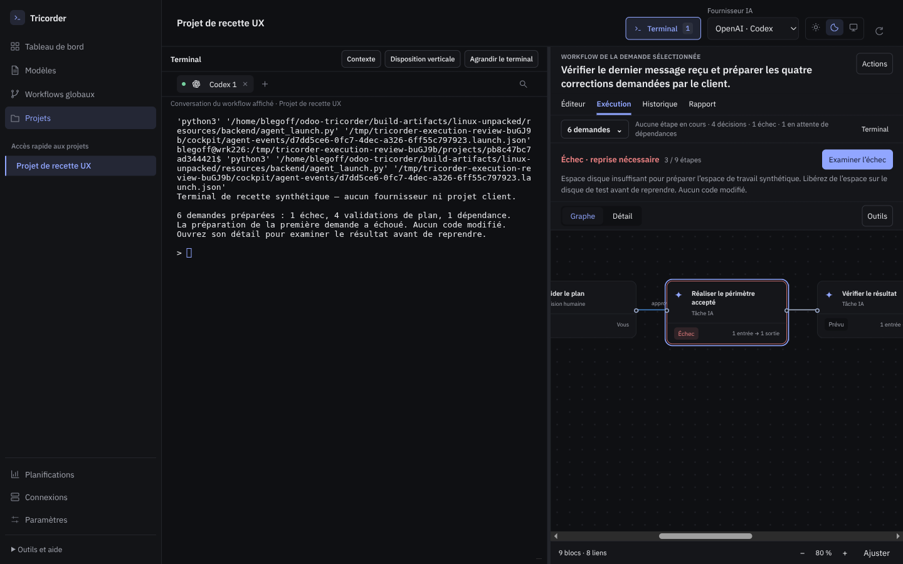
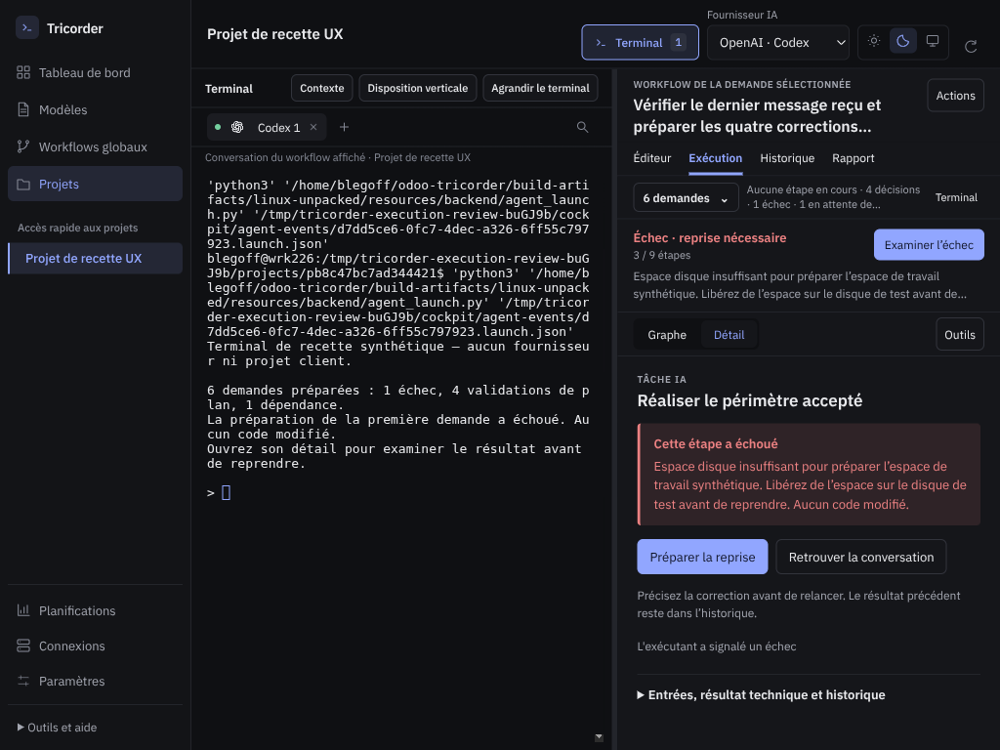
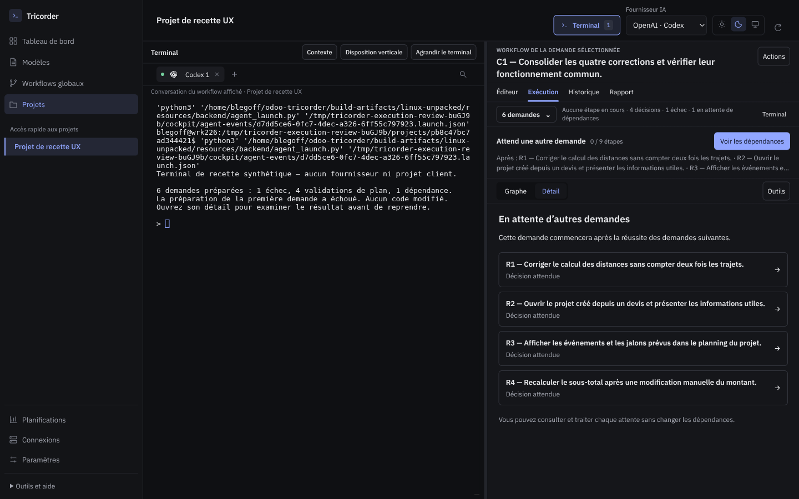

# 0.6.0-rc.10 — Comprendre et piloter l’exécution

Une exécution de six demandes rendait le panneau illisible : cartes, contexte,
graphe et détail se partageaient trop peu de place. Le terminal affichait des
informations issues d’une autre vue. Une copie de dépôt de 132,4 Mo était refusée
avant même le travail, à cause d’un plafond global de 20 Mo.

Cette version traite ensemble la lecture du suivi, les interactions et ce
blocage d’exécution. Elle conserve le terminal et les workflows déjà enregistrés.

*Application réelle, projet et agent synthétiques. Aucun contenu client publié.*

## Lire ce qui se passe

- **N demandes** ouvre une liste compacte avec recherche. Choisir une demande
  conserve le mode d’affichage et le terminal.
- L’état et une action directe indiquent quoi examiner ou faire ensuite. Les
  étapes en cours, questions, décisions et dépendances sont comptées séparément.
- **Graphe** utilise la hauteur disponible et suit l’étape courante.
  **Détail** remplace cette surface par la lecture de la question, du résultat
  ou du plan. Les deux ne sont plus empilés dans un espace réduit.
- Une décision nomme la demande qu’elle autorise. L’acceptation du plan commun
  n’accepte pas silencieusement les propositions indépendantes des autres tâches.
- Une demande en attente nomme ses prédécesseurs et permet de les ouvrir. Une
  suspension manuelle reste affichée comme telle.

Le graphe mesuré passe de 148 à 496 pixels de hauteur à 1440 × 900. Il conserve
366 pixels à 1024 × 768 et 316 pixels au zoom 125 % de la fenêtre 1440 × 900.
Les mesures incluent le terminal et le résumé de six demandes.

## Comprendre les résultats et reprendre

Un résultat d’exécution en échec montre sa cause concrète et, lorsque le moteur
l’autorise, **Préparer la reprise**. Les entrées et l’historique restent accessibles
sans précéder cette information. Le badge se met aussi à jour lorsqu’un échec
arrive pendant la consultation du graphe.

Le statut du bloc choisi n’est plus remplacé par l’erreur d’un autre bloc.
Un test métier négatif prévu par une branche reste un résultat recevable :
recevoir ce constat permet de suivre la correction, sans déclarer le code conforme.
Une opération externe incertaine garde la recherche d’accusé ; elle n’est pas
renvoyée automatiquement.

Le terminal distingue la conversation affichée, une autre conversation et un
shell disponible. Ses réglages sont repliés sous **Contexte**. Les messages et
boutons de rattachement d’une ancienne release ne restent plus dans le suivi du
workflow. Aucun changement d’affichage ne redémarre une session.

## Copier un dépôt avec ses pièces

Le plafond cumulatif de 20 Mo est supprimé. La préparation inventorie les fichiers
Git suivis et les fichiers non ignorés admissibles, vérifie la place disponible
pour les copies, puis lit, copie et calcule leurs empreintes par blocs de 1 Mio.
Les historiques et les grosses pièces inchangées restent dans le périmètre ;
aucune exclusion de dossier métier n’a été introduite pour faire passer le test.

La capture distingue fichiers inchangés et modifications de texte. La QA et
l’application contrôlent les empreintes, y compris celles des pièces. L’application
ne refait plus une copie complète du dépôt. Un disque plein pendant la préparation
QA supprime la copie partielle créée par cette tentative et donne une action utile.
Une cible préexistante reste intacte. Une annulation pendant la copie empêche le
lancement du modèle, même si la copie en cours se termine avant ce contrôle.

Les limites restantes sont explicites : 10 000 fichiers admissibles, inventaire
Git de 2 Mo, 100 fichiers modifiés, fichiers texte modifiés de 2 Mo maximum,
proposition et diff de 2 Mo chacun. Les modifications binaires et de permissions
ne sont pas prises en charge. Les exclusions de fichiers sensibles connus,
dépendances et répertoires internes sont conservées. Un manque de place ne conduit
ni à tronquer une preuve ni à ignorer une pièce du dossier métier.

## Recette et reviews

La [review du layout](../../docs/audits/2026-10-09-execution-lisibilite.md) reproduit
le cas six demandes/neuf blocs sur le binaire rc.9, puis compare trois tailles,
le zoom, la disposition verticale et la saisie clavier. Le terminal garde son
identifiant et son processus. La [review fonctionnelle](../../docs/audits/2026-10-09-suivi-execution.md)
sépare les états et réceptionne indépendamment la copie de candidats.
Les tests [d’interaction](../../tests/execution-interactions.spec.cjs) couvrent
les mises à jour en direct, le clavier, les brouillons de réponse et de recherche,
la réception d’un constat négatif et la recherche d’accusé sans deuxième envoi.

Une première campagne a détecté une régression introduite dans l’identité des
terminaux sans conversation : deux références absentes comparées égales
provoquaient une erreur d’affichage. Elle a été corrigée avant livraison et les
parcours historiques ont été rejoués. La review a aussi détecté la perte du focus
de recherche et un rafraîchissement différé oublié ; les tests rouges puis verts
sont conservés. Ces défauts n’ont pas été masqués par des assertions assouplies.

La recette utilise des projets temporaires, des CLI et adaptateurs de substitution.
Elle valide le produit et ses refus ; elle ne vaut ni appel à un modèle réel ni
recette métier Odoo. La release client signalée n’a pas été relancée ou modifiée.

La réception locale compte **277 tests Python, 89 tests JavaScript et 80 parcours
UI sur le paquet final**, ainsi que 15 contrôles indépendants de lisibilité et
d’interaction. Deux parcours optionnels sur projets réels sont désactivés. Les
campagnes source ont été reçues par lots, avec rejeu des cinq cas corrigés ; la
CI rejoue l’ensemble sur le commit publié avant livraison.

Les [résultats consolidés](.suivi/local-validation.json), les journaux et les
[empreintes du paquet](.suivi/build-validation.json) sont consignés dans `.suivi/`.
Le résultat final de CI est joint à la
[release GitHub](https://github.com/le-goff-benoit/odoo-tricorder/releases/tag/v0.6.0-rc.10).

## Reprendre une conversation déjà ouverte

L’installation prépare le prochain lancement et conserve les terminaux. Pour
charger la nouvelle interface, choisir **Quitter Tricorder** dans l’icône système,
puis relancer l’application ; fermer seulement la fenêtre peut la laisser dans
la barre système sur l’ancienne version.

Un agent déjà lancé conserve aussi ses instructions précédentes, qui peuvent
référencer le moteur rc.9. Après sa sortie normale et le retour au prompt Bash,
cliquer **Terminal** dans le suivi, puis **Reprendre l’agent… → Reprendre dans ce
terminal**. L’application recrée alors les instructions avec le moteur installé.
Elle reprend la session fournisseur si son identifiant est connu ; sinon elle
ouvre une nouvelle invocation liée à la même conversation Tricorder. Cette reprise
annule la ligne de saisie du shell après confirmation ; elle n’est pas envoyée à
un agent encore actif. Les demandes, résultats et décisions restent enregistrés.
