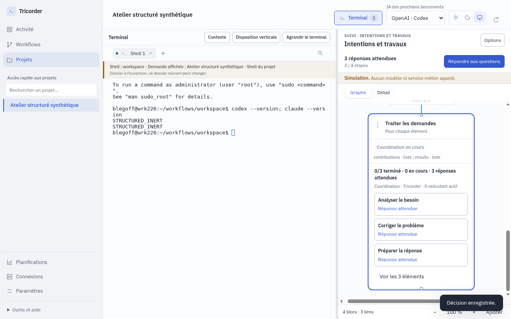
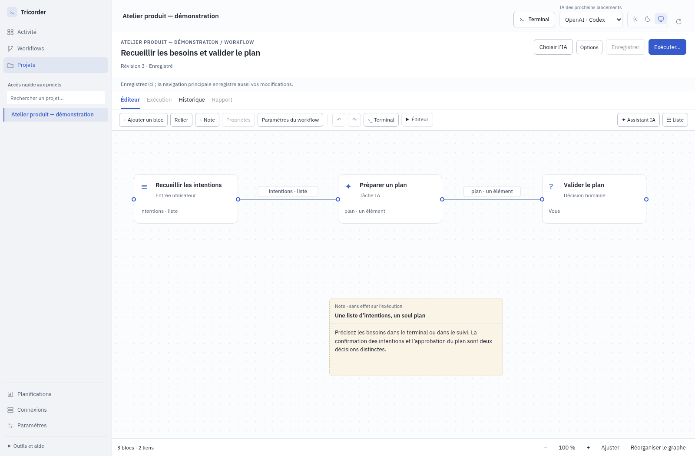

# Des intentions aux tâches suivies — 0.6.0-rc.13

Tricorder permet de dessiner une méthode, de la lancer dans le terminal et de
suivre le travail concret dans le graphe : les intentions, le plan, les tâches,
les dépendances et les interventions attendues.

## Ce qui change à l’utilisation

- **Plusieurs intentions, un plan.** Ajoutez et corrigez vos intentions depuis le
  terminal ou le suivi. Confirmer la liste la transmet à la préparation du plan ;
  son approbation reste une décision distincte.
- **Un travail par élément.** Le bloc « Pour chaque élément » crée des tâches
  durables avec leur titre, leur projet et leurs dépendances. Le moteur gère les
  places disponibles. Le graphe distingue travaux en cours et attentes et montre
  les exécutants réellement démarrés.
- **Un résultat commun vérifié.** Le modèle de développement réunit les
  contributions de code et teste le candidat commun avant son approbation.
  L’intégration refuse les conflits ; les tests individuels ne remplacent pas
  les tests de l’ensemble.
- **Des compléments indépendants.** Un brouillon ou une notification facultative
  conserve sa propre exécution. Son échec reste visible et ne rouvre pas le
  résultat principal. Chaque action proposée attend son activation explicite.
- **Un éditeur plus direct.** Déplacez les cartes, reliez les ports à la souris ou
  au clavier, annulez une modification et ajoutez des notes sans effet sur le flux.
  Les données échangées peuvent être un élément ou une liste, requis ou facultatif.
- **Une lecture métier.** Les résultats par élément s’affichent directement, les
  projets sont nommés et les états distinguent production d’un résultat et accord
  humain. Le retour à la demande principale fonctionne aussi depuis Activité ou
  Projets, tout en conservant le terminal.

Les modèles **Intentions, plan et travaux** et **Développement par élément et
tests communs** servent de points de départ. Les workflows et exécutions
historiques gardent leur version. La conversion du format de données concerne
uniquement le brouillon choisi dans l’éditeur.

## Six profils, puis correction des retours

Six agents indépendants ont créé ou adapté des workflows et les ont utilisés sur
des projets synthétiques : chef de projet, analyste support, responsable de
réunion, responsable de programme, chef de projet technique et utilisateur métier
au clavier sur petit écran. Il s’agit d’un panel d’agents, pas d’une étude auprès
de personnes recrutées.

Les 14 tests initiaux ont donné 13 succès et un échec sur le retour au parent.
Les scénarios aboutis ont également révélé des défauts de lecture des résultats,
de cadrage, de libellés et de configuration. Les rapports d’origine restent
inchangés ; les tests de réception demandent maintenant le comportement corrigé.

[Rapports et preuves du panel](.suivi/panel-utilisateurs/PLAN.md) ·
[Décisions d’architecture](ARBITRAGES.md) ·
[Registre des corrections](.suivi/CORRECTIONS-A-RECEVOIR.md).

## Un second panel aux usages plus variés

Six autres agents ont joué le fondateur d’un SaaS, le chef d’équipe de services,
le développeur senior sceptique, la responsable opérations, le Product Manager
B2B et le consultant multi-client. Chacun a réalisé deux parcours sur le paquet,
avec des projets fictifs et des limites de simulation explicites.

Leurs retours ont conduit à protéger les ajouts d’intentions rapides et leur
récupération après conflit, retrouver les shells des autres projets, distinguer
attente d’un enfant et suspension humaine, expliciter la relance automatique et
montrer le diagnostic d’une commande. Le shell de suivi démarre dans le projet ;
celui de conception indique son dossier `.tricorder`. Le JSON enregistré garde
un ordre stable pour faciliter la revue Git.
Le terminal compact préserve la sortie courante et l’historique consulté.
Retrouver une conversation vérifie la session réelle ; un terminal fermé
nécessite une reprise explicite avant tout nouveau lancement.
Le service terminal notifie désormais les transitions entre commande active et
retour au prompt. Les services déjà ouverts restent préservés lors d'une mise à
jour et gardent le rafraîchissement périodique ; la notification immédiate prend
effet au prochain démarrage du service, pas au seul redémarrage de la fenêtre.

Le refus d’un plan annonce sa conséquence. La révision dans la même exécution,
les connexions OAuth intégrées et l’attestation des sources Git réellement testées
restent des évolutions distinctes ; cette version ne les annonce pas disponibles.

[Synthèse des six personas et rapports](.suivi/panel-produit/SYNTHESE.md) ·
[Relecture indépendante des corrections](.suivi/REVIEW-PANEL-PRODUIT.md).

## Réception

La recette associe les tests moteur, les parcours du bureau et les contre-épreuves
indépendantes. La CI rejoue les suites complètes sur le commit livré et teste le
paquet qu’elle produit ; ce paquet est celui publié dans la release.

[Réception locale et diagnostics](.suivi/reception-finale.md) ·
[Manifeste de la livraison](https://github.com/le-goff-benoit/odoo-tricorder/releases/download/v0.6.0-rc.13/tricorder-0.6.0-rc.13-validation.json).

Les essais utilisent des projets temporaires, des fournisseurs inertes et des
adaptateurs locaux. Ils comprennent de vrais processus parallèles, des copies
de code, une intégration et des commandes de test exécutées. Les contenus IA
fournis par les bancs ne qualifient ni un modèle commercial, ni un compte externe,
ni une release cliente Odoo.

## Périmètre de cette version

Une liste contient au plus 100 éléments ; chaque traitement autorise de 1 à 4
travaux simultanés, avec une limite globale de quatre exécutants. Les traitements
par élément imbriqués ne sont pas encore proposés. L’intégration de code porte
sur un dépôt ; une coordination entre projets n’est pas une transaction commune
sur plusieurs dépôts. Le modèle de tests Python doit être adapté au projet et
ne remplace pas une recette Odoo.

Les notifications obligatoires d’un traitement par élément sont présentées au
lancement. Une connexion modifiée ensuite exige un nouvel examen ; elle ne
récupère pas l’autorisation de l’ancienne version. Les actions facultatives
conservent leur activation distincte.
