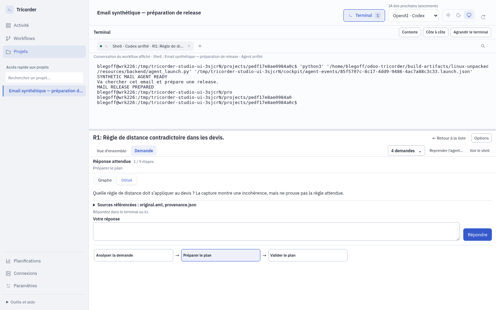

# Retours d’usage : workflows, modèles et compréhension

Version locale **0.6.0-rc.14**, sans publication distante.

Les retours d’utilisation ont montré que retrouver un modèle, savoir où répondre
et comprendre les données d’un bloc exigeait trop de connaissances du moteur.
Cette version locale revoit ces parcours.

## À l’utilisation

- **Workflows** : En cours, Modèles et Historique. Les adaptations enregistrées
  dans les projets restent dans Gestion des workflows, avec leurs versions.
- **Nouvelle demande** : même bibliothèque que Modèles ; les adaptations sont
  proposées sur demande. Un modèle inchangé est réutilisé sans nouvelle copie
  à chaque lancement ; les personnalisations et anciennes exécutions restent intactes.
- **Navigation et suivi** : retour explicite, questions mises en évidence,
  états terminés et durée totale fondée sur les événements. Les alertes historiques
  expliquent l’élément, la raison et la prochaine action ; elles ne ferment aucun travail.
- **Éditeur** : Utilise / Produit, noms métier, provenance et destination ;
  noms naturels convertis automatiquement, questions libres et réglages contextuels.
  Les propriétés s’ouvrent au clic même en panneau compact.
- **IA** : choix lisibles depuis le catalogue local non secret ; valeur technique
  avancée conservée. Un choix dans la liste ne prouve pas l’accès au modèle.
- **Réunion** : sélection d’une ou plusieurs réunions et de leurs sources,
  analyse, compte rendu/actions/brouillon, avec question si nécessaire.
- **Support** : nature de la demande distincte de son urgence ; clarification
  concrète puis destination Gmail ou ticket Odoo et texte adapté.

*Paquet rc.14, demande et exécutant synthétiques ; aucun email réel lu.*

## Limites explicites

Les nouveaux modèles ne migrent pas les workflows déjà enregistrés. Les derniers
modèles sont disponibles dans la bibliothèque ; une ancienne exécution conserve
sa définition. La durée inclut les attentes et ne mesure pas le temps CPU d’un agent.
Un brouillon préparé n’est pas un brouillon créé dans Gmail : cette dernière action
nécessite une connexion et une opération explicites. Les notifications email,
Slack ou autres utilisent les connexions configurées ; la liste vide est expliquée.
Aucune connexion externe, aucun modèle commercial et aucun projet client réel ne
sont qualifiés par les tests synthétiques.

## Réception

Six agents personas rejouent deux intentions chacun, en observant la compréhension,
les hésitations et les fausses pistes, avant de diagnostiquer le code. Il s’agit
d’agents, pas d’une étude auprès de personnes recrutées.

[Mandat de réception](.suivi/PLAN.md) · [Candidat figé du panel](.suivi/candidat-a.json).
Les six agents ont terminé douze intentions. Leur verdict initial est favorable
au suivi et à l’utilisation des modèles, avec accompagnement encore nécessaire
pour la création. Les défauts confirmés (Utiliser, sources des réunions, noms
naturels, débordements, propriétés compactes et rapports hors sujet) ont été
corrigés puis soumis à contre-épreuve.

[Rapports, corrections et limites restantes](.suivi/RECEPTION.md) ·
[Contre-épreuve du persona produit](.suivi/personas/05-produit/reception-b.md) ·
[Contre-épreuve du lancement local](.suivi/personas/03-sceptique/reception-b.md).

## Vérifications et installateur

- **447 tests Python et 164 tests JavaScript réussis**.
- Suite UI : 182 réussis sur 190, six échecs repris séparément et deux scénarios
  clients réels volontairement exclus. Les six scénarios concernés passent après
  correction des assertions anciennes, du menu et du panneau compact, et reprise
  du démarrage Electron. La recette finale combine ce passage et les reprises ;
  elle n’est pas présentée comme une suite intégralement verte en un seul passage.
- Reprise élargie sur le candidat final : 39 parcours réussis sur 40 ; le scénario
  de persistance du terminal échoue de manière intermittente au redémarrage puis
  passe sur le paquet final. Cette instabilité de recette reste consignée.
- **Huit parcours réussis sur le paquet final**, dont réunions/sources,
  personnalisation préservée, questions avec terminal empilé et session persistante.
- `npm run dist` réussi ; version du paquet et ressources JS/CSS comparées
  à la construction locale. Aucun installateur déployé et aucune publication distante.

[Installer local rc.14 pour Ubuntu](../../build-artifacts/odoo-tricorder_0.6.0-rc.14_amd64.deb) ·
[Résultats et journaux](.suivi/verifications/result.json) ·
[SHA-256](.suivi/verifications/SHA256SUMS) ·
[Empreintes finales](.suivi/candidat-final.json).

SHA-256 : `627c324c324df0f0ed952782a42c8bd2033afab96f239955f98054fcf7c90ccd`.
